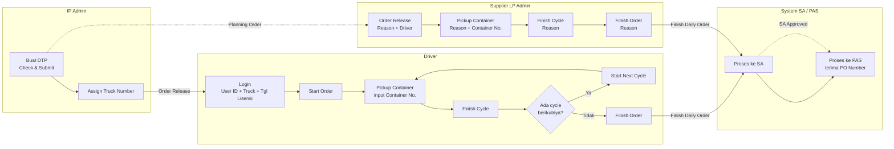
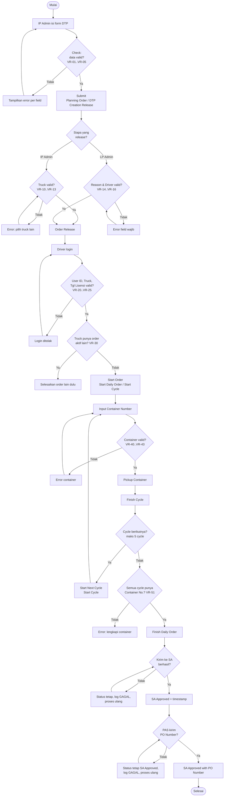
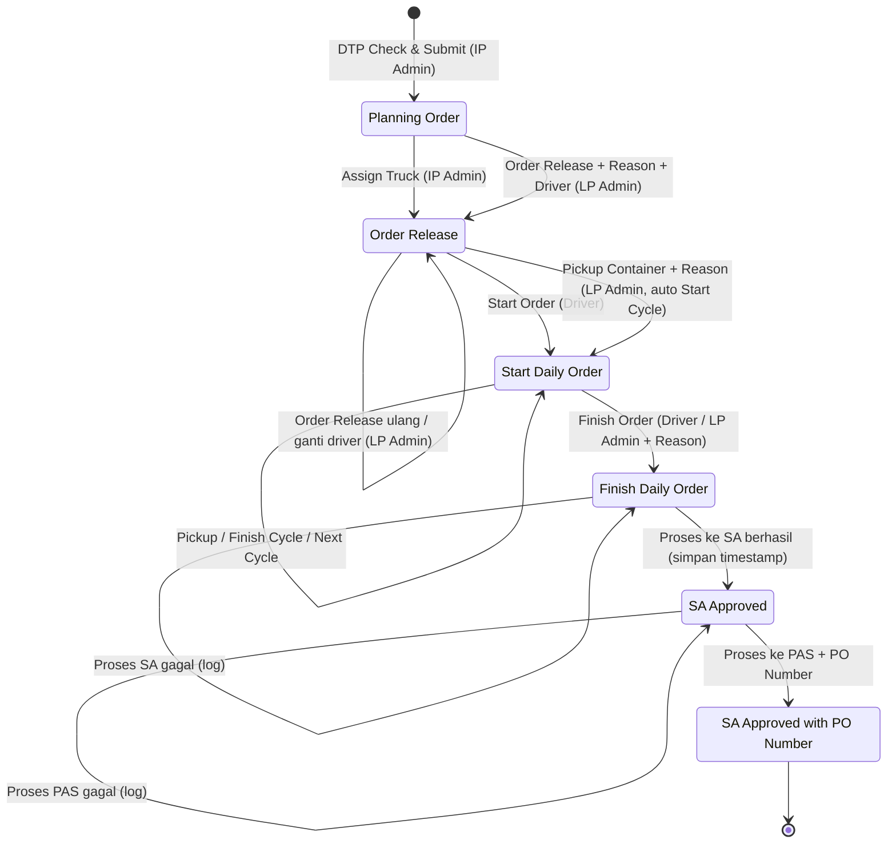
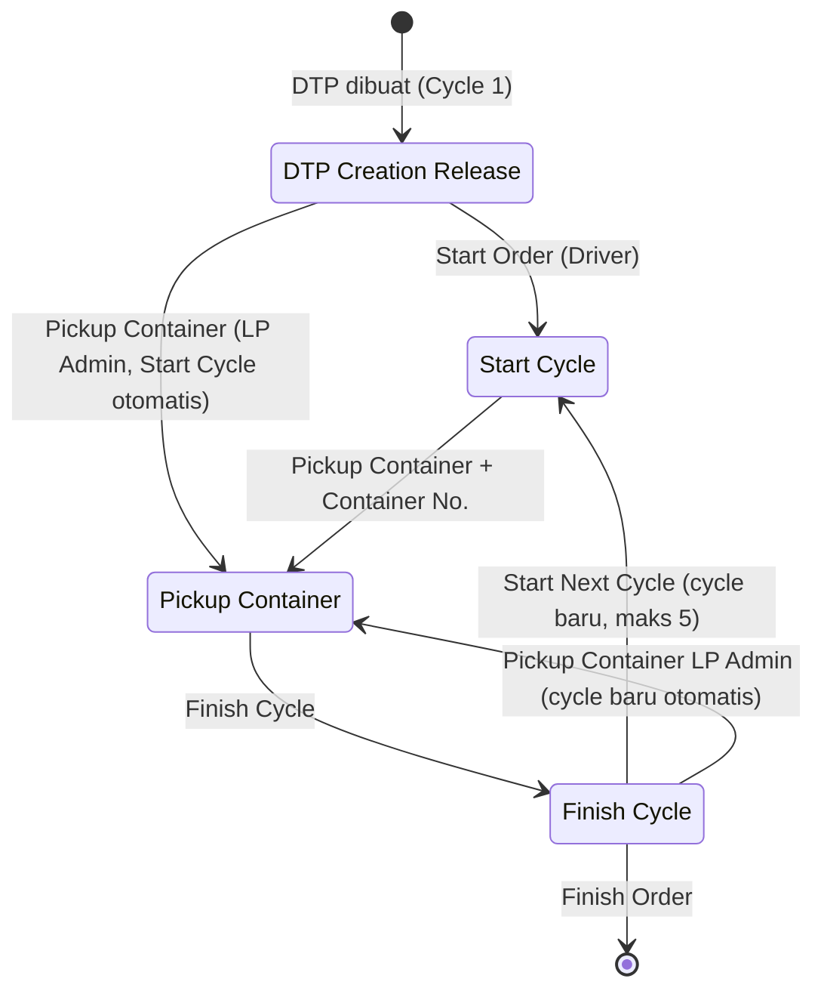

# ELIPS Daily Order Monitoring: Proses Bisnis, Status, dan Aturan Validasi

Dokumen ini menjabarkan alur Daily Order dari pembuatan DTP sampai SA Approved with PO Number. Isinya mencakup business process, flowchart, state transition diagram, dan aturan validasi sistem.

Semua aturan di dokumen ini sudah diterapkan di mock-up (`index.html`). Logikanya ada di [`workflow.js`](../workflow.js), jadi perilaku mock-up dan dokumen ini selalu sama.

---

## 1. Status

### Order Status

| # | Order Status | Kapan terjadi |
|---|---|---|
| 1 | **Planning Order** | DTP dibuat lewat Check & Submit |
| 2 | **Order Release** | IP Admin meng-assign order ke truck number (atau LP Admin melakukan Order Release) |
| 3 | **Start Daily Order** | Driver memulai order |
| 4 | **Finish Daily Order** | Driver (atau LP Admin) menyelesaikan order |
| 5 | **SA Approved** | Order berhasil diproses ke SA; timestamp SA disimpan |
| 6 | **SA Approved with PO Number** | Order berhasil diproses ke PAS dan mendapat PO Number |

### Cycle Status (per cycle, maksimal 5 cycle per order)

| # | Cycle Status | Kapan terjadi |
|---|---|---|
| 1 | **DTP Creation Release** | Cycle 1 terbentuk saat DTP dibuat |
| 2 | **Start Cycle** | Driver memulai order (Cycle 1) atau memulai cycle berikutnya |
| 3 | **Pickup Container** | Driver pickup container; Container Number dicatat |
| 4 | **Finish Cycle** | Cycle selesai |

---

## 2. Aktor dan Hak Akses

| Aktor | Data yang bisa dilihat | Aksi yang boleh dilakukan |
|---|---|---|
| **IP Admin** | Semua order | DTP Check & Submit, Assign Truck, Proses ke SA, Proses ke PAS |
| **Driver** | Hanya order yang di-assign ke truck yang dipakai saat login | Start Order, Pickup Container, Finish Cycle, Start Next Cycle, Finish Order |
| **Supplier (Viewer)** | Hanya order milik supplier sendiri | Tidak ada (hanya lihat) |
| **Supplier (LP Admin)** | Hanya order milik supplier sendiri | Order Release, Pickup Container, Finish Cycle, Finish Order (selalu dengan Reason) |
| **System (Batch SA/PAS)** | Semua order | Proses ke SA, Proses ke PAS |

### Matriks aksi per status

| Aksi | Status awal yang diizinkan | IP Admin | Driver | LP Admin | Field wajib |
|---|---|:-:|:-:|:-:|---|
| DTP Check & Submit | (order baru) | ✔ | | | Date, Type, Trucking Comp., Shift, From, To, Renban, Planned Cycle |
| Assign Truck | Planning Order | ✔ | | | Truck Number |
| Order Release | Planning Order, Order Release | | | ✔ | **Reason, Driver** |
| Start Order | Order Release | | ✔ | | - |
| Pickup Container | Start Daily Order + Cycle `Start Cycle` | | ✔ | ✔ | Container Number (+ **Reason** untuk LP Admin) |
| Pickup Container (LP Admin) | Order Release, atau Start Daily Order + cycle terakhir `Finish Cycle` | | | ✔ | **Reason, Container Number** |
| Finish Cycle | Start Daily Order + Cycle `Pickup Container` | | ✔ | ✔ | (+ **Reason** untuk LP Admin) |
| Start Next Cycle | Start Daily Order + cycle terakhir `Finish Cycle` | | ✔ | | - |
| Finish Order | Start Daily Order + cycle terakhir `Finish Cycle` | | ✔ | ✔ | (+ **Reason** untuk LP Admin) |
| Proses ke SA | Finish Daily Order | ✔ | | | - |
| Proses ke PAS | SA Approved | ✔ | | | PO Number (dari PAS) |

---

## 3. Business Process

| Langkah | Aktor | Aktivitas | Input | Hasil (Order Status / Cycle Status) |
|---|---|---|---|---|
| 1 | IP Admin | Membuat DTP lalu **Check & Submit** | Date, Type DTP, Trucking Comp., Shift, From/To, Renban, Planned Cycle | Planning Order / DTP Creation Release |
| 2 | IP Admin | **Assign** order ke truck number | Truck Number | Order Release / DTP Creation Release |
| 3 | Driver | **Login** di Driver App | User ID, No. Truck, Tanggal Lisensi Truck | Tidak ada perubahan status (driver hanya melihat order truck-nya) |
| 4 | Driver | **Start Order** | - | Start Daily Order / Start Cycle (Cycle 1) |
| 5 | Driver | **Pickup Container** | Container Number | Start Daily Order / Pickup Container |
| 6 | Driver | **Finish Cycle** | - | Start Daily Order / Finish Cycle |
| 7 | Driver | **Start Next Cycle** (Cycle 2, 3, dst.), lalu ulangi langkah 5 sampai 6 | - | Start Daily Order / Start Cycle (cycle baru) |
| 8 | Driver | **Finish Order** | - | Finish Daily Order / Finish Cycle |
| 9 | System / IP Admin | Kirim order ke **SA** | Data order + Container Number setiap cycle | **SA Approved** + timestamp SA |
| 10 | System / IP Admin | Kirim ke **PAS**, terima PO Number | PO Number | **SA Approved with PO Number** + PO Number + timestamp |

**Jalur LP Admin (input manual oleh supplier):** Order Release (Reason, Driver) → Pickup Container (Reason, Container Number) → Finish Cycle (Reason) → Finish Order (Reason).
- Pickup Container oleh LP Admin pada status Order Release otomatis mengisi Start Cycle untuk Cycle 1.
- Pickup Container oleh LP Admin setelah Finish Cycle otomatis membuka cycle berikutnya.

### Swimlane

---

## 4. Flowchart

---

## 5. State Transition Diagram

### 5.1 Order Status

### 5.2 Cycle Status

### 5.3 Tabel transisi

| ID | Dari (Order / Cycle) | Event | Aktor | Guard | Ke (Order / Cycle) |
|---|---|---|---|---|---|
| T01 | - | DTP Check & Submit | IP Admin | VR-01..05 | Planning Order / DTP Creation Release |
| T02 | Planning Order / DTP Creation Release | Assign Truck | IP Admin | VR-10..13 | Order Release / DTP Creation Release |
| T03 | Planning Order atau Order Release | Order Release | LP Admin | VR-14..16, VR-60 | Order Release / DTP Creation Release |
| T04 | Order Release / DTP Creation Release | Start Order | Driver | VR-26, VR-30 | Start Daily Order / Start Cycle |
| T05 | Start Daily Order / Start Cycle | Pickup Container | Driver, LP Admin | VR-40..43 (+VR-60) | Start Daily Order / Pickup Container |
| T06 | Order Release / DTP Creation Release | Pickup Container | LP Admin | Driver sudah di-release, VR-40..43, VR-60 | Start Daily Order / Pickup Container (Start Cycle otomatis) |
| T07 | Start Daily Order / Pickup Container | Finish Cycle | Driver, LP Admin | Container tercatat (+VR-60) | Start Daily Order / Finish Cycle |
| T08 | Start Daily Order / Finish Cycle | Start Next Cycle | Driver | VR-50 | Start Daily Order / Start Cycle (cycle baru) |
| T09 | Start Daily Order / Finish Cycle | Pickup Container | LP Admin | VR-50, VR-40..43, VR-60 | Start Daily Order / Pickup Container (cycle baru) |
| T10 | Start Daily Order / Finish Cycle | Finish Order | Driver, LP Admin | VR-51 (+VR-60) | Finish Daily Order / Finish Cycle |
| T11 | Finish Daily Order | Proses ke SA | System, IP Admin | VR-70, SA sukses | SA Approved (+ timestamp) |
| T12 | SA Approved | Proses ke PAS | System, IP Admin | VR-71, PAS sukses | SA Approved with PO Number |

Semua transisi lain ditolak sistem dengan pesan "*<Aksi> hanya bisa saat status ...*".

---

## 6. Aturan Validasi Sistem

### 6.1 DTP Check & Submit

| ID | Aturan | Pesan error |
|---|---|---|
| VR-01 | Date, Type, Trucking Comp., Shift, DTP Loc. From, DTP Loc. To, Renban, dan Planned Cycle wajib diisi | `<Field> wajib diisi` |
| VR-02 | Tanggal DTP tidak boleh di masa lalu | Tanggal DTP tidak boleh di masa lalu |
| VR-03 | DTP Loc. From ≠ DTP Loc. To | DTP Loc. To tidak boleh sama dengan DTP Loc. From |
| VR-04 | Renban 5 digit angka dan unik untuk kombinasi supplier + tanggal + shift | Renban harus 5 digit angka / Renban sudah dipakai ... |
| VR-05 | Planned Cycle antara 1 sampai 5 | Planned Cycle harus 1 - 5 |
| VR-06 | Hanya IP Admin yang dapat membuat DTP | Hanya IP Admin yang dapat membuat DTP |

Tombol **Check** hanya menjalankan validasi. Tombol **Submit** menjalankan validasi yang sama, lalu menyimpan order.

### 6.2 Assign Truck dan Order Release

| ID | Aturan | Pesan error |
|---|---|---|
| VR-10 | Truck Number wajib dipilih dan terdaftar di master | Truck Number wajib diisi / Truck tidak terdaftar |
| VR-11 | Truck milik trucking company order tersebut | Truck bukan milik trucking company order ini |
| VR-12 | Lisensi truck masih berlaku pada tanggal order | Lisensi truck habis (...) sebelum tanggal order |
| VR-13 | Satu truck tidak boleh punya dua order aktif (Order Release / Start Daily Order) pada tanggal dan shift yang sama | Truck sudah di-assign ke order ... |
| VR-14 | LP Admin: Reason dan Driver wajib diisi | Reason wajib diisi / Driver wajib diisi |
| VR-15 | Driver terdaftar, aktif, dan milik supplier order | Driver tidak terdaftar / tidak aktif / bukan milik supplier |
| VR-16 | Jika order belum punya truck, driver harus punya truck terdaftar | Driver belum punya truck terdaftar ... |

### 6.3 Login Driver

| ID | Aturan | Pesan error |
|---|---|---|
| VR-20 | User ID, No. Truck, dan Tanggal Lisensi Truck wajib diisi | `<Field> wajib diisi` |
| VR-21 | User ID terdaftar dan aktif | User ID tidak terdaftar / User ID tidak aktif |
| VR-22 | No. Truck terdaftar | No. Truck tidak terdaftar |
| VR-23 | Truck milik supplier yang sama dengan driver | Truck bukan milik supplier driver ini |
| VR-24 | Tanggal Lisensi Truck sama dengan data master | Tanggal Lisensi Truck tidak sesuai dengan data master |
| VR-25 | Lisensi truck belum habis pada hari login | Lisensi truck sudah habis sejak ... |
| VR-26 | Setelah login, driver hanya melihat dan memproses order yang di-assign ke truck tersebut | Anda tidak memiliki akses ke order ini |

### 6.4 Start Order dan Cycle

| ID | Aturan | Pesan error |
|---|---|---|
| VR-30 | Start Order hanya jika truck tidak punya order lain berstatus Start Daily Order | Truck masih punya order aktif ..., selesaikan dulu |
| VR-31 | Setiap aksi hanya boleh dari status awal sesuai tabel transisi | `<Aksi> hanya bisa saat status ...` |
| VR-50 | Cycle berikutnya hanya setelah cycle sebelumnya Finish Cycle; maksimal 5 cycle per order | Maksimal 5 cycle per order |
| VR-51 | Finish Order hanya jika cycle terakhir Finish Cycle **dan semua cycle punya Container Number** | Container Number Cycle N belum tercatat |
| VR-52 | Finish Order dengan jumlah cycle kurang dari Planned Cycle tetap diizinkan, tetapi dicatat di riwayat ("Aktual X dari rencana Y cycle") | (peringatan di riwayat) |

### 6.5 Container Number (wajib di setiap cycle)

| ID | Aturan | Pesan error |
|---|---|---|
| VR-40 | Container Number wajib diisi saat Pickup Container | Container Number wajib diisi |
| VR-41 | Format ISO 6346: 3 huruf kode pemilik + U/J/Z + 6 digit + 1 check digit (contoh `SELU4384522`); spasi dan tanda "-" diabaikan, huruf diubah ke kapital | Format Container Number harus 4 huruf + 7 angka |
| VR-42 | Check digit ISO 6346 harus benar | Check digit Container Number tidak valid (seharusnya ...) |
| VR-43 | Tidak boleh sama dengan container di cycle lain pada order yang sama, dan tidak boleh sedang aktif (Pickup Container) di order lain | Container Number sudah dipakai ... / sedang aktif di order ... |

### 6.6 Reason (LP Admin)

| ID | Aturan | Pesan error |
|---|---|---|
| VR-60 | Reason wajib untuk semua aksi LP Admin (Order Release, Pickup Container, Finish Cycle, Finish Order), minimal 10 karakter | Reason wajib diisi / Reason minimal 10 karakter |
| VR-61 | Reason disimpan di Riwayat Status bersama user, role, waktu, dan status sebelum/sesudah | - |

### 6.7 SA dan PAS

| ID | Aturan | Pesan error |
|---|---|---|
| VR-70 | Proses ke SA hanya untuk order Finish Daily Order dengan semua cycle Finish Cycle dan Container Number lengkap. Jika berhasil, status menjadi SA Approved dan **timestamp SA disimpan** | Semua cycle harus Finish Cycle dan punya Container Number |
| VR-71 | Proses ke PAS hanya untuk order SA Approved. PO Number wajib ada (10 digit diawali 45). Jika berhasil, status menjadi SA Approved with PO Number dan PO Number + timestamp disimpan | PO Number harus 10 digit diawali 45 |
| VR-72 | Jika SA/PAS gagal, status **tidak berubah**, kegagalan dicatat di Riwayat Status, dan proses bisa diulang | SA menolak data ... / PAS tidak mengembalikan PO Number ... |

### 6.8 Akses data

| ID | Aturan |
|---|---|
| VR-80 | Supplier (Viewer maupun LP Admin) hanya melihat order dengan Trucking Company miliknya, termasuk di pencarian, jumlah data, dan Export |
| VR-81 | Supplier tanpa akses LP Admin hanya bisa melihat (tidak ada tombol aksi) |
| VR-82 | Setiap perubahan status dicatat di Riwayat Status: waktu, user, role, aksi, status sebelum dan sesudah, reason/catatan |

---

## 7. Asumsi yang perlu dikonfirmasi

Asumsi berikut dipakai di mock-up karena belum dijelaskan di kebutuhan:

1. **Login driver** memakai User ID, **No. Truck**, dan Tanggal Lisensi Truck. Kebutuhan hanya menyebut User ID dan tanggal lisensi, jadi No. Truck ditambahkan supaya sistem tahu truck mana yang dicek.
2. **"Tanggal lisensi"** dianggap tanggal masa berlaku lisensi truck di master. Lisensi yang sudah lewat menolak login dan Assign Truck.
3. **Maksimal 5 cycle** per order, mengikuti kolom CYCLE 1 sampai 5 di layar monitoring.
4. **Finish Order** boleh dilakukan walaupun cycle aktual kurang dari Planned Cycle, dan dicatat di riwayat. Jika harus diblokir, ubah VR-52.
5. **Order Release oleh LP Admin** boleh dari status Planning Order (tanpa Assign Truck dari IP Admin) maupun Order Release (ganti driver). Jika order belum punya truck, truck diambil dari truck terdaftar milik driver.
6. **Pickup Container oleh LP Admin** otomatis mencatat Start Cycle (dari Order Release) atau membuka cycle baru (setelah Finish Cycle), karena alur LP Admin tidak punya langkah Start terpisah.
7. **Format PO Number** diasumsikan 10 digit diawali `45`.
8. **Reason** minimal 10 karakter supaya tidak diisi asal-asalan.
9. Belum ada aturan **batas waktu Start Order** (misalnya harus pada tanggal order), **Cancel Order**, atau **Rollback Cycle**. Menu-menu ini ada di sidebar tetapi belum didefinisikan.
