# Delivery Note (Surat Jalan) – Spec & Rules (mock-up)

Menu: **Daily › Delivery Note** (`index.html#delivery-note`) and the **DN icon** (red document) in the Action column of every Daily Monitoring row.

Files: `dn-rules.js` (rules, pure), `dn-pdf.js` (PDF renderer, jsPDF 2.5.1 in `vendor/jspdf`), `delivery-note.js` (UI), `tests/delivery-note.test.js` (12 unit tests).

## 1. Traceability

```mermaid
flowchart LR
  A[Delivery<br>Daily Order + cycles] --> B[Daily Monitoring row<br>DN icon]
  B --> C[On-the-fly PDF<br>dn-pdf.js]
  C --> D[Base64 API<br>GET /api/delivery-note/&#123;deliveryId&#125; TBD]
  D --> E[PAS GR Attachment<br>idempotency key = Delivery ID]
```

Delivery ID = **No. Order** (Daily Monitoring). The same ID is carried in the PDF header, the API request and response, and the PAS attachment record.

## 2. PDF layout and data source

The layout follows the TMMIN **SURAT JALAN** reference: A4 portrait, one page per started cycle. The grid icon gives all started cycles of the delivery in one PDF; the per-cycle **PDF** button in Order Detail gives that one cycle.

| Zone | Item | Data source (mock) | Note |
|---|---|---|---|
| Header | printed by | Fixed `System` | |
| Header | printed date | System date-time at generation, `YYYY-MM-DD HH:MI:SS` | Not part of the data hash |
| Header | Logo + `PT. TOYOTA MOTOR MANUFACTURING INDONESIA` | Fixed | Logo in the mock is a placeholder drawing |
| Header | `SURAT JALAN` | Fixed | |
| Header left | Nama | Daily Order · Driver name | Mandatory |
| Header left | No. Telp | Master Driver · phone | Source table TBD; `-` if empty |
| Header left | No Polisi | Daily Order · License Plate | Mandatory |
| Header left | Tanggal | Cycle · Start Cycle date, `DD Month YYYY` | |
| Header right | SA Number | Service Acceptance number | Source / format TBD; mock `ILS/TC/<supplier>/<YYMMDD><NN>` after SA Approved, otherwise `-` |
| Header right | No Order | Daily Order · No. Order (= Delivery ID) | Mandatory |
| Header right | No Cycle Order | Cycle number `<YYMMDD start>C2<supplier code><NNN>` | |
| Header right | Cycle | Cycle sequence (1..5) | |
| Body | NO | Row sequence | |
| Body | LOKASI ASAL | `<location code> - <name>` of the cycle origin | Mandatory |
| Body | LOKASI TUJUAN | `<location code> - <name>` of the cycle destination | Mandatory |
| Body | CTR NO | Cycle · Container No | `-` before Pick Up |
| Body | KETERANGAN | Mock `PENGIRIMAN CONTAINER` | Source TBD |
| Footer | Petugas, stamp `TMMIN`, `TMMIN LOGISTIC PLANNING DIVISION` | Fixed | Stamp image TBD |
| Page | Watermark `COPY` | Fixed | Rule for original vs copy TBD |

## 3. Rules

| Rule | Description |
|---|---|
| DN-R01 | Mandatory data: No Order, Nama (Driver), No Polisi, at least one cycle with Start Cycle, plus Lokasi Asal and Lokasi Tujuan of every printed cycle. If any are missing, no PDF is created. The API returns 422 `INCOMPLETE_DATA` with `missingFields`. |
| DN-R02 | PDF content uses only the items in §2. An empty optional value prints as `-`. |
| DN-R03 | On-the-fly: the PDF is generated on each click (View / Download / API / PAS attach) from the latest data. No PDF is stored, pre-generated or batch-generated. |
| DN-R04 | Same data gives the same document. Only the printed date differs; the `dataHash` (hash of the document data without printed date) is equal for View, Download and API. Viewing changes no data. |
| DN-R05 | Access follows Daily Monitoring visibility (`W.canView`). IP Admin and Planner see all; a Supplier sees only its own trucking company; a Driver sees only its truck. A request for another company's delivery returns 403 with no Base64. |
| DN-R06 | Output check before sending: the Base64 must be valid, the decoded file must start with `%PDF-` and end with `%%EOF`. Otherwise the API returns 500 `INVALID_BASE64` / `CORRUPTED_PDF`. |
| DN-R07 | In-flight guard: while a request for a delivery is running, a repeated click or a second request for the same delivery is refused with "sedang diproses". |
| DN-R08 | PAS GR attachment: one attachment per Delivery ID (idempotency key). A retry with the same `dataHash` gives `ALREADY_ATTACHED` and adds no file. Changed data gives `REPLACED` and Rev + 1. A PAS failure leaves the existing attachment unchanged and can be retried. |

## 4. API (simulated)

`GET /api/delivery-note/{deliveryId}`. The endpoint and auth are **TBD**; the mock uses a session token.

The checks run in this order:

| HTTP | error | When |
|---|---|---|
| 503 | SERVICE_UNAVAILABLE | Service down |
| 401 | UNAUTHORIZED | No or invalid token |
| 400 | MISSING_PARAMETER / INVALID_PARAMETER | `deliveryId` empty, or not in the No. Order format `^\d{6}C\d{11}$` |
| 404 | NOT_FOUND | ID does not exist |
| 403 | FORBIDDEN | No access to the delivery |
| 422 | INCOMPLETE_DATA | DN-R01 fails (`missingFields[]`) |
| 504 | TIMEOUT | Generation exceeds the SLA (TBD) |
| 500 | GENERATION_FAILED / CORRUPTED_PDF / INVALID_BASE64 | Engine error or DN-R06 fails |
| 200 | – | `{ deliveryId, fileName, contentType: application/pdf, pages, size, dataHash, generatedAt, base64 }`. Optional `cycle` parameter for a single cycle. |

## 5. TBD (not defined in the requirement)

| # | Item | Mock value (for demo only) |
|---|---|---|
| TBD-01 | Source of No. Telp, SA Number, KETERANGAN; logo and stamp images | See §2 |
| TBD-02 | API endpoint, method, request/response schema | `GET /api/delivery-note/{deliveryId}`, JSON above |
| TBD-03 | Authentication / authorization method | Session token; role visibility of Daily Monitoring |
| TBD-04 | File name convention | `SJ_<No. Order>.pdf`, per cycle `SJ_<No. Order>_C<n>.pdf` |
| TBD-05 | Response time SLA / timeout | – |
| TBD-06 | Maximum file / payload size | – |
| TBD-07 | PAS GR interface contract (endpoint, GR key, retry, replace policy) | Idempotent per Delivery ID, replace on change |
| TBD-08 | Mandatory field list | DN-R01 |

## 6. Open questions

| # | Question |
|---|---|
| OQ-01 | Is one Delivery = one Daily Order (all cycles in one PDF), or one cycle (one Surat Jalan No.)? The mock supports both: the order PDF, plus a per-cycle PDF from Order Detail. |
| OQ-02 | Which fields are mandatory? Are SA Number, No. Telp and CTR NO mandatory (SA Number exists only after SA Approved)? |
| OQ-03 | From which order or cycle status may the Delivery Note be generated, and from which may it be attached to the GR (for example only after Finish Cycle / SA Approved)? |
| OQ-04 | For an ID the user may not access: should the API return 403, or 404 to avoid ID enumeration? |
| OQ-05 | When data changes after the GR attachment: replace the attachment, add a new version, or block? |
| OQ-06 | Is the PAS attachment pushed by ELIPS, or pulled by PAS through the Base64 API? Which key links it to the GR (GR No., PO No., Delivery ID)? |
| OQ-07 | "printed by" is always `System`. Should it show the requesting user? When is the `COPY` watermark printed (always, or only on re-print)? |
| OQ-08 | Who may download: Driver, Supplier Viewer, LP Admin, Planner, IP Admin? |
| OQ-09 | Is an audit log of each generation (who, when, which delivery) needed? |
| OQ-10 | What is the content / source of KETERANGAN (fixed `PENGIRIMAN CONTAINER`, or by order type / cycle direction)? |
