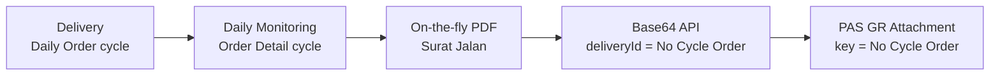

# Delivery Note (Surat Jalan) – Spec & Rules (mock-up)

**Location:** Daily Monitoring › Order Detail › **Cycle n** › Files:
- **Surat Jalan ELIPS:** View. Opens a PDF preview, plus a test panel for API Base64 and PAS GR.
- **PDF:** Download.

**Delivery:** one Delivery = **one cycle** of a Daily Order.

**Delivery ID:** the cycle's **No Cycle Order**. It is shown as "Order No" in the cycle box (e.g. `261026C2PBM311`) and is unique per cycle.

**Files:**
- `dn-rules.js`: rules (pure logic).
- `dn-pdf.js`: PDF renderer, jsPDF 2.5.1 in `vendor/jspdf` (MIT).
- `delivery-note.js`: UI.
- `tests/delivery-note.test.js`: 12 unit tests.
- UISS: `docs/uiss/UISS_Report_Delivery_Note.xlsx`.
- Test cases: `docs/tc-pbr/TC-PBR_Delivery_Note.xlsx`.

## 1. Traceability

The same Delivery ID (No Cycle Order) and No Order appear in:
- the cycle box,
- the PDF (`No Cycle Order`, `No Order`),
- the API response (`deliveryId`, `orderNo`, `cycle`),
- the file name,
- the PAS attachment record.

## 2. PDF layout and data source

The layout follows the TMMIN **SURAT JALAN** reference: one A4 portrait page per cycle.

| Zone | Item | Data source (mock) | Note |
|---|---|---|---|
| Header | printed by | Fixed `System` | OQ-07 |
| Header | printed date | System date-time at generation, `YYYY-MM-DD HH:MI:SS` | Not part of data hash |
| Header | Logo + `PT. TOYOTA MOTOR MANUFACTURING INDONESIA` | Fixed | Logo drawing is a placeholder (TBD-01) |
| Header | `SURAT JALAN` | Fixed | |
| Header left | Nama | Daily Order · Driver | Mandatory |
| Header left | No. Telp | Master Driver · phone | Source TBD; `-` if empty |
| Header left | No Polisi | Daily Order · License Plate | Mandatory |
| Header left | Tanggal | Cycle · Start Cycle date, `DD Month YYYY` | Mandatory (cycle started) |
| Header right | SA Number | Service Acceptance number | Source / format TBD. Mock: `ILS/TC/<supplier>/<YYMMDD><NN>` after SA Approved, otherwise `-` |
| Header right | No Order | Daily Order · No. Order | Mandatory |
| Header right | No Cycle Order | `<order YYMMDD>C2<supplier code><NNN>` | Delivery ID |
| Header right | Cycle | Cycle sequence 1..5 | |
| Body | NO | Row sequence | |
| Body | LOKASI ASAL | `<location code> - <name>` of the cycle origin (name only if no code) | Mandatory |
| Body | LOKASI TUJUAN | `<location code> - <name>` of the cycle destination | Mandatory |
| Body | CTR NO | Cycle · Container No | `-` before Pick Up |
| Body | KETERANGAN | Mock `PENGIRIMAN CONTAINER` | Source TBD (OQ-10) |
| Footer | `Petugas,`, stamp `TMMIN`, `TMMIN LOGISTIC PLANNING DIVISION` | Fixed | Stamp image TBD |
| Page | Watermark `COPY` | Fixed | OQ-07 |

## 3. Rules

| Rule | Description |
|---|---|
| DN-R01 | Mandatory data per cycle: No Order, Nama (Driver), No Polisi, Tanggal (Start Cycle), Lokasi Asal, Lokasi Tujuan. If any are missing, no PDF is created. The API returns 422 `INCOMPLETE_DATA` with `missingFields`. The buttons stay disabled until Start Cycle. |
| DN-R02 | The PDF shows only the items in §2. An empty optional value prints as `-`. |
| DN-R03 | On-the-fly: the PDF is generated on each click (View / Download / API / PAS attach) from the latest data. No PDF is stored, pre-generated or batch-generated. |
| DN-R04 | Same data gives the same document. Only the printed date differs. The `dataHash` (hash of the document data without printed date) is equal for View, Download and API. Viewing changes no data. |
| DN-R05 | Access follows Daily Monitoring visibility (`W.canView`). IP Admin and Planner see all; a Supplier sees only its own trucking company; a Driver sees only its truck. A request for another company's delivery returns 403 with no Base64. |
| DN-R06 | Output check before sending: the Base64 must be valid, the decoded file must start with `%PDF-` and end with `%%EOF`. Otherwise the API returns 500 `INVALID_BASE64` / `CORRUPTED_PDF`. |
| DN-R07 | In-flight guard: while a request for a delivery is running, a repeated click or a second request for the same delivery is refused with "sedang diproses". |
| DN-R08 | PAS GR attachment: one attachment per Delivery ID (idempotency key). A retry with the same `dataHash` gives `ALREADY_ATTACHED` and adds no file. Changed data gives `REPLACED` and Rev + 1. A PAS failure leaves the existing attachment unchanged and can be retried. |
| DN-R09 | Delivery ID must resolve to exactly one cycle. If it resolves to more than one, the API returns 409 `AMBIGUOUS_DELIVERY` and sends no document (no cross-delivery document). |

## 4. API (simulated)

`GET /api/delivery-note/{deliveryId}`. The endpoint and auth are **TBD**; the mock uses a session token.

The checks run in this order:

| HTTP | error | When |
|---|---|---|
| 503 | SERVICE_UNAVAILABLE | Service down |
| 401 | UNAUTHORIZED | No or invalid token |
| 400 | MISSING_PARAMETER / INVALID_PARAMETER | `deliveryId` empty, or not in the No Cycle Order format `^\d{6}C\d[A-Z]{2,5}\d{3}$` |
| 404 | NOT_FOUND | ID does not exist |
| 409 | AMBIGUOUS_DELIVERY | ID matches more than one cycle |
| 403 | FORBIDDEN | No access to the delivery |
| 422 | INCOMPLETE_DATA | DN-R01 fails (`missingFields[]`) |
| 504 | TIMEOUT | Generation exceeds the SLA (TBD) |
| 500 | GENERATION_FAILED / CORRUPTED_PDF / INVALID_BASE64 | Engine error or DN-R06 fails |
| 200 | – | `{ deliveryId, orderNo, cycle, fileName, contentType: application/pdf, size, dataHash, generatedAt, base64 }` |

## 5. TBD (not defined in the requirement)

| # | Item | Mock value (demo only) |
|---|---|---|
| TBD-01 | Source of No. Telp, SA Number, KETERANGAN; logo and stamp images | See §2 |
| TBD-02 | API endpoint, method, request/response schema | §4 |
| TBD-03 | Authentication / authorization method | Session token + Daily Monitoring visibility |
| TBD-04 | File name convention | `SJ_<No Cycle Order>.pdf` |
| TBD-05 | Response time SLA / timeout | – |
| TBD-06 | Maximum file / payload size | – |
| TBD-07 | PAS GR interface contract (endpoint, GR key, retry, replace policy) | Idempotent per Delivery ID, replace on change |
| TBD-08 | Final mandatory field list | DN-R01 |

## 6. Open questions

| # | Question |
|---|---|
| OQ-01 | Confirm that Delivery = one cycle and Delivery ID = No Cycle Order. The reference shows No Cycle Order with the cycle date (`260706…` for order `260703…`); the mock keeps the order date already shown in Order Detail. |
| OQ-02 | Are SA Number, No. Telp and CTR NO mandatory? SA Number exists only after SA Approved. |
| OQ-03 | From which cycle status may the Surat Jalan be generated (Start / Pick Up / Finish Cycle), and from which may it be attached to the GR? |
| OQ-04 | For an ID the user may not access: should the API return 403, or 404 to avoid ID enumeration? |
| OQ-05 | When data changes after the GR attachment: replace the attachment, add a new version, or block? |
| OQ-06 | Is the PAS attachment pushed by ELIPS, or pulled by PAS through the Base64 API? Which key links it to the GR (GR No., PO No., Delivery ID)? |
| OQ-07 | "printed by" is always `System`; should it be the requesting user? When is the `COPY` watermark printed? |
| OQ-08 | Which roles may view/download (Driver, Supplier Viewer, LP Admin, Planner, IP Admin)? |
| OQ-09 | Is an audit log of each generation needed? |
| OQ-10 | What is the content / source of KETERANGAN? |
