# Delivery Note (Surat Jalan) – Spec & Rules (mock-up)

Menu: **Daily › Delivery Note** (`index.html#delivery-note`) and the **DN icon** (red document) in the Action column of every Daily Monitoring row.

Files: `dn-rules.js` (rules, pure), `dn-pdf.js` (PDF renderer, jsPDF 2.5.1 in `vendor/jspdf`), `delivery-note.js` (UI), `tests/delivery-note.test.js` (12 unit tests).

## 1. Traceability

```mermaid
flowchart LR
  A[Delivery<br>Daily Order + cycles] --> B[Daily Monitoring row<br>DN icon]
  B --> C[On-the-fly PDF<br>dn-pdf.js]
  C --> D[Base64 API<br>GET /api/delivery-note/&#123;deliveryId&#125; TBD]
  D --> E[PAS GR Attachment<br>idempotency key = Delivery ID]
```

Delivery ID = **No. Order** (Daily Monitoring). The same ID is carried in the PDF header, the API request and response, and the PAS attachment record.

## 2. Rules

| Rule | Description |
|---|---|
| DN-R01 | Mandatory data: Tanggal, No. Order, Trucking Company, Police No, Driver, and at least one cycle with Start Cycle. If any are missing, no PDF is created. The API returns 422 `INCOMPLETE_DATA` with `missingFields`. |
| DN-R02 | PDF content uses only the fields of the existing Surat Jalan: Tanggal, No. Order, Trucking Company, Police No / Driver, and per started cycle: No. Surat Jalan, Container No, Dari, Tujuan, Start Cycle, Pick Up, Finish Cycle. Signature boxes: Driver, Security, Penerima. An empty value prints as `-`. |
| DN-R03 | On-the-fly: the PDF is generated on each click (View / Download / API / PAS attach) from the latest order data. No PDF is stored, pre-generated or batch-generated. |
| DN-R04 | Deterministic output: the same data gives the same bytes and checksum, so View = Download = API. Viewing changes no data. |
| DN-R05 | Access follows Daily Monitoring visibility (`W.canView`). IP Admin and Planner see all deliveries; a Supplier sees only its own trucking company; a Driver sees only its truck. A request for another company's delivery returns 403 with no Base64. |
| DN-R06 | Output check before sending: the Base64 must be valid, the decoded file must start with `%PDF-` and end with `%%EOF`. Otherwise the API returns 500 `INVALID_BASE64` / `CORRUPTED_PDF`. |
| DN-R07 | In-flight guard: while a request for a delivery is running, a repeated click or a second request for the same delivery is refused with the message "sedang diproses". |
| DN-R08 | PAS GR attachment: one attachment per Delivery ID (idempotency key). A retry with the same checksum gives `ALREADY_ATTACHED` and adds no file. Changed data gives `REPLACED` and Rev + 1. A PAS failure leaves the existing attachment unchanged and can be retried. |

## 3. API (simulated)

`GET /api/delivery-note/{deliveryId}`. The endpoint and auth are **TBD**; the mock uses a session token.

The checks run in this order:

| HTTP | error | When |
|---|---|---|
| 503 | SERVICE_UNAVAILABLE | Service down |
| 401 | UNAUTHORIZED | No or invalid token |
| 400 | MISSING_PARAMETER / INVALID_PARAMETER | `deliveryId` empty, or not in the No. Order format `^\d{6}C\d{11}$` |
| 404 | NOT_FOUND | ID does not exist |
| 403 | FORBIDDEN | No access to the delivery |
| 422 | INCOMPLETE_DATA | DN-R01 fails (`missingFields[]`) |
| 504 | TIMEOUT | Generation exceeds the SLA (TBD) |
| 500 | GENERATION_FAILED / CORRUPTED_PDF / INVALID_BASE64 | Engine error or DN-R06 fails |
| 200 | – | `{ deliveryId, fileName, contentType: application/pdf, size, checksum, generatedAt, base64 }` |

## 4. TBD (not defined in the requirement)

| # | Item | Mock value (for demo only) |
|---|---|---|
| TBD-01 | Exact Delivery Note field list / PDF template | Existing Surat Jalan fields (DN-R02) |
| TBD-02 | API endpoint, method, request/response schema | `GET /api/delivery-note/{deliveryId}`, JSON above |
| TBD-03 | Authentication / authorization method | Session token; role visibility of Daily Monitoring |
| TBD-04 | File name convention | `DN_<No. Order>.pdf`, per cycle `DN_<No. Order>_C<n>.pdf` |
| TBD-05 | Response time SLA / timeout | – |
| TBD-06 | Maximum file / payload size | – |
| TBD-07 | PAS GR interface contract (endpoint, GR key, retry, replace policy) | Idempotent per Delivery ID, replace on change |
| TBD-08 | Mandatory field list | DN-R01 |

## 5. Open questions

| # | Question |
|---|---|
| OQ-01 | Is one Delivery = one Daily Order (all cycles in one PDF), or one cycle (one Surat Jalan No.)? The mock supports both: the order PDF, plus a per-cycle PDF from Order Detail. |
| OQ-02 | Which fields are mandatory? Is Container No mandatory once Pick Up is done? |
| OQ-03 | From which order or cycle status may the Delivery Note be generated, and from which may it be attached to the GR (for example only after Finish Cycle / SA Approved)? |
| OQ-04 | For an ID the user may not access: should the API return 403, or 404 to avoid ID enumeration? |
| OQ-05 | When data changes after the GR attachment: replace the attachment, add a new version, or block? |
| OQ-06 | Is the PAS attachment pushed by ELIPS, or pulled by PAS through the Base64 API? Which key links it to the GR (GR No., PO No., Delivery ID)? |
| OQ-07 | Should the PDF show a generation timestamp or the user? If it does, View and Download are no longer byte-identical. |
| OQ-08 | Who may download: Driver, Supplier Viewer, LP Admin, Planner, IP Admin? |
| OQ-09 | Is an audit log of each generation (who, when, which delivery) needed? |
