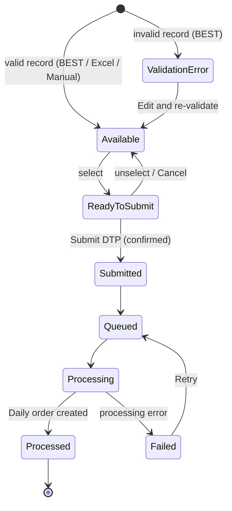

# ELIPS TC-PBR DTP Creation (Planning Order): Process and Validation Rules

**DTP (Daily Trucking Plan) Creation** is used by the **VPLD Planner** to create the trucking delivery orders that go to the trucking company (LP). TC-PBR uses **one Universal DTP model** for both Import and Export.

- **Menu:** Daily > **Planning Order** (`index.html#planning-order`). Daily now has three sub menus: Daily Monitoring, Planning Order and Planning Truck Assignment ([truck-assignment-spec.md](truck-assignment-spec.md)).
- **Rules:** [`dtp-rules.js`](../dtp-rules.js)
- **UI:** [`dtp.js`](../dtp.js)
- **Unit tests:** [`tests/dtp-creation.test.js`](../tests/dtp-creation.test.js)
- **Excel template:** based on `format_DTP2_1.xlsx`
- **UISS:**
  - [`UISS_Screen_DTP_Creation.xlsx`](uiss/UISS_Screen_DTP_Creation.xlsx) (screen)
  - [`UISS_Batch_DTP_Excel_Upload.xlsx`](uiss/UISS_Batch_DTP_Excel_Upload.xlsx) (upload backend)
  - [`UISS_Batch_DTP_Queue_Processing.xlsx`](uiss/UISS_Batch_DTP_Queue_Processing.xlsx) (processing queue)

```
DTP Calendar → Select Date → Universal DTP → DTP Creation → Upload Excel / Manual Entry / BEST Interface
→ Delivery Grid → Select Deliveries → Submit DTP → Processing Queue → LP Admin (Daily order: Planning Order / DTP Creation Release)
```

---

## 1. Screens

### 1.1 DTP Calendar

| Element | Content |
|---|---|
| Toolbar | ‹ › Today, month title, view **Month / Week / Day** |
| Info | System Master range: *backdate n day(s), advance n day(s) → selectable dd-Mon-yyyy to dd-Mon-yyyy*; view-only notice for users who are not VPLD Planner |
| Day cell | **Selectable** (white, "+ DTP" on hover), **Disabled** (hatched, outside the System Master range, click shows the reason), **Today** (blue number), **Selected** (navy outline) |
| Entries | One entry per date and DTP type of the Daily orders: `DTP - U ( dd/mm/yyyy ) [ assigned / total ]` (U = Universal; older orders show DTP 1-4). "+n more" opens the Day view. Clicking an entry opens Daily Monitoring filtered on that date |
| Draft badge | "n open · n in queue" for DTP records of the date that are not processed yet |
| Legend | Waiting Assignment (blue), Assigned to Truck (green), Rejected by LP (red), Order Finish (navy); Selectable / Disabled / Today / Selected |

Entry colour (orders of the date and type):
- **Order Finish**: every order is Finish / SA / PO.
- **Rejected by LP**: at least one order was rejected by the LP and is still in Planning Order.
- **Assigned to Truck**: every order has a truck.
- **Waiting Assignment**: in all other cases.

### 1.2 Universal DTP selection (modal)

Title `Planning order form #dd/mm/yyyy`, *Choose Transaction Type**, banner "Please select the Universal DTP", one card **Universal DTP (Import / Export)**. **Next** is enabled after the card is selected and opens DTP Creation for that date (`#planning-order/YYYY-MM-DD`), so the date stays in the URL.

### 1.3 DTP Creation

| Section | Content |
|---|---|
| Header | **Daily Plan Date**, **DTP Model: Universal DTP**, **Operation Type** Import / Export (applies to uploaded and manual records), **Planner** (logged-in user), Demo menu (simulate BEST error, simulate submission failure, reset demo data) |
| Upload Excel | Filename, **Choose File** (.xlsx / .xls), **Download Template** |
| Manual Entry | Form with all template fields plus Import/Export, Exporter, Importer CD; **+ Add to Grid** / Clear |
| Interface Data (BEST) | Number of records received for the date; **Load / Refresh from BEST** |
| Grid toolbar | **Select All** (eligible rows of the current filter) with "n Selected", **Delete** (selected Excel / Manual records), filters Status / Source / Import-Export, Search, Kolom |
| Grid | ☐, Options (✎ Edit, 🗑 Delete, ↻ Retry, ⓘ History), **Import/Export, Exporter, Importer CD, Container No., Renban, ETD Based, Vessel Name, Data Source, Status**, LP, Order No. Other template columns are available via Kolom. Header click sorts; 25 / 50 / 100 rows per page |
| Footer | ← Back (calendar); summary "n record(s) selected · n validation error · n in queue · n processed"; **Cancel** (clear selection); **Submit DTP (n)** |

Rows that are not selectable are greyed and their check box is disabled. Rows with a validation error are red; the error text is shown on the status badge and in the Edit dialog.

---

## 2. Data sources and the Excel template

| Source | How it arrives | Notes |
|---|---|---|
| **BEST Interface** | Received automatically per planning date; **Load / Refresh from BEST** asks for new records | Invalid interface records stay in the grid with **Validation Error** (never dropped) and can be corrected with Edit. They cannot be deleted |
| **Excel Upload** | Template upload | Operation Type from the header. Exporter / Importer CD are not in the template |
| **Manual Entry** | Form | Same validation as upload and interface |

**Template columns** (header row found by the cell `ROUNDUSE`, as in `format_DTP2_1.xlsx` row 7; * = mandatory):

ROUNDUSE*, LP*, RENBAN*, FROM LOCATION*, TO LOCATION*, DESTINATION*, ETD*, CONTAINER SIZE*, SHIPPING AGENT, CTR BOOKING NO, VESSEL NAME, TRUCK TYPE*, CONTAINER NO, DESCRIPTION, SHIFT, CTR DG FLAG, ARRIVAL DATE, ARRIVAL TIME.

The **DATA MAPPING** sheet lists the codes:

| Kind | Codes in the mock-up |
|---|---|
| LP | PBM, PNJ, SRL, TFL, SML (the trucking companies of Daily Monitoring) |
| FROM | D1 Depo Sunter, D2 Depo Cikarang, D3 Depo Cakung Marunda |
| TO | K1E CY TMMIN Karawang (EMPTY), S1E CY TMMIN Sunter (EMPTY) |

Download Template creates `Format_DTP_Universal.xlsx` with the same layout and both sheets.

---

## 3. Status of a DTP record

| Status | Meaning | Selectable |
|---|---|---|
| Available | Valid, not selected | Yes |
| Validation Error | Fails a validation (interface record or edit); fix with Edit | No |
| Ready to Submit | Valid and selected | Yes (selected) |
| Submitted | Submitted by the planner | No |
| Queued | In the processing queue | No |
| Processing | Picked up by the background service | No |
| Processed | Daily order created; visible for the LP Admin (Daily Monitoring, Planning Order / DTP Creation Release) | No |
| Failed | Processing failed (retryable); reason on the badge; **Retry** sends it to the queue again | No (Retry) |



---

## 4. Rules

| ID | Rule |
|---|---|
| DT-01 | Only the **VPLD Planner** can create DTP. Other users see the calendar and grid read only |
| DT-02 | **Date range from System Master:** the planning date must be between today − *backdate days* and today + *advance days*. Mock-up: 3 / 14. Dates outside are disabled. If the range is not configured, no date is selectable and the message says so |
| DT-03 | One **Universal DTP** model for Import and Export; Operation Type is a record field |
| DT-04 | Mandatory: all template columns marked * and Import/Export |
| DT-05 | ROUNDUSE Y / N; CONTAINER SIZE 20 / 40 / 40 HC / 45; SHIFT DAY / NIGHT (optional); CTR DG FLAG blank or DG |
| DT-06 | LP, FROM and TO must exist in the data mapping; TO ≠ FROM |
| DT-07 | RENBAN, DESTINATION, CTR BOOKING NO, IMPORTER CD: letters and numbers, max 20 |
| DT-08 | ETD / ARRIVAL DATE valid dates (Excel date, serial number, `yyyy-mm-dd` or `dd/mm/yyyy`); ARRIVAL TIME HH:MM |
| DT-09 | CONTAINER NO (when filled) must pass the ISO 6346 check digit (same rule as Daily Monitoring) |
| DT-10 | **Duplicates:** key = Container No, otherwise Ctr Booking No. Not allowed twice in one file, not if it already exists in the grid, and not if it was already submitted. Failed records do not block |
| DT-11 | **Upload:** wrong file type or header → whole file rejected. Any invalid row → **no row is added**; every error is listed per row and column (downloadable). The planner corrects the file and uploads again |
| DT-12 | Manual entry and Edit use the same validations. Only valid manual records are added |
| DT-13 | Only **Available / Ready to Submit** rows can be selected. Submit is disabled without a selection |
| DT-14 | **Submit** asks for confirmation: "Submit n delivery record(s) as DTP for dd-Mon-yyyy? Submitted records cannot be submitted again." Cancel / Confirm Submit |
| DT-15 | On success the records become Submitted and leave the selectable set at once; then Queued → Processing → Processed / Failed. If the submission itself fails, nothing changes and the records stay selected |
| DT-16 | **No double submission after refresh:** the record status is stored (mock-up: browser storage), and submitted records stay locked after reload |
| DT-17 | **Processed:** one Daily order per record (type `Universal`, status Planning Order / DTP Creation Release, supplier = LP, From / To names, Renban, Shift, Planned Cycle = 2 if ROUNDUSE = Y else 1). The LP Admin sees it in Daily Monitoring |
| DT-18 | **Failed** shows the reason (e.g. LP Admin service timeout) and can be retried |
| DT-19 | **Reject by LP** (new action for the LP Admin in Daily Monitoring, order still in Planning Order without truck, reason ≥ 10 characters). The calendar shows **Rejected by LP**; Assign Truck and Order Release are blocked for that order |
| DT-20 | BEST interface error: message, nothing received, retry later |
| DT-21 | **DTP Switching** (rollback): Submitted / Queued / Failed records, and Processed records whose driver has not started (Daily order Planning Order / Order Release, no Start Cycle), can be rolled back to **Available**. Processed: the Daily order is cancelled and the truck assignment released. Checked again immediately before the rollback; all-or-nothing; history kept. See [dtp-switching-spec.md](dtp-switching-spec.md) |

---

## 5. Open questions (TBD)

1. **System Master values:** how many days may the planner backdate and plan ahead (mock-up 3 / 14)?
2. **Template vs interface fields:** Exporter and Importer CD are not in the Excel template. Should the template get these columns, together with IMPORT/EXPORT?
3. **Duplicate key:** for records without Container No and Booking No, which fields identify a duplicate?
4. **Data mapping:** the final LP and location code lists. The template has only D1 / D2 / D3 and K1E / S1E, and the sample row uses D1, which is not in the template mapping. Also, "CY TEMMIN" in the template is probably a typo.
5. **ROUNDUSE → Planned Cycle:** is Y = round use (2 cycles) correct?
6. **Partial upload:** should valid rows be added while invalid rows are rejected? The mock-up rejects the whole file.
7. **BEST interface:** schedule, record key, and how changes or cancellations from BEST after submission are handled.
8. **Queue failure rules:** which errors are retryable, how many retries, and who is notified.
9. **Rejected by LP:** may the planner change the LP of a rejected order from DTP Creation, or must a new record be submitted?
10. **Truck Assignment menu:** done, see [truck-assignment-spec.md](truck-assignment-spec.md).
