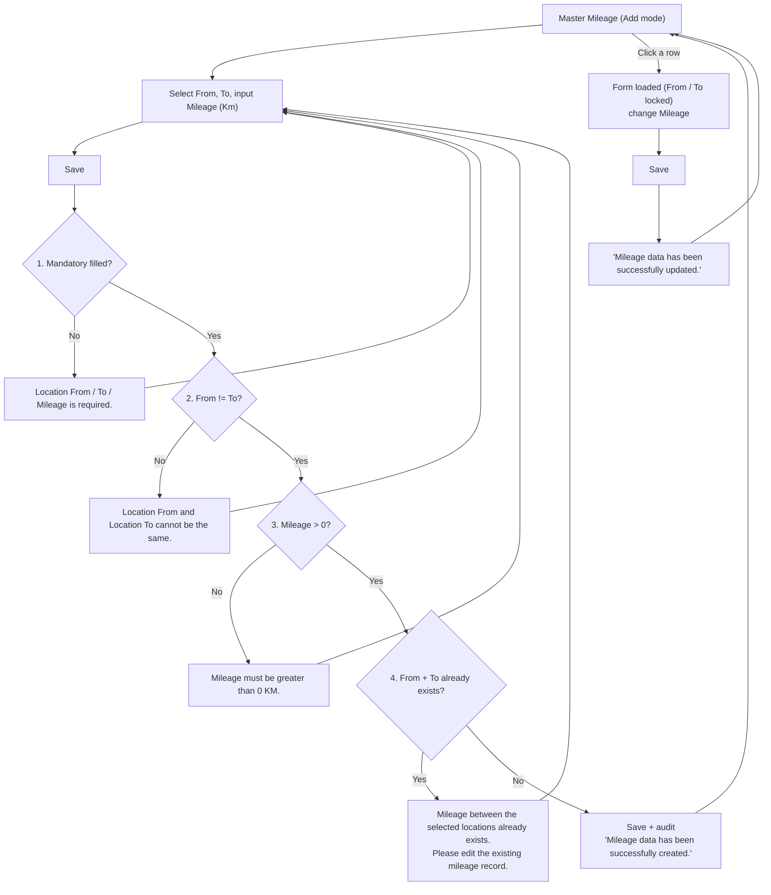
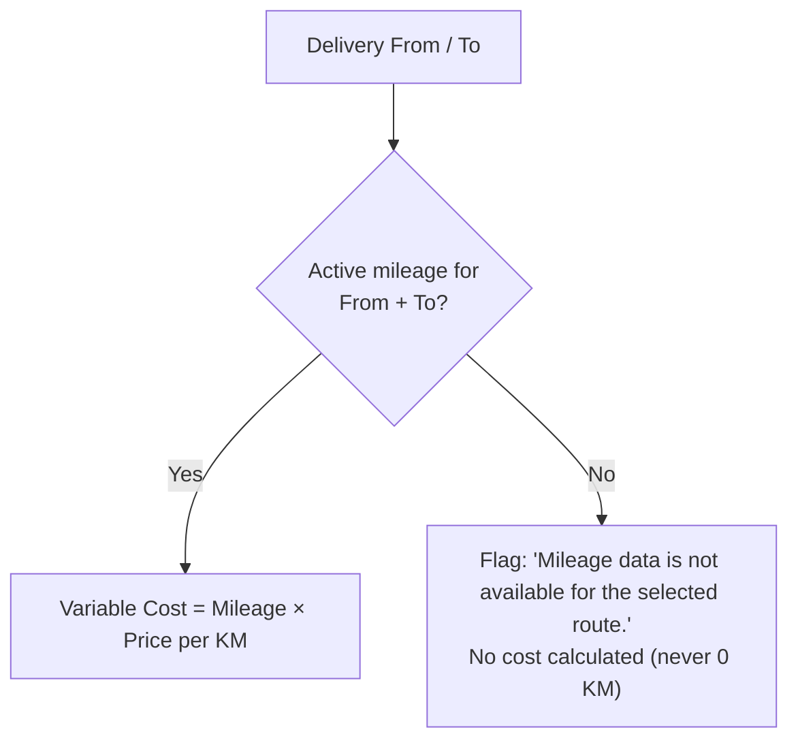
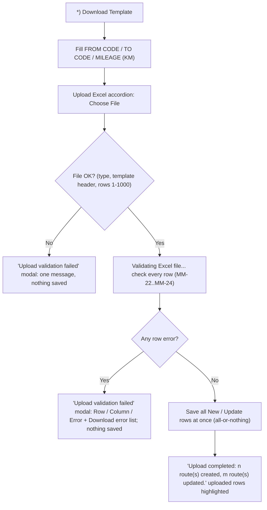

# ELIPS Master Mileage: Process and Validation Rules

Master Mileage maintains the distance (KM) between two Master Location records. TC-PBR uses it to calculate the variable cost of each delivery:

**Variable Cost = Mileage (KM) × Price per KM**, e.g. SNT → KRW 65 KM × IDR 5,000 = **IDR 325,000**.

Mock-up: `master.html#mileage` (Master > Mileage). Rules live in [`master-mileage.js`](../../../../master-mileage.js).
The screen follows the existing **Route Mileage** screen exactly.

---

## 1. Screen (Route Mileage)

| Section | Content |
|---|---|
| Header | Title "Route Mileage", breadcrumb "Master - Route Mileage" |
| Form | From ("Select From Location"), To ("Select To Location"): dropdowns from Master Location (active only, searchable by code / name); Mileage (Km). Save / Cancel |
| Route Mileage List | Search, Table View (show / hide columns), **Upload Excel**, **Download Template**, Export .xls, pagination |
| Columns | From Code, From, To Code, To, Mileage (Km), Created Date, Change Date (Created By and Changed By available via Table View) |
| Edit | Click a row: the route is loaded into the form (From / To locked), change Mileage, Save. Cancel clears the form |
| States | Save disabled while saving ("Saving..."); empty list shows "No mileage data found." / "No mileage data found for the selected criteria." |

---

## 2. Flow

### TC-PBR usage

---

## 3. Validation and business rules

| ID | Rule | Message |
|---|---|---|
| MM-01 | Location From, Location To, Mileage mandatory | Location From is required. / Location To is required. / Mileage is required. |
| MM-02 | Location From ≠ Location To | Location From and Location To cannot be the same. |
| MM-03 | Mileage numeric and > 0 (0, negative, non-numeric rejected); up to 2 decimals | Mileage must be greater than 0 KM. |
| MM-04 | Unique combination Location From + Location To (Active or Inactive) | Mileage between the selected locations already exists. Please edit the existing mileage record. |
| MM-05 | Route is directional: SNT → KRW and KRW → SNT are separate records | - |
| MM-06 | From / To must be registered in Master Location; no free text. New records accept ACTIVE locations only | Location X is not an active location in Master Location. |
| MM-07 | Edit (click a row) changes Mileage only; From / To are locked | Mileage data has been successfully updated. |
| MM-08 | No physical delete. Active / Inactive status and Deactivate (with confirmation) are supported by the rules engine but **not shown on the reference screen** (open question 7) | Are you sure you want to deactivate this mileage data? |
| MM-09 | (When status is shown) Active only when both locations are ACTIVE in Master Location | Cannot activate: location X is inactive in Master Location. |
| MM-10 | Inactive records stay for history / audit and are not used for new TC-PBR calculations | - |
| MM-11 | Audit: Created By / Date on insert; Updated By / Date on every change; Created By / Date never overwritten; concurrency check on edit | Data has been changed by another user ... |
| MM-12 | TC-PBR lookup uses the Active record for From + To; missing route is flagged, never 0 KM | Mileage data is not available for the selected route. |
| MM-13 | Save button disabled while saving to prevent double submission | - |

---

## 3a. Excel upload (added 13-Nov-2026, layout like Planning Order since UISS rev 0.3 / 0.4)

Mass maintenance of routes from an Excel file, built like the Planning Order (DTP Creation) upload.
Screen part: UISS-Screen Master Mileage rev 0.3. Backend: [UISS-Batch Master Mileage - Route Mileage Upload](UISS_Batch_Master_Mileage_Upload.xlsx) rev 0.2.
Rules: `master-mileage.js` `readSheet`, `checkUpload`, `applyUpload`; tests `tests/master-mileage-upload.test.js` (6).

| ID | Rule |
|---|---|
| MM-20 | Same placement as Planning Order: on top of the page an accordion **Upload Excel** (Filename, **Choose File**, link **\*) Download Template**) and below it an accordion **Manual Entry** (the From / To / Mileage form). Upload Excel is open and Manual Entry is collapsed when the screen opens (as in Planning Order); both headers show the badge **IELP Admin only**; clicking a list row opens Manual Entry |
| MM-21 | **Template** (`Template_Route_Mileage.xlsx`): sheet *Route Mileage* with header `FROM CODE`, `TO CODE`, `MILEAGE (KM)` (the header row may be below a title; other columns are ignored), sheet *Active Locations* (code, name), sheet *Notes*. File .xlsx / .xls, max 1,000 data rows; empty rows are skipped |
| MM-22 | Every row is checked with the screen rules: mandatory From / To / Mileage (MM-01), From and To active in Master Location (MM-06), From ≠ To (MM-02), Mileage > 0 with up to 2 decimals, comma accepted as decimal sign (MM-03). Codes are converted to upper case |
| MM-23 | The same route twice in the file is an error on the later row ("Route is repeated in the file (row n)"). An existing **Inactive** route is an error (activate it on the screen first) |
| MM-24 | Result per row: **New** (route not in Master Mileage) = insert, **Update** (existing Active route, other mileage) = update, **No change** (same mileage) = skipped |
| MM-25 | **No preview** (like Planning Order): choosing the file validates it at once ("Validating Excel file..."). With one or more errors the modal **Upload validation failed** lists Row / Column / Error, offers **Download error list** (CSV) and **Close and correct the file**; **nothing is saved (all-or-nothing)** |
| MM-26 | Without errors all rows are saved immediately in one transaction: New = insert (Active, Created / Updated By = user); Update = new mileage, Updated By / Date, version + 1, Created By / Date kept. The list is refreshed and the uploaded rows are highlighted; the message adds "n route(s) unchanged" when there are No change rows |
| MM-27 | File errors (wrong file type, template columns not found, no data, more than 1,000 rows) open the same modal with one message |
| MM-28 | Messages: "Upload completed: n route(s) created, m route(s) updated." · "n row(s) have errors. Nothing was saved; correct the file and upload again." · "All routes in the file already have the same mileage. Nothing to save." |
| MM-29 | Backend log and temp rows per upload (Upload ID, counts, status, error per row) as in the UISS-Batch (proposed tables) |

## 4. Assumptions / open questions

1. **Duplicate check includes Inactive records**, so an old route is edited instead of re-created.
2. **Edit locks From / To**; to change a route, create a new one.
3. **Decimals:** up to 2 decimals accepted (e.g. 7.5 KM). Is a maximum mileage needed?
4. **Price per KM** comes from Master Price (not built yet).
5. **Location codes** follow the reference (DPCMR, DPSTR, PRTGP, WHCKR, KRWP1, CYSTR) and are registered in Master Location.
6. **Edit trigger:** the reference has no Action column, so the mock-up edits by clicking a row. Is there an Edit button in the real screen?
7. **Deactivate / Status:** the requirement asks for Active / Inactive and Deactivate, but the reference screen has no Status column or Deactivate action. Should they be added (e.g. via Table View column and row action)?
8. **Upload of an existing route:** update the mileage (mock-up) or reject it (only new routes by upload)?
9. **Upload of an Inactive route:** error (mock-up) or update and re-activate?
10. **Upload limits:** max rows (1,000 assumed), partial save of the valid rows instead of all-or-nothing?
11. **Mileage history:** keep the old / new mileage per change (history table) for audit of the cost calculation?
12. **Role:** only IELP Admin maintains Master Mileage (upload and manual entry), as shown by the badge? Other roles view only?

## Database mapping (ELIPS schema, review 14-Nov-2026)

The UISS of this function were revised against `docs/db/ELIPS_Schema.sql` ([DB-R1]) and the conflicts were resolved by the decision of
14-Nov-2026 ([DB-R2]): **the existing application logic is kept**; where the existing table cannot hold it a DB change request (DCR) is raised
([../../review/12-db-change-requests.md](../../../review/12-db-change-requests.md)). No sample data was available: value lists / status codes stay TBD.

- **UISS_Screen_Master_Mileage** - tables: `ielp.MS_LOCATION`, `ielp.TB_M_MILEAGE`
  - G-MML-01 Mileage decimals: Existing logic kept: mileage > 0 with up to 2 decimals (master-mileage.js parseMileage). **DCR-06**: ALTER ielp.TB_M_MILEAGE.MILEAGE decimal(18,0) -> decimal(9,2)
  - G-MML-02 Route key: Existing logic kept: a route is unique by From + To (directional). **DCR-07**: ALTER ielp.TB_M_MILEAGE: TO_CODE NOT NULL; primary key (LOC_NAME_FROM, FROM_CODE) -> (FROM_CODE, TO_CODE)
  - G-MML-03 Location names stored: Existing logic kept: names shown from Master Location; LOC_NAME_FROM / LOC_NAME_TO filled with a copy of MS_LOCATION.LOCATION_NAME on save. (no DB change)
  - G-MML-04 Active / Inactive and VERSION: Existing logic kept: Active / Inactive status and VERSION. **DCR-08**: ADD ielp.TB_M_MILEAGE.STATUS varchar(8) NOT NULL default 'Active'; ADD VERSION int NOT NULL default 1
- **UISS_Batch_Master_Mileage_Upload** - tables: `ielp.TB_M_MILEAGE`
  - G-MML-01 Mileage decimals: Existing logic kept: mileage > 0 with up to 2 decimals (master-mileage.js parseMileage). **DCR-06**: ALTER ielp.TB_M_MILEAGE.MILEAGE decimal(18,0) -> decimal(9,2)
  - G-MML-02 Route key: Existing logic kept: a route is unique by From + To (directional). **DCR-07**: ALTER ielp.TB_M_MILEAGE: TO_CODE NOT NULL; primary key (LOC_NAME_FROM, FROM_CODE) -> (FROM_CODE, TO_CODE)
  - G-MML-03 Location names stored: Existing logic kept: names shown from Master Location; LOC_NAME_FROM / LOC_NAME_TO filled with a copy of MS_LOCATION.LOCATION_NAME on save. (no DB change)
  - G-MML-04 Active / Inactive and VERSION: Existing logic kept: Active / Inactive status and VERSION. **DCR-08**: ADD ielp.TB_M_MILEAGE.STATUS varchar(8) NOT NULL default 'Active'; ADD VERSION int NOT NULL default 1
  - G-MML-05 LAST_UPLOAD_ID: Existing logic kept: upload with temp rows, upload log and mileage history (UISS-Batch Route Mileage Upload). **DCR-09**: ADD ielp.TB_M_MILEAGE.LAST_UPLOAD_ID bigint NULL; CREATE TB_T_MILEAGE_UPLOAD, TB_R_MILEAGE_UPLOAD_LOG, TB_H_MILEAGE (definitions in the UISS-Batch Appendix)

Full lists: [../../review/07-gap-analysis.md](../../../review/07-gap-analysis.md), [../../review/12-db-change-requests.md](../../../review/12-db-change-requests.md), [../../review/10-tbd-list.md](../../../review/10-tbd-list.md).
