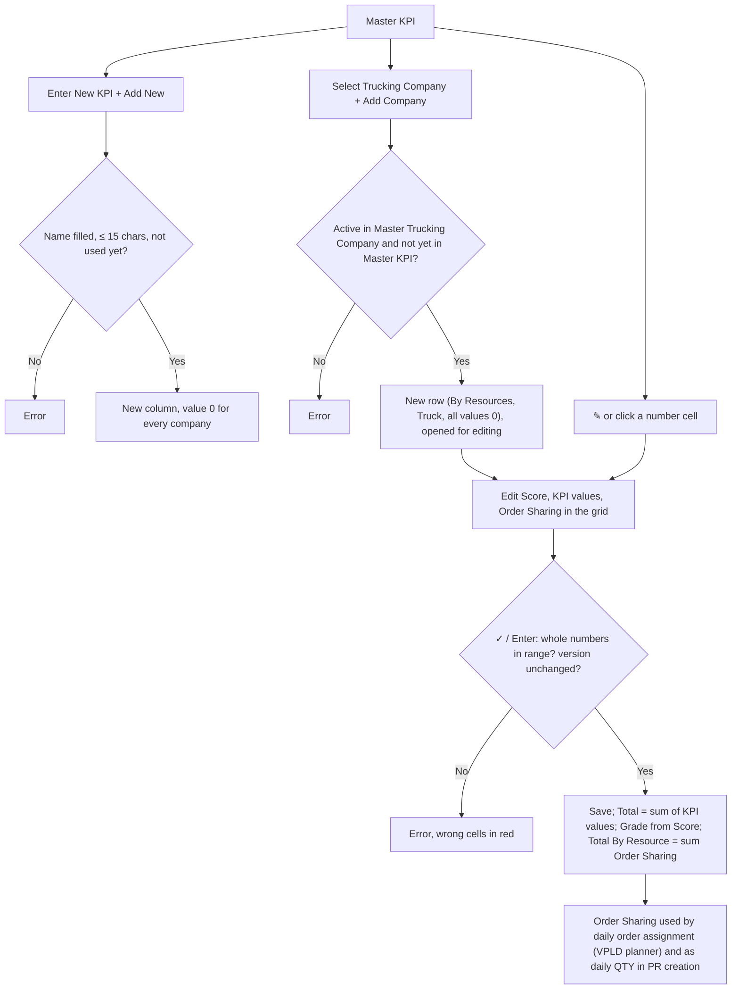

# ELIPS Master KPI: Process and Validation Rules

Master KPI holds the **performance value of each trucking company** and its **Order Sharing**:

- **Order Sharing** is the share each trucking company gets in the **daily order assignment** done by the VPLD planner.
- The same number is the **daily QTY** in **PR creation**.
- **Total By Resource** is the sum of Order Sharing of the companies with Payment Type *By Resources* (reference: 3 + 4 + 5 + 4 + 4 = **20**).
- **Payment Type By Trip** (added 13-Nov-2026). **Both payment types have the same columns: Order Sharing % and Daily Trip** (rev 13-Nov-2026 b):
  - **By Resources:** Daily Trip is **typed** (trucks per day). Order Sharing % is typed too, but it is **information only**: it does not change the Daily Trip yet.
  - **By Trip:** Order Sharing % is typed (total = **100%**); Daily Trip is **calculated** from the **trips per day** (reference **20**): 1 trip per company, the rest by % (KP-15).
  - A company can be registered both By Resources and By Trip. Each payment type has its own **summary** shown above the grid.

Mock-up: `master.html#kpi` (Master > KPI). Rules live in [`master-kpi.js`](../master-kpi.js). UISS: [`docs/uiss/UISS_Screen_Master_KPI.xlsx`](uiss/UISS_Screen_Master_KPI.xlsx). The screen follows the existing **Master KPI** screen.

---

## 1. Screen (Master KPI)

| Section | Content |
|---|---|
| Header | Title "Master KPI", breadcrumb "Master - Master KPI" |
| Toolbar | **Enter New KPI** + **Add New**: adds a KPI item as a new column. **Payment Type** (By Resources / By Trip) + **Select Trucking Company** + **+ Add Company**: adds a company row of that payment type from Master Trucking Company *(not on the reference screen; see open question 2)*. Tabs **All / By Resources / By Trip**. Search, Kolom (show / hide columns), Export XLS |
| Grid | Action (✎ / 🗑; while editing ✓ / ✕), Payment Type (yellow By Resources, green By Trip), **No** (per payment type), Trucking Company (`Code - Name`), Score, Grade, **one column per KPI item** (coloured header: Safety, Comm., Flexi., Legal, KPI, TPS, Tax, QCC, …), **Total**, **Order Sharing %** (`x.xx%`, both types), **Daily Trip** (typed for By Resources; calculated, italic, for By Trip), UoM (Truck), Created Dt, Created By, Changed Dt, Changed By. Rows are grouped By Resources first, then By Trip (as the two reference tables). A By Trip row without Order Sharing (e.g. SGL, SILVER) is hatched: not eligible |
| Summary (above the grid) | **One summary per payment type**: **By Resources** (green): Total Order Sharing % (information only), Total Daily Trip (= Total By Resource). **By Trip** (teal): Total Order Sharing % (must be 100%, red otherwise), **Trips per day** input (default 20), Total Daily Trip. The tab By Resources / By Trip shows only its own summary. The separate daily trip allocation table was removed: the allocation is the Daily Trip column of the grid |
| Footer | "Menampilkan x - y dari z data", pager |

### Editing in the grid

- **Start editing:** click ✎, or click any number cell (Score, a KPI value, Order Sharing). The row turns into input boxes.
- **While typing:** Total and Grade are recalculated live.
- **Finish:** ✓ or Enter saves; ✕ or Esc cancels.
- **One row at a time:** other actions are blocked until the row is saved or cancelled.
- **Delete a KPI item:** hover its header and click ×.

---

## 2. Flow

---

## 3. Rules

| ID | Rule |
|---|---|
| KP-01 | One row per trucking company **and Payment Type** (By Resources / By Trip). A company is selected from Master Trucking Company (active, Deletion = No); the same company may have one By Resources row and one By Trip row |
| KP-02 | KPI items are dynamic columns. Name required, max 15 characters, unique (case-insensitive). A new item starts at 0 for every company |
| KP-03 | Deleting a KPI item (after confirmation) removes its values for all companies and recalculates Total |
| KP-04 | Score and KPI values are whole numbers: Score 0–1000, KPI value 0–999. **Order Sharing %** (both types): 0–100 with at most 2 decimals. **Daily Trip** (By Resources only, typed): whole number 0–99. By Trip Daily Trip is calculated, not typed (limits TBD) |
| KP-05 | **Total** = sum of all KPI item values of the row (calculated, not typed) |
| KP-06 | **Grade** from Score: ≥ 666 GOLD, 600–665 SILVER, < 600 BRONZE (thresholds TBD; the By Trip reference shows 667 GOLD and 665 SILVER) |
| KP-07 | **By Resources summary:** Total Daily Trip (= Total By Resource) = sum of the typed Daily Trip; Total Order Sharing % = sum of the % (information only, not validated) |
| KP-08 | **Daily order assignment:** orders of a day are split in proportion to the By Resources Daily Trip (largest remainder; ties by higher Total, then code). Example: 20 orders with shares 3/4/5/4/4 gives exactly 3/4/5/4/4 |
| KP-09 | **PR creation:** the daily QTY of a trucking company = its By Resources Daily Trip |
| KP-10 | Grid edit: one row at a time, concurrency check on save (version). Changed Dt / By set on save; Created Dt / By never change |
| KP-11 | Deleting a trucking company (after confirmation) removes it from Total By Resource, daily order assignment and PR creation |
| KP-12 | Search filters on all visible columns. Export XLS exports all filtered rows with the visible columns plus the Total By Resource line |
| KP-14 | **By Trip summary:** Total Order Sharing % of the By Trip rows must be **100.00%**. Saving a row is not blocked, but the total turns red and the save message warns. A By Trip row with 0% is **not eligible** (gets no trips) |
| KP-15 | **Daily Trip of By Trip (calculated):** every eligible By Trip company gets **1 trip** first; the rest (trips per day − number of companies) is split by Order Sharing % with the largest remainder (ties: higher %, then code). Fewer trips than companies: 1 trip each to the highest shares. Reference: 20 trips over 11 companies → GIB, VMB, JMP, DNX, IBT, MJR, PLI, PNJ, PBM 2 each; AGR, PS 1 each |
| KP-16 | **Trips per day (By Trip)**: whole number 0–999, default 20 (reference). Source and maintenance (fixed value, per day from the plan, or equal to Total By Resource) TBD |
| KP-13 | **DTP Creation vs Master KPI:** By Resources Order Sharing is the daily truck limit, and the By Trip daily trip limit (KP-15) is the trip limit per trucking company monitored in DTP Creation ([dtp-creation-rules.md](dtp-creation-rules.md) §4a, KM-09..KM-12). Mock-up seed: `MasterKpi.SEED` = the two reference tables (By Resources AGR..PBM plus PNJ, SRL, TFL: Total 28; By Trip AGR..VMB 100%, SGL SILVER not eligible) |

### Messages

| Case | Message |
|---|---|
| KPI name blank / too long / used | KPI name is required. · KPI name must be at most 15 characters. · KPI {name} already exists. |
| Company blank / inactive / already listed | Trucking Company is required. · Trucking Company {code} is not active in Master Trucking Company. · Trucking Company {code} is already registered in Master KPI. |
| Value out of range | {Score / KPI / Order Sharing} must be a whole number between 0 and {max}. · Order Sharing (By Trip) must be a percentage between 0 and 100 with at most 2 decimals. · Trips per day (By Trip) must be a whole number between 0 and 999. |
| Company already listed / total | Trucking Company {code} is already registered in Master KPI as {payment type}. · Total By Trip is {x}%; it must be 100.00%. |
| Concurrency | Error in Update because of concurrency check. |
| Success | KPI {name} has been added. … · Trucking Company {code} has been added. … · KPI data for {code} has been successfully updated. · … deleted … |

---

## 4. Open questions

1. **Score vs Total:** in the reference, Score (766–892) differs from Total (645). What is Score: an input from the performance evaluation, or calculated (e.g. a weighted Total)? The mock-up treats it as an input. Also, the reference values add up to **650**, not 645.
2. **Adding a trucking company:** the reference has no button for it. The mock-up adds "Select Trucking Company + Add Company". Should every active company from Master Trucking Company appear automatically instead?
3. **Grade:** what are the grade levels and thresholds, and do they affect Order Sharing?
4. **Order Sharing:** typed by the user (mock-up), or calculated from Score / Total / Grade?
5. **Payment Type:** which other types exist besides *By Resources* (only those rows count in Total By Resource)?
6. **KPI item:** is a maximum or weight needed per item, and is deleting an item allowed when it was already used?
7. **Period:** is Master KPI one current set, or per period (month), with history?
8. **By Trip Order Sharing %:** typed (mock-up) or calculated? The reference values look linear on Total (share ≈ (Total − 623.6) / Σ), but the formula is not confirmed.
9. **Trips per day (By Trip):** fixed value (20 in the reference), equal to Total By Resource, or the planned trips of each day? Who maintains it?
10. **Daily trip allocation rule:** confirmed as "1 trip per company, the rest by %" (matches the reference table)? An alternative that also matches 20 trips is a round robin by rank; it differs for other totals.
11. **Not eligible By Trip company (SGL, SILVER, hatched):** is eligibility decided by Grade (only GOLD) or by an empty Order Sharing?
12. **Trucking company codes on the reference:** IBT (allocation table) vs IBL "Iron Bird Logistics" (KPI table), and PS (2 characters, Master Trucking Company expects 3).
13. **By Resources Order Sharing %:** information only for now (Daily Trip is typed). When will it drive the Daily Trip, and must its total be 100% (not validated yet)? Mock-up seed: Daily Trip / Total Daily Trip.
