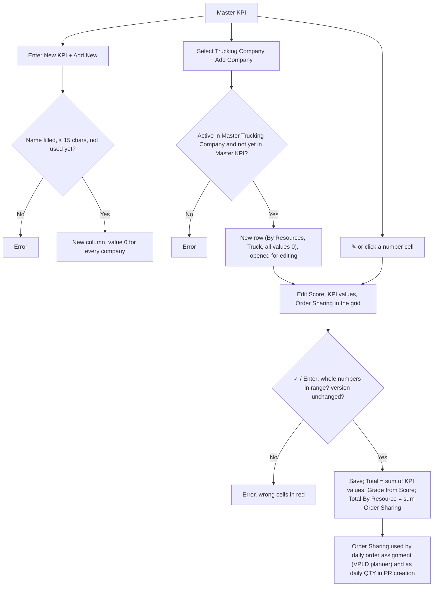

# ELIPS Master KPI: Process and Validation Rules

Master KPI holds the **performance value of each trucking company** and its **Order Sharing**:

- **Order Sharing** is the share each trucking company gets in the **daily order assignment** done by the VPLD planner.
- The same number is the **daily QTY** in **PR creation**.
- **Total By Resource** is the sum of Order Sharing of the companies with Payment Type *By Resources* (reference: 3 + 4 + 5 + 4 + 4 = **20**).

Mock-up: `master.html#kpi` (Master > KPI). Rules live in [`master-kpi.js`](../master-kpi.js). UISS: [`docs/uiss/UISS_Screen_Master_KPI.xlsx`](uiss/UISS_Screen_Master_KPI.xlsx). The screen follows the existing **Master KPI** screen.

---

## 1. Screen (Master KPI)

| Section | Content |
|---|---|
| Header | Title "Master KPI", breadcrumb "Master - Master KPI" |
| Toolbar | **Enter New KPI** + **Add New**: adds a KPI item as a new column. **Select Trucking Company** + **+ Add Company**: adds a company from Master Trucking Company *(not on the reference screen; see open question 2)*. Search, Kolom (show / hide columns), Export XLS |
| Grid | Action (✎ / 🗑; while editing ✓ / ✕), Payment Type, Trucking Company (`Code - Name`), Score, Grade, **one column per KPI item** (coloured header: Safety, Comm., Flexi., Legal, KPI, TPS, Tax, QCC, …), **Total**, **Order Sharing** (yellow), UoM (Truck), Created Dt, Created By, Changed Dt, Changed By |
| Footer | "Menampilkan x - y dari z data", green **Total By Resource** bar, pager |

### Editing in the grid

- **Start editing:** click ✎, or click any number cell (Score, a KPI value, Order Sharing). The row turns into input boxes.
- **While typing:** Total and Grade are recalculated live.
- **Finish:** ✓ or Enter saves; ✕ or Esc cancels.
- **One row at a time:** other actions are blocked until the row is saved or cancelled.
- **Delete a KPI item:** hover its header and click ×.

---

## 2. Flow

---

## 3. Rules

| ID | Rule |
|---|---|
| KP-01 | One row per trucking company. A company is selected from Master Trucking Company (active, Deletion = No) and can appear only once |
| KP-02 | KPI items are dynamic columns. Name required, max 15 characters, unique (case-insensitive). A new item starts at 0 for every company |
| KP-03 | Deleting a KPI item (after confirmation) removes its values for all companies and recalculates Total |
| KP-04 | Score, KPI values and Order Sharing are whole numbers: Score 0–1000, KPI value 0–999, Order Sharing 0–99 (limits TBD) |
| KP-05 | **Total** = sum of all KPI item values of the row (calculated, not typed) |
| KP-06 | **Grade** from Score: ≥ 750 GOLD, 600–749 SILVER, < 600 BRONZE (thresholds TBD) |
| KP-07 | **Total By Resource** = sum of Order Sharing of rows with Payment Type *By Resources* |
| KP-08 | **Daily order assignment:** orders of a day are split in proportion to Order Sharing (largest remainder; ties by higher Total, then code). Example: 20 orders with shares 3/4/5/4/4 gives exactly 3/4/5/4/4 |
| KP-09 | **PR creation:** the daily QTY of a trucking company = its Order Sharing |
| KP-10 | Grid edit: one row at a time, concurrency check on save (version). Changed Dt / By set on save; Created Dt / By never change |
| KP-11 | Deleting a trucking company (after confirmation) removes it from Total By Resource, daily order assignment and PR creation |
| KP-12 | Search filters on all visible columns. Export XLS exports all filtered rows with the visible columns plus the Total By Resource line |

### Messages

| Case | Message |
|---|---|
| KPI name blank / too long / used | KPI name is required. · KPI name must be at most 15 characters. · KPI {name} already exists. |
| Company blank / inactive / already listed | Trucking Company is required. · Trucking Company {code} is not active in Master Trucking Company. · Trucking Company {code} is already registered in Master KPI. |
| Value out of range | {Score / KPI / Order Sharing} must be a whole number between 0 and {max}. |
| Concurrency | Error in Update because of concurrency check. |
| Success | KPI {name} has been added. … · Trucking Company {code} has been added. … · KPI data for {code} has been successfully updated. · … deleted … |

---

## 4. Open questions

1. **Score vs Total:** in the reference, Score (766–892) differs from Total (645). What is Score: an input from the performance evaluation, or calculated (e.g. a weighted Total)? The mock-up treats it as an input. Also, the reference values add up to **650**, not 645.
2. **Adding a trucking company:** the reference has no button for it. The mock-up adds "Select Trucking Company + Add Company". Should every active company from Master Trucking Company appear automatically instead?
3. **Grade:** what are the grade levels and thresholds, and do they affect Order Sharing?
4. **Order Sharing:** typed by the user (mock-up), or calculated from Score / Total / Grade?
5. **Payment Type:** which other types exist besides *By Resources* (only those rows count in Total By Resource)?
6. **KPI item:** is a maximum or weight needed per item, and is deleting an item allowed when it was already used?
7. **Period:** is Master KPI one current set, or per period (month), with history?
