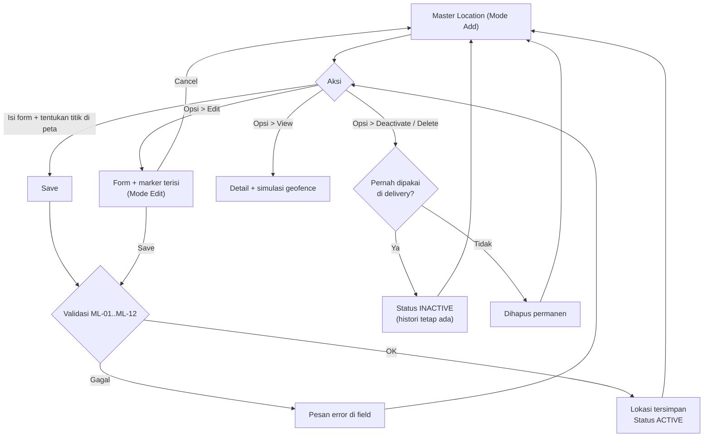
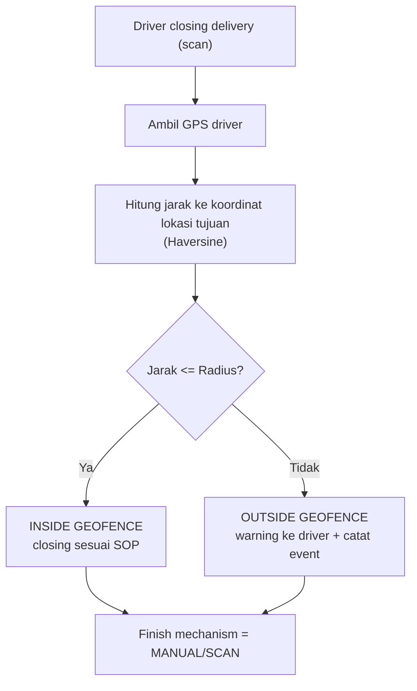

# ELIPS Master Location: Proses dan Aturan Bisnis

Master Location dipakai untuk menambah dan memelihara lokasi operasional TC-PBR. Setiap lokasi punya **Location Alias** (kode unik, contoh `A1`, `A2`, `K1E`) yang menjadi referensi lokasi di transaksi delivery.

Master Location menjadi dasar untuk:
1. referensi lokasi asal/tujuan pada delivery TC-PBR,
2. titik koordinat lokasi,
3. validasi geofence (radius) saat driver melakukan closing delivery,
4. Auto Finish delivery pada lokasi tertentu.

Mock-up: `master.html#location-code` (submenu Master > Location Code). Aturan ada di [`master-location.js`](../master-location.js).
Peta mock-up memakai Leaflet + OpenStreetMap; aplikasi asli memakai Google Maps yang sudah ada.

---

## 1. Layar

| Bagian | Isi |
|---|---|
| Form (kiri) | Location Name\*, Location Alias\*, Location Address Google Map (pencarian alamat), Physical Location Address, Location Sub Area, Radius (m)\*, Auto Finish Order\*, Auto Generate Cycle, Latitude\*, Longitude\*, tombol Save / Cancel, keterangan mode (Add / Edit) |
| Peta (kanan) | Marker lokasi + lingkaran radius. Titik ditentukan dengan memilih hasil pencarian alamat, klik peta, atau geser marker. Latitude/Longitude dan alamat Google Map ikut ter-update |
| Location Registrations | Search, Kolom (show/hide), Export .xls, sort, paging. Kolom: Options, Location Code, Loc Name, Loc Sub Area, Auto Cycle, Cycle To Area, Auto Finish, Coordinates, Radius, G.Map Address, Physical Address, Status, Created/Updated By/At |
| Options per baris | View, Edit, Deactivate (lokasi sudah dipakai delivery) atau Delete (belum pernah dipakai) |

---

## 2. Alur

### Geofence saat closing manual oleh driver

Closing di luar radius **tidak diblokir**; driver mendapat pesan *"Anda melakukan closing delivery di luar radius lokasi tujuan."* dan event dicatat untuk monitoring.

### Auto Finish

Jika lokasi tujuan berstatus **Auto Finish Order = Yes** dan trigger Auto Finish TC-PBR terpenuhi, delivery selesai otomatis tanpa scan driver. Yang dicatat: finish mechanism `AUTO`, waktu selesai, lokasi tujuan, latitude/longitude pemicu (jika ada), dan user/sistem (`SYSTEM`). Closing biasa oleh driver dicatat sebagai `MANUAL/SCAN`.

---

## 3. Aturan validasi

| ID | Field / aksi | Aturan | Pesan |
|---|---|---|---|
| ML-01 | Location Name | Wajib; maksimal 100 karakter; spasi ganda dirapikan, disimpan huruf besar | Location Name wajib diisi |
| ML-02 | Location Alias | Wajib; huruf/angka tanpa spasi, maksimal 10 karakter; otomatis huruf besar | Location Alias wajib diisi / hanya huruf / angka ... |
| ML-03 | Location Alias | Unik di semua lokasi, termasuk yang INACTIVE | Location Alias X sudah dipakai |
| ML-04 | Location Sub Area | Opsional; jika diisi harus ada di master Sub Area | Location Sub Area tidak terdaftar ... |
| ML-05 | Latitude / Longitude | Wajib (dipakai geofence) | Koordinat wajib: pilih lokasi di peta atau isi Latitude / Longitude |
| ML-06 | Latitude | Angka -90 s/d 90, disimpan 7 desimal | Latitude harus angka -90 s/d 90 |
| ML-07 | Longitude | Angka -180 s/d 180, disimpan 7 desimal | Longitude harus angka -180 s/d 180 |
| ML-08 | Radius | Wajib; angka > 0 (meter) | Radius wajib diisi / harus angka lebih dari 0 |
| ML-09 | Auto Finish Order | Wajib Yes / No | Auto Finish Order wajib dipilih |
| ML-10 | Auto Generate Cycle | Yes / No, default No (aturan mengikuti proses existing) | Auto Generate Cycle harus Yes / No |
| ML-11 | Alamat Google Map / Physical Address | Opsional; maksimal 300 karakter; Physical Address bisa diedit bebas | Maksimal 300 karakter |
| ML-12 | Edit | Lokasi INACTIVE tidak bisa di-edit; Alias terkunci jika lokasi sudah dipakai delivery; concurrency check | Lokasi X sudah INACTIVE / Location Alias tidak bisa diubah ... / Data sudah diubah user lain |
| ML-20 | Deactivate | Lokasi yang sudah dipakai delivery tidak dihapus: Status INACTIVE, tidak bisa dipilih di transaksi baru, histori tetap merujuk | - |
| ML-21 | Delete | Hanya untuk lokasi yang belum pernah dipakai delivery; wajib konfirmasi | Lokasi X sudah dipakai di transaksi delivery, gunakan Deactivate |
| ML-30 | Geofence | Jarak dihitung dengan Haversine (jari-jari bumi 6.371.008,8 m). INSIDE jika jarak <= Radius | Anda melakukan closing delivery di luar radius lokasi tujuan. |
| ML-31 | Audit | Created By/At dan Updated By/At diisi otomatis | - |
| ML-32 | Search | Mencari di Location Code, Name, Sub Area, Google Map Address, Physical Address | - |
| ML-33 | Export .xls | Semua hasil pencarian, kolom mengikuti pilihan Kolom | - |

---

## 4. Asumsi dan pertanyaan terbuka

1. **Alias vs Code:** satu field "Location Alias" dipakai sebagai kode unik. Di data contoh dari screenshot, Alias berisi nama (misalnya "KARAWANG PLANT 3") dan kode ada di Sub Area ("K3E - Karawang Plant 3"). Perlu dipastikan mana yang menjadi kode di sistem existing.
2. **Format Alias:** huruf/angka maksimal 10 karakter, mengikuti contoh A1, K1E, X10E.
3. **Koordinat wajib untuk semua lokasi**, karena radius juga wajib. Apakah ada lokasi yang bukan tujuan delivery dan boleh tanpa koordinat?
4. **Batas Radius:** belum ada nilai maksimal.
5. **Trigger Auto Finish** (misalnya driver masuk radius tujuan, gate-in, atau event lain) mengikuti proses TC-PBR existing dan belum dijelaskan.
6. **Aturan Auto Generate Cycle** dan **Cycle To Area** (kolom di tabel existing) mengikuti sistem existing; di mock-up hanya ditampilkan, tidak diubah logikanya.
7. **Reactivate** lokasi INACTIVE tidak ada di kebutuhan, jadi belum dibuat.
8. **Hak akses** (View, Add, Edit, Deactivate, Export) mengikuti role existing; di mock-up semua aksi tersedia untuk IP Admin.
9. **Lokasi dengan nama sama** (contoh dua "WAREHOUSE CIKARANG") diizinkan selama Alias berbeda.
