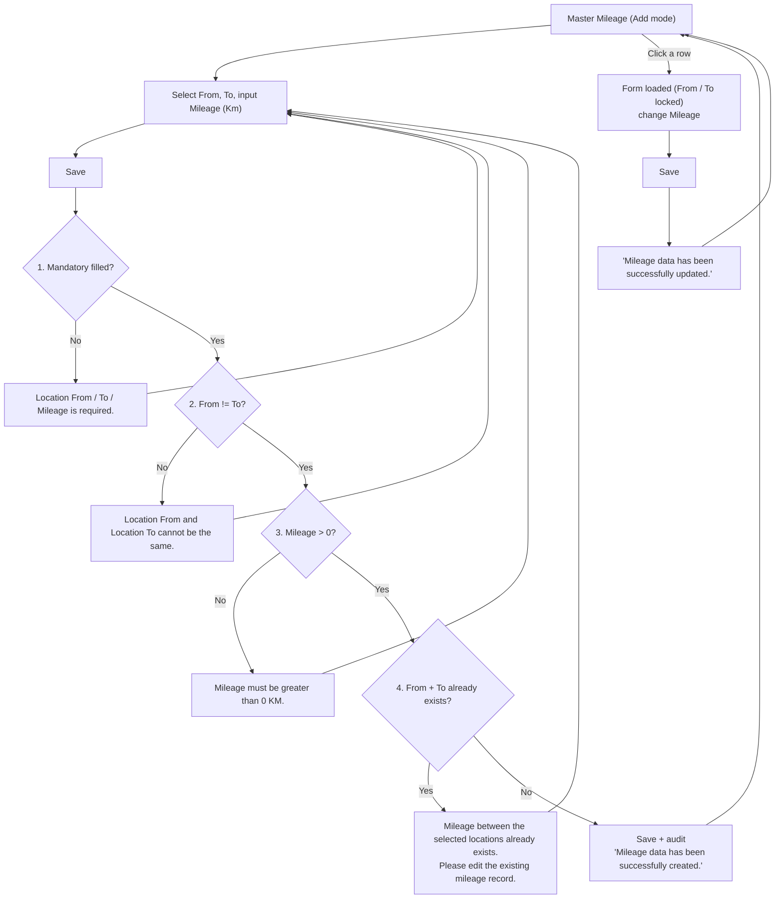
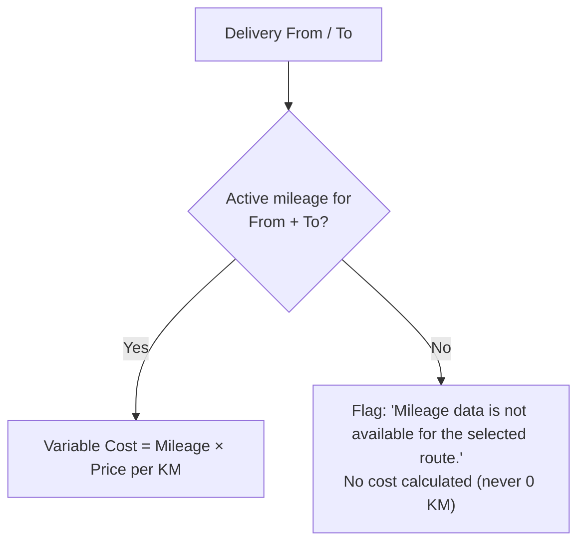

# ELIPS Master Mileage: Process and Validation Rules

Master Mileage maintains the distance (KM) between two Master Location records. TC-PBR uses it to calculate the variable cost of each delivery:

**Variable Cost = Mileage (KM) × Price per KM**, e.g. SNT → KRW 65 KM × IDR 5,000 = **IDR 325,000**.

Mock-up: `master.html#mileage` (Master > Mileage). Rules live in [`master-mileage.js`](../master-mileage.js).
The screen follows the existing **Route Mileage** screen exactly.

---

## 1. Screen (Route Mileage)

| Section | Content |
|---|---|
| Header | Title "Route Mileage", breadcrumb "Master - Route Mileage" |
| Form | From ("Select From Location"), To ("Select To Location"): dropdowns from Master Location (active only, searchable by code / name); Mileage (Km). Save / Cancel |
| Route Mileage List | Search, Table View (show / hide columns), Export .xls, pagination |
| Columns | From Code, From, To Code, To, Mileage (Km), Created Date, Change Date (Created By and Changed By available via Table View) |
| Edit | Click a row: the route is loaded into the form (From / To locked), change Mileage, Save. Cancel clears the form |
| States | Save disabled while saving ("Saving..."); empty list shows "No mileage data found." / "No mileage data found for the selected criteria." |

---

## 2. Flow

### TC-PBR usage

---

## 3. Validation and business rules

| ID | Rule | Message |
|---|---|---|
| MM-01 | Location From, Location To, Mileage mandatory | Location From is required. / Location To is required. / Mileage is required. |
| MM-02 | Location From ≠ Location To | Location From and Location To cannot be the same. |
| MM-03 | Mileage numeric and > 0 (0, negative, non-numeric rejected); up to 2 decimals | Mileage must be greater than 0 KM. |
| MM-04 | Unique combination Location From + Location To (Active or Inactive) | Mileage between the selected locations already exists. Please edit the existing mileage record. |
| MM-05 | Route is directional: SNT → KRW and KRW → SNT are separate records | - |
| MM-06 | From / To must be registered in Master Location; no free text. New records accept ACTIVE locations only | Location X is not an active location in Master Location. |
| MM-07 | Edit (click a row) changes Mileage only; From / To are locked | Mileage data has been successfully updated. |
| MM-08 | No physical delete. Active / Inactive status and Deactivate (with confirmation) are supported by the rules engine but **not shown on the reference screen** (open question 7) | Are you sure you want to deactivate this mileage data? |
| MM-09 | (When status is shown) Active only when both locations are ACTIVE in Master Location | Cannot activate: location X is inactive in Master Location. |
| MM-10 | Inactive records stay for history / audit and are not used for new TC-PBR calculations | - |
| MM-11 | Audit: Created By / Date on insert; Updated By / Date on every change; Created By / Date never overwritten; concurrency check on edit | Data has been changed by another user ... |
| MM-12 | TC-PBR lookup uses the Active record for From + To; missing route is flagged, never 0 KM | Mileage data is not available for the selected route. |
| MM-13 | Save button disabled while saving to prevent double submission | - |

---

## 4. Assumptions / open questions

1. **Duplicate check includes Inactive records**, so an old route is edited instead of re-created.
2. **Edit locks From / To**; to change a route, create a new one.
3. **Decimals:** up to 2 decimals accepted (e.g. 7.5 KM). Is a maximum mileage needed?
4. **Price per KM** comes from Master Price (not built yet).
5. **Location codes** follow the reference (DPCMR, DPSTR, PRTGP, WHCKR, KRWP1, CYSTR) and are registered in Master Location.
6. **Edit trigger:** the reference has no Action column, so the mock-up edits by clicking a row. Is there an Edit button in the real screen?
7. **Deactivate / Status:** the requirement asks for Active / Inactive and Deactivate, but the reference screen has no Status column or Deactivate action. Should they be added (e.g. via Table View column and row action)?
