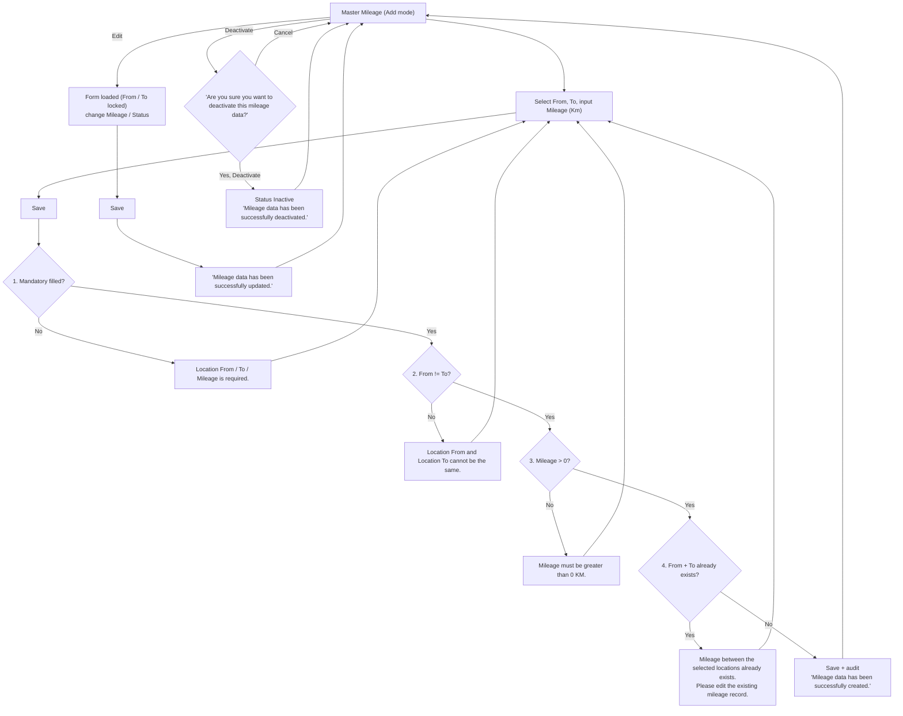
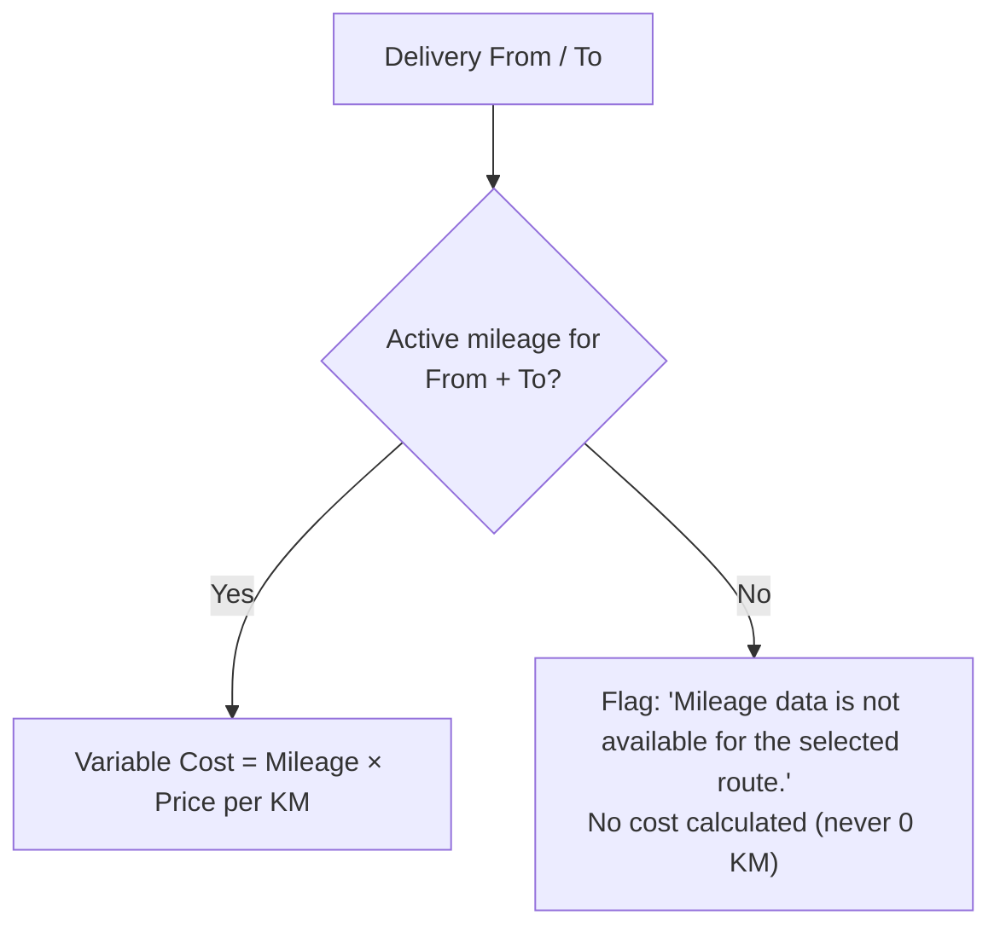

# ELIPS Master Mileage: Process and Validation Rules

Master Mileage maintains the distance (KM) between two Master Location records. TC-PBR uses it to calculate the variable cost of each delivery:

**Variable Cost = Mileage (KM) × Price per KM**, e.g. SNT → KRW 65 KM × IDR 5,000 = **IDR 325,000**.

Mock-up: `master.html#mileage` (Master > Mileage). Rules live in [`master-mileage.js`](../master-mileage.js).
Layout follows the existing *Route Mileage* screen: inline form (From, To, Mileage (Km), Status) with Save / Cancel on top, then the Route Mileage List with Search, Table View and Export .xls.

---

## 1. Screen

| Section | Content |
|---|---|
| Form | From\*, To\* (searchable by code or name, active Master Location only), Mileage (Km)\* with KM suffix, Status toggle (default Active). Save / Cancel. "+ Add Mileage" resets the form to Add mode |
| Filter | Location From, Location To (searchable, default All), Status (All / Active / Inactive), Search, Reset |
| Route Mileage List | Quick Search, Table View (show/hide columns), Export .xls, sorting, pagination, total records |
| Columns | No., From Code, From, To Code, To, Mileage (Km), Status, Created Date, Created By (hidden by default), Change Date, Updated By, Action (Edit, Activate / Deactivate) |
| States | Loading indicator on search, Save disabled while saving ("Saving..."), empty state "No mileage data found." + Add Mileage, no result "No mileage data found for the selected criteria." + Reset Filter |

---

## 2. Flow

### TC-PBR usage

---

## 3. Validation and business rules

| ID | Rule | Message |
|---|---|---|
| MM-01 | Location From, Location To, Mileage mandatory | Location From is required. / Location To is required. / Mileage is required. |
| MM-02 | Location From ≠ Location To | Location From and Location To cannot be the same. |
| MM-03 | Mileage numeric and > 0 (0, negative, non-numeric rejected); up to 2 decimals | Mileage must be greater than 0 KM. |
| MM-04 | Unique combination Location From + Location To (Active or Inactive) | Mileage between the selected locations already exists. Please edit the existing mileage record. |
| MM-05 | Route is directional: SNT → KRW and KRW → SNT are separate records | - |
| MM-06 | From / To must be registered in Master Location; no free text. New records accept ACTIVE locations only | Location X is not an active location in Master Location. |
| MM-07 | Edit changes Mileage and Status only; From / To are locked | Mileage data has been successfully updated. |
| MM-08 | No physical delete; Deactivate asks confirmation | Are you sure you want to deactivate this mileage data? / Mileage data has been successfully deactivated. |
| MM-09 | Activate / set Active only when both locations are ACTIVE in Master Location | Cannot activate: location X is inactive in Master Location. |
| MM-10 | Inactive records stay for history / audit and are not used for new TC-PBR calculations | - |
| MM-11 | Audit: Created By / Date on insert; Updated By / Date on every change; Created By / Date never overwritten; concurrency check on edit | Data has been changed by another user ... |
| MM-12 | TC-PBR lookup uses the Active record for From + To; missing route is flagged, never 0 KM | Mileage data is not available for the selected route. |
| MM-13 | Save button disabled while saving to prevent double submission | - |

---

## 4. Assumptions / open questions

1. **Screen title:** "Master Mileage" (spec) vs "Route Mileage" (existing screen). The mock-up uses Master Mileage with the Route Mileage List.
2. **Duplicate check includes Inactive records**, so an old route is re-activated / edited instead of re-created.
3. **Edit locks From / To**; changing a route means deactivating it and creating a new one.
4. **Decimals:** up to 2 decimals accepted (e.g. 27.5 KM). Is a maximum mileage needed?
5. **Price per KM** comes from Master Price (not built yet); the simulation on the screen uses a typed price.
6. **Location codes in the reference** (DPCMR, CYSTR, KRWP1 ...) differ from the Master Location sample codes; the mock-up uses Master Location codes.
