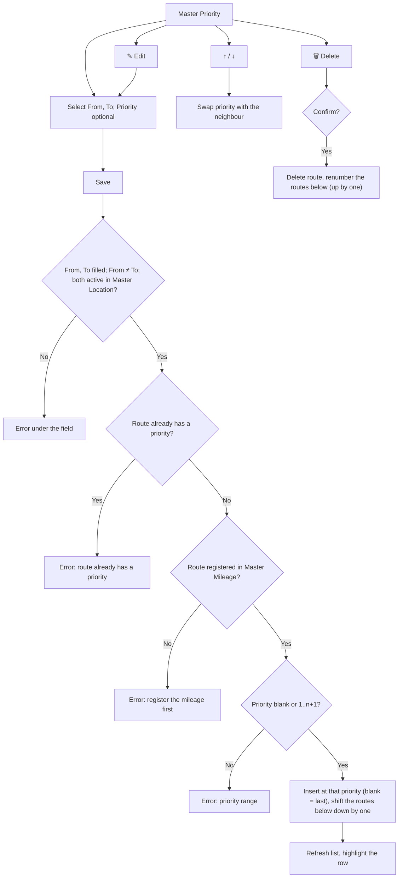

# ELIPS Master Priority: Process and Validation Rules

Master Priority keeps the **priority order of routes (From → To)**. It is the reference used to decide which route comes first in **Trucking Payment by Resource**. Priority **1** is the highest; the numbers are always 1..n without gaps.

Mock-up: `master.html#priority` (Master > Priority). Rules live in [`master-priority.js`](../master-priority.js).
The screen follows the existing **Master Priority** screen.

---

## 1. Screen (Master Priority)

| Section | Content |
|---|---|
| Header | Title "Master Priority", breadcrumb "Master - Master Priority" |
| Form bar | From ("Select From"), To ("Select To"): searchable dropdowns from Master Location (active only); Priority ("Enter Priority", optional). Cancel / Save. Search, Kolom (show / hide columns), Export XLS on the same bar |
| List | Sorted by Priority. Columns: Action (↑ ↓ ✎ 🗑), From, From Description, To, To Description, Trip, Mileage, **Priority** (highlighted), Created DT, Created By, Changed DT, Changed By |
| Footer | "Menampilkan x - y dari z data", pager ‹ 1 › (20 rows per page) |

| Column | Source |
|---|---|
| From / To Description | Location name in Master Location |
| Trip | From code + To code (e.g. `DPCMRCYKRW`) |
| Mileage | Active mileage of the route in Master Mileage |
| Dates | `DD/MM/YYYY HH:MI` |

---

## 2. Flow

---

## 3. Rules

| ID | Rule |
|---|---|
| PR-01 | From and To are required, must be different and must be **ACTIVE** in Master Location |
| PR-02 | One priority per route: From + To is unique (directional, so A → B and B → A are separate routes) |
| PR-03 | The route must be registered (Active) in **Master Mileage**; the Mileage column is taken from there |
| PR-04 | Priority is a whole number. Add: 1..n+1, blank = last. Edit: 1..n, blank = keep the current priority |
| PR-05 | Insert / change priority to *p*: the route takes *p*, the routes from *p* onward shift by one. Numbers stay 1..n without gaps |
| PR-06 | ↑ swaps with the route above, ↓ with the route below. ↑ disabled on priority 1, ↓ disabled on the last priority |
| PR-07 | Delete asks for confirmation; the routes below move up by one |
| PR-08 | Edit loads From, To and Priority into the form (row highlighted). Concurrency check on save (version) |
| PR-09 | Audit: Created DT / By on insert; Changed DT / By on every change, including both rows swapped by ↑ / ↓ |
| PR-10 | Search filters on all columns; Export XLS exports all filtered rows with the visible columns |
| PR-11 | Trucking Payment by Resource sorts candidate routes by priority (lowest number first); routes without a priority come last |

### Messages

| Case | Message |
|---|---|
| From / To blank | From is required. / To is required. |
| Same location | From and To cannot be the same. |
| Location not active | Location {code} is not an active location in Master Location. |
| Duplicate | Route {From} -> {To} already has a priority. Please edit the existing record. |
| No mileage | Route {From} -> {To} is not registered in Master Mileage. Please register the mileage first. |
| Priority range | Priority must be a whole number between 1 and {max}. |
| Concurrency | Error in Update because of concurrency check. |
| Success | Route {From} -> {To} has been added / updated with priority {p}. · moved to priority {p}. · has been deleted. Priorities have been renumbered. |

---

## 4. Open questions

1. **Use in Trucking Payment by Resource:** what exactly does the priority decide? For example, which route a truck (resource) is paid for when it serves several routes, or the order in which routes are allocated or paid.
2. **Location names:** this screen shows PRTGP = "PRIMA TIRTA GEMILANG" and CYSTR = "CY INTERNAL STAR", but the Route Mileage screen shows "PORT TANJUNG PRIOK" and "CY INTERNAL SUNTER". The mock-up takes the names from Master Location, which uses the Route Mileage names. Which names are correct?
3. **Mileage required?** Must a route exist in Master Mileage before it gets a priority (assumed yes, since the Mileage column is shown)?
4. **Delete:** physical delete (assumed) or inactive flag with history?
5. **Scope:** one priority list for all, or per trucking company / per period?
