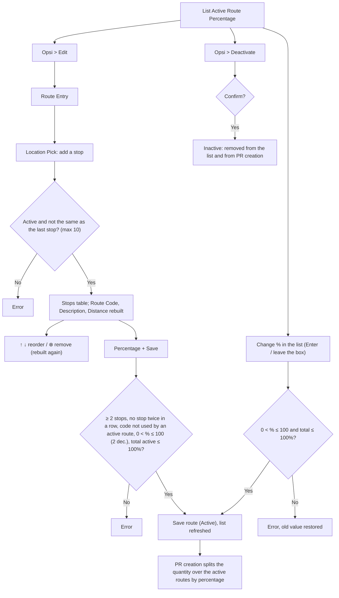

# ELIPS Master Route Percentage: Process and Validation Rules

Master Route Percentage decides **which routes are used in PR creation** and **how big a share each route gets**.

- A route is a sequence of **Master Location** stops: START, optional VIA stops, then END.
- The system builds the **Route Code** and **Route Description** from the stops and **calculates the distance** of the route.

Mock-up: `master.html#route-percentage` (Master > Route Percentage). Rules live in [`master-route-percentage.js`](../master-route-percentage.js). UISS: [`docs/uiss/UISS_Screen_Master_Route_Percentage.xlsx`](uiss/UISS_Screen_Master_Route_Percentage.xlsx). The screen follows the existing **Route Entry / List Active Route Percentage** screen.

---

## 1. Screen

| Section | Content |
|---|---|
| Route Entry | **Route Code*** (read only, codes joined by `_`, e.g. `A1_A2`); **Location Pick** (searchable, active Master Location, × clears the box); **Route Description*** (read only, names joined by ` - `) |
| Stops table | Move (↑ ↓), Delete (⊗), Code, Location Name, Descr (**START** for the first stop, **END** for the last, **VIA** in between) |
| Below the stops | **Percentage*** and **Distance (Km)** (read only, calculated). Save / Clear |
| List Active Route Percentage | Search, Kolom. Columns: Options (Opsi ▾: Edit, Deactivate), Route Code, Description, Distance (Km), **Percentage (%)** (editable in the list; the header sorts it), plus Created By and Changed Dt via Kolom |
| Footer | "Menampilkan x - y dari z data", **Total Percentage** (green at 100%, otherwise shows the unassigned %), pager |

Distance (Km) is not on the reference screen. It was added because the system has to calculate the distance (see open question 1).

---

## 2. Flow

---

## 3. Rules

| ID | Rule |
|---|---|
| RP-01 | A route is built from Master Location stops picked in order. Only **ACTIVE** locations; the same location cannot follow itself; at least 2 and at most 10 stops (max TBD) |
| RP-02 | **Route Code** = stop codes joined by `_`; **Route Description** = location names joined by ` - `. Both are generated and read only |
| RP-03 | Route Code is unique among **active** routes (the code of an inactive route may be used again) |
| RP-04 | **Distance** = sum of the legs. A leg uses the Active **Master Mileage** of From → To; if none, a straight-line estimate from the Master Location coordinates, marked *est.* |
| RP-05 | **Percentage** required, > 0 and ≤ 100, max 2 decimals |
| RP-06 | **Total Percentage** of active routes must not exceed **100%**. Checked on Save and on a change in the list |
| RP-07 | Percentage can be changed directly in the list (saved on Enter or leaving the box). An invalid value is rejected and the old value comes back |
| RP-08 | Opsi > Edit loads the route into Route Entry. Stops and percentage can be changed; version check on save |
| RP-09 | Opsi > Deactivate (with confirmation): the route becomes Inactive, leaves the list and frees its percentage. It is not physically deleted |
| RP-10 | **PR creation** uses only active routes with percentage > 0. The PR quantity is split in proportion to the percentages (largest remainder; ties by higher percentage, then code) |
| RP-11 | List default order: newest first. The Percentage header toggles descending / ascending / default |
| RP-12 | Audit: Created By / Dt on create; Changed By / Dt on every change |

### Messages

| Case | Message |
|---|---|
| Stops | Location {code} is not an active location in Master Location. · Location {code} is already the last stop of the route. · A route can have at most 10 locations. · Route must have at least 2 locations (start and end). · Location {code} cannot follow itself. Please change the order. |
| Duplicate | Route {code} already exists. Please edit the existing route. |
| Percentage | Percentage is required. · Percentage must be a number greater than 0 and at most 100, with max 2 decimals. · Total percentage of active routes would be {t}%. The maximum is 100%. |
| Concurrency | Error in Update because of concurrency check. |
| Success | Route {code} has been successfully created / updated. · Route {code} has been deactivated and is no longer used in PR creation. |

---

## 4. Open questions

1. **Distance calculation:** should distance come from Master Mileage (per leg), from a map service (e.g. Google Maps road distance), or both? The mock-up uses Master Mileage and falls back to a straight-line estimate. Where must the distance be shown, and is it used in PR creation (e.g. for the Mileage price)?
2. **What does the percentage split?** For example, the daily QTY of PR creation per trucking company, or the total trips of the month. Must the total be exactly 100% before PR creation can run?
3. **"(Full)" in the description:** the reference shows "Depo Sunter - (Full) CY TMMIN Sunter 1 - …". Does a stop carry a container status (Full / Empty)? If yes, where is it chosen?
4. **Per trucking company / period:** is the percentage one global list, or per trucking company / per month?
5. **Same location twice:** may a route visit the same location again later (e.g. A1_A2_A1)? The mock-up allows it, but not twice in a row.
6. **Location names:** A2 was renamed "PORT AREA PATIMBAN" (was "PATIMBAN PORT"). A1 (PORT AREA PRIOK), X1 and D3 were added to Master Location as sample data.
