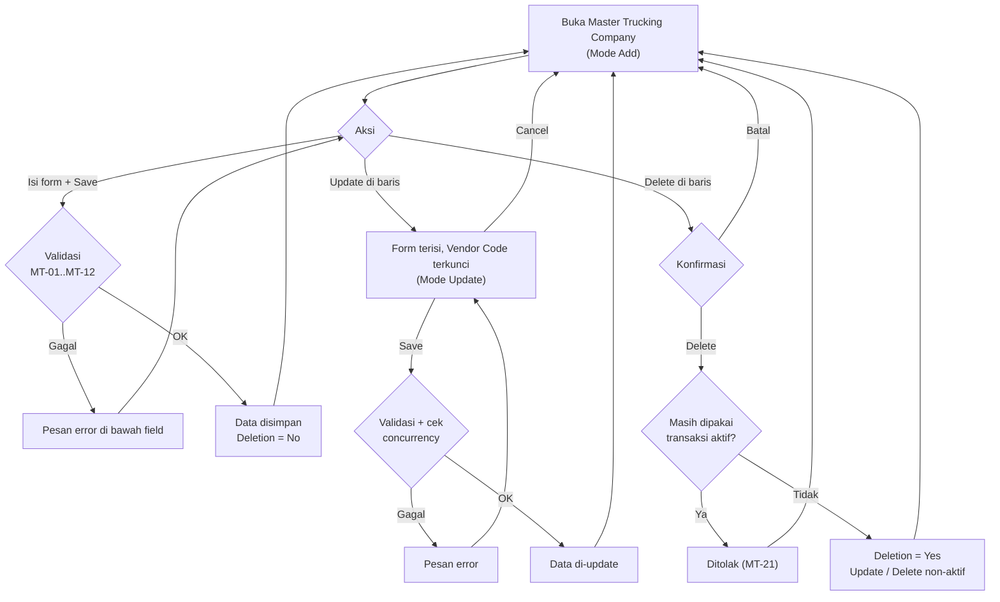

# ELIPS Master Trucking Company: Proses dan Aturan Validasi

Master Trucking Company dipakai untuk mendaftarkan dan memelihara trucking company sebagai **vendor tc-PBR**: tambah, ubah, hapus, cari, dan export.

Mock-up: `master.html#trucking-company`. Logika validasi ada di [`master-trucking.js`](../master-trucking.js).

Menu Master berisi 8 submenu: **Trucking Company**, Mileage, Price, Location Code, Priority, Renban, KPI, Route Percentage. Saat ini baru Trucking Company yang dibuat; yang lain masih placeholder.

---

## 1. Layar

| Bagian | Isi |
|---|---|
| Form | Vendor Name\*, Vendor Code\*, SAP Vendor Code\*, Service Type, NPWP\*, Contact Name, E-Mail, Phone, Mobile Phone, Address. Tombol Save dan Cancel, plus keterangan mode (Add / Update) |
| Trucking Company List | Search, Table View (show/hide kolom), Export .xls, tabel dengan sort, paging 10/25/50 |
| Kolom tabel | Vendor Name, Vendor Code, SAP Vendor Code, Service Type, NPWP, Contact Name, E-Mail, Phone, Mobile Phone, Address, Deletion (Yes/No), Action (Delete, Update). Kolom tambahan lewat Table View: Created By, Created Date, Updated By, Updated Date |

\* wajib diisi

---

## 2. Alur

---

## 3. Aturan validasi

| ID | Field / aksi | Aturan | Pesan |
|---|---|---|---|
| MT-01 | Vendor Name, Vendor Code, SAP Vendor Code, NPWP | Wajib diisi | `<Field>` wajib diisi |
| MT-02 | Vendor Name | Maksimal 100 karakter; spasi ganda dirapikan dan disimpan huruf besar | Maksimal 100 karakter |
| MT-03 | Vendor Code | 3 karakter huruf/angka, otomatis huruf besar (contoh DNX) | Vendor Code harus 3 karakter huruf / angka |
| MT-04 | Vendor Code | Unik di antara vendor yang belum dihapus | Vendor Code X sudah dipakai |
| MT-05 | SAP Vendor Code | 10 digit angka (contoh 4000006763), unik di antara vendor yang belum dihapus | SAP Vendor Code harus 10 digit angka / sudah dipakai |
| MT-06 | Service Type | Pilihan dari daftar (saat ini hanya MRO, default MRO) | Service Type tidak valid |
| MT-07 | NPWP | 16 digit, otomatis diformat `999.999.999.9-999.999`, unik di antara vendor yang belum dihapus | NPWP harus 16 digit / sudah dipakai vendor lain |
| MT-08 | E-Mail | Opsional; jika diisi harus format email yang valid | Format E-Mail tidak valid |
| MT-09 | Phone | Opsional; angka, spasi, `+`, `-`, `( )`, 6-20 karakter | Phone hanya angka ... |
| MT-10 | Mobile Phone | Opsional; diawali `08` / `+628` / `628`, 10-15 digit | Mobile Phone harus diawali 08 / +628 |
| MT-11 | Contact Name, Address | Opsional; maksimal 100 / 300 karakter | Maksimal n karakter |
| MT-12 | Update | Vendor Code tidak bisa diubah; vendor yang sudah dihapus tidak bisa di-update | Vendor Code tidak bisa diubah / Vendor X sudah dihapus |
| MT-13 | Update | Concurrency: data tidak boleh berubah sejak dimuat ke form | Data sudah diubah user lain, silakan Cancel lalu Update ulang |
| MT-20 | Delete | Wajib konfirmasi. Penghapusan bersifat logis: Deletion = Yes, data tetap tampil di list, tombol Update dan Delete menjadi non-aktif | - |
| MT-21 | Delete | Ditolak jika trucking company masih dipakai transaksi yang belum selesai (contoh: Daily Order aktif, PR/PO Monthly yang masih Pending) | Vendor X masih dipakai di ..., tidak bisa dihapus |
| MT-22 | Semua aksi | Created By/Date dan Updated By/Date diisi otomatis dengan user login dan waktu server | - |
| MT-30 | Search | Mencari di semua kolom yang ada di tabel | - |
| MT-31 | Export .xls | Mengekspor semua baris hasil pencarian (bukan hanya halaman aktif), dengan kolom sesuai Table View | - |

---

## 4. Asumsi yang perlu dikonfirmasi

1. **Pilihan Service Type** selain MRO belum diketahui; saat ini hanya MRO.
2. **Format Vendor Code** diasumsikan 3 karakter, mengikuti contoh data (ALS, DNX, PNJ). **SAP Vendor Code** diasumsikan 10 digit angka. Data lama "PNJ" dengan SAP Vendor Code "PNJ" tidak memenuhi aturan ini.
3. **NPWP** diasumsikan 16 digit dengan format `999.999.999.9-999.999`, sesuai contoh di desain. Apakah NPWP 15 digit lama masih perlu diterima?
4. **Keunikan** Vendor Code, SAP Vendor Code, dan NPWP hanya dicek terhadap vendor yang belum dihapus, sehingga kode milik vendor yang sudah dihapus boleh dipakai lagi (contoh: PNJ lama dihapus, PT. Puninar Jaya memakai PNJ).
5. **Transaksi yang menghalangi Delete** (MT-21) perlu dipastikan: Daily Order aktif, PR/PO Monthly yang belum selesai, atau yang lain?
6. **Restore** (mengaktifkan kembali vendor yang sudah dihapus) tidak ada di desain, jadi belum dibuat.
7. **Hak akses**: siapa yang boleh menambah, mengubah, dan menghapus (diasumsikan IP Admin)?
8. **Hubungan dengan data lain**: Vendor Code diasumsikan sama dengan Trucking Code di menu Daily dan Monthly (contoh DNX, PBM).
