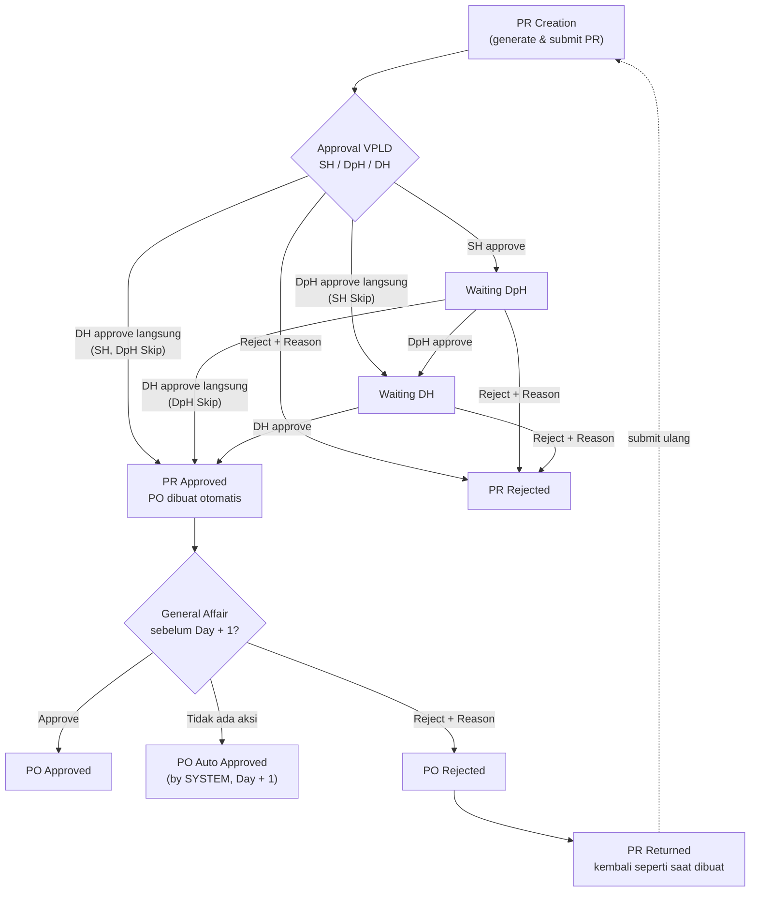
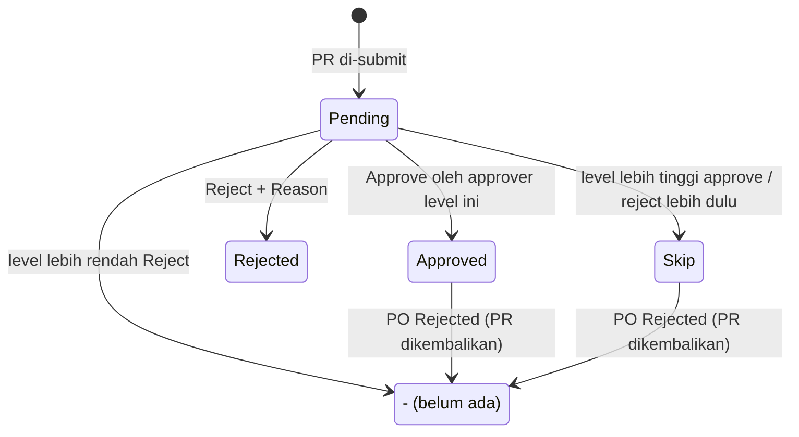
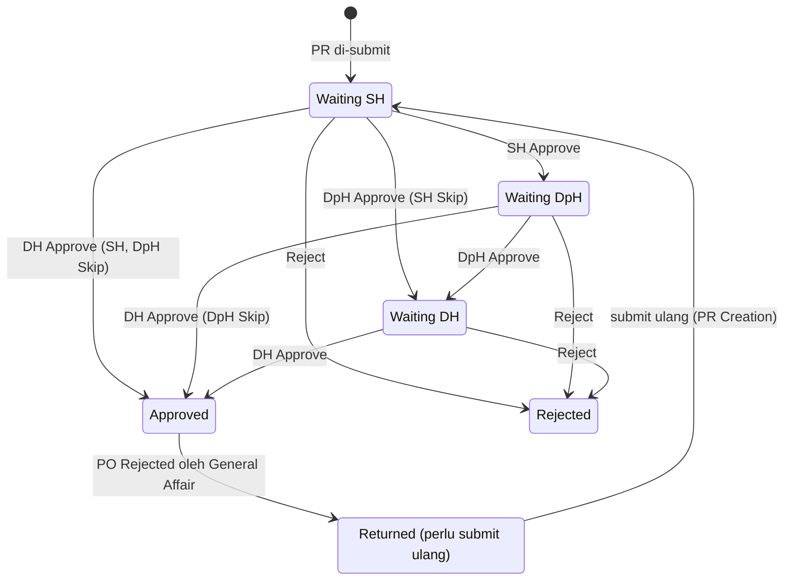
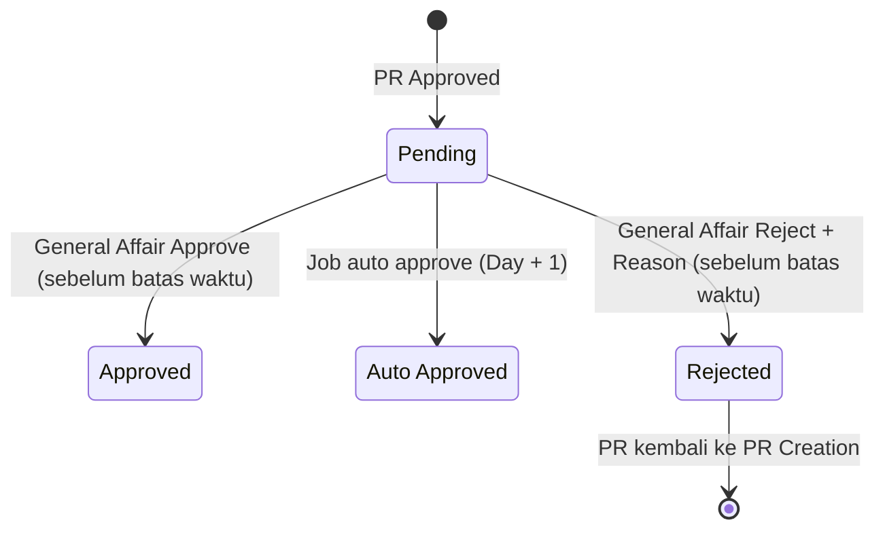

# ELIPS Monthly PR / PO: Proses, Status, dan Aturan Validasi

Dokumen ini menjabarkan alur Monthly PR (Purchase Request) dan PO (Purchase Order) untuk menu **PR Approval, PO Approval, PR Inquiry, dan PO Inquiry**. PR Creation belum termasuk.

Mock-up: `monthly.html`. Logika ada di [`monthly-workflow.js`](../monthly-workflow.js), jadi perilaku mock-up dan dokumen ini selalu sama.

---

## 1. Menu dan template

Keempat menu memakai template yang sama dengan **PR Inquiry**:
- **Kriteria pencarian:** Number, Prod. Month From/To, Status, tombol Search dan Clear.
- **Status Legend.**
- **Tabel:** Search, Kolom (show/hide), sort, dan paging.
- **Modal detail:** muncul saat nomor PR/PO (hyperlink) diklik. Isinya:
  - detail route: Route, Route Percentage, Qty 20/40/Total, Price 20/40/Total
  - total: Sharing Percentage, Total QTY, dan Total Price
  - Riwayat Approval
- **Tombol download** di sebelah nomor PR/PO: detail route dalam format CSV.

| Menu | Isi | Aksi |
|---|---|---|
| PR Approval | PR yang level login user masih Pending (default filter "Perlu approval saya") | Approve / Reject (bisa beberapa PR sekaligus) |
| PO Approval | PO berstatus Pending (default filter) | General Affair: Approve / Reject manual. IP Admin: jalankan Auto Approve |
| PR Inquiry | Semua PR (default Prod. Month From = bulan berjalan) | Lihat detail, download |
| PO Inquiry | Semua PO (default Prod. Month From = bulan berjalan) | Lihat detail, download |

Kolom PR: Production Month, PR Number, Status SH/DpH/DH, Current PIC, PR date, Trucking Code/Name, Order Sharing (Percentage, Qty, Total Price), Released By SH/DpH/DH (user + tanggal).

Kolom PO: Production Month, PO Number, PR Number, PO Status, Auto Approve At (dengan sisa waktu), Approved By, PO date, Trucking Code/Name, Order Sharing.

**Production Month** ditulis `MM/YYYY-n`. Angka `n` adalah urutan pembuatan PR untuk production month yang sama; contohnya `10/2026-2` berarti PR kedua yang dibuat untuk Oktober 2026.

---

## 2. Aktor dan hak akses

| Aktor | Data yang dilihat | Aksi |
|---|---|---|
| IP Admin (pembuat PR) | Semua PR / PO | PR Creation (belum di mock-up); jalankan Auto Approve PO secara manual |
| SH VPLD | Semua PR / PO | Approve / Reject PR di level SH |
| DpH VPLD | Semua PR / PO | Approve / Reject PR di level DpH (level SH yang masih Pending menjadi Skip) |
| DH VPLD | Semua PR / PO | Approve / Reject PR di level DH (level SH dan DpH yang masih Pending menjadi Skip); approve DH membuat PO |
| General Affair Department | Semua PR / PO | Approve / Reject PO manual sebelum batas waktu |
| Supplier (trucking) | Hanya PR / PO milik sendiri | Hanya lihat |
| System (job terjadwal) | Semua PO | Auto Approve PO pada Day + 1 |

**Current PIC** selalu user yang men-generate PR.

---

## 3. Alur proses

---

## 4. State transition

### 4.1 Status approval per level (SH, DpH, DH)

### 4.2 Status PR (keseluruhan)

### 4.3 Status PO

**Batas waktu PO** = waktu PO dibuat (PR Approved) + 1 hari (Day + 1, parameter System Master).

---

## 5. Aturan validasi

| ID | Aturan | Pesan |
|---|---|---|
| MV-01 | Prod. Month From ≤ Prod. Month To | Prod. Month From tidak boleh lebih besar dari Prod. Month To |
| MV-02 | Approve / Reject minimal 1 dokumen dipilih; checkbox hanya aktif untuk dokumen yang boleh diproses user | Pilih minimal satu PR / PO |
| MV-10 | Hanya approver VPLD (SH, DpH, DH) yang dapat approve / reject PR | Hanya approver VPLD ... |
| MV-11 | Approver boleh memproses PR selama level-nya masih Pending, walaupun level di bawahnya belum approve | Level X untuk PR ... sudah Approved / Skip |
| MV-12 | Saat level lebih tinggi approve / reject, semua level di bawahnya yang masih Pending menjadi **Skip** (dicatat di riwayat) | - |
| MV-13 | PR yang sudah Approved, Rejected, atau Returned tidak bisa diproses lagi | PR ... sudah Approved / Rejected; PR ... dikembalikan ke PR Creation |
| MV-14 | Reject PR wajib Reason minimal 10 karakter; level di atasnya menjadi "-" | Reason wajib diisi / Reason minimal 10 karakter |
| MV-15 | Approve DH membuat PO otomatis dengan status Pending dan batas waktu Day + 1 | - |
| MV-20 | Approve / reject PO manual hanya oleh General Affair Department | Approve / reject PO manual hanya oleh General Affair Department |
| MV-21 | PO hanya bisa diproses saat Pending dan sebelum batas waktu | PO ... sudah X / Batas waktu PO ... sudah lewat |
| MV-22 | Reject PO wajib Reason minimal 10 karakter | Reason wajib diisi / Reason minimal 10 karakter |
| MV-23 | PO Rejected mengembalikan PR ke kondisi saat dibuat: status Returned, semua level approval dikosongkan ("-"), dan PR perlu di-submit ulang dari PR Creation | - |
| MV-24 | Job terjadwal mengubah setiap PO Pending yang melewati batas waktu menjadi Auto Approved (Approved By = SYSTEM) | - |
| MV-30 | Supplier hanya melihat PR / PO milik sendiri (daftar, detail, download) | Anda tidak memiliki akses ke dokumen ini |
| MV-31 | Setiap approve / reject / skip / auto approve / pengembalian PR dicatat di Riwayat Approval: waktu, user, role, aksi, status sebelum/sesudah, reason | - |

---

## 6. Keputusan yang sudah dikonfirmasi

| Topik | Keputusan |
|---|---|
| Approve PO | Otomatis oleh sistem; manual oleh General Affair Department |
| Batas waktu auto approve | Day + 1 |
| Skip | Level lebih tinggi boleh approve langsung; level di bawahnya menjadi Skip |
| Current PIC | User yang men-generate PR |
| "-n" pada Production Month | Urutan pembuatan PR untuk production month yang sama |
| Format PO Number | `PO` + PR Number |
| PO Rejected | PR kembali seperti saat dibuat dan perlu submit ulang |

## 7. Asumsi yang masih perlu dikonfirmasi

1. **Day + 1** dihitung 24 jam sejak PO dibuat. Belum dipastikan apakah maksudnya pukul 00:00 hari berikutnya.
2. **Nama parameter System Master** dan seberapa sering job auto approve berjalan. Mock-up menjalankan job setiap 15 detik dan saat IP Admin menekan tombol.
3. **Reject oleh level lebih tinggi** saat level di bawahnya masih Pending: level di bawahnya juga dibuat Skip, sama seperti approve.
4. **PR yang di-reject oleh approver** (bukan karena PO) saya anggap direvisi dengan membuat PR baru, misalnya `10/2026-2`. Perlu konfirmasi apakah perlakuannya sama dengan PO Rejected (submit ulang dengan PR yang sama).
5. **Route Percentage** = Qty route ÷ Total Qty PR (dibulatkan). Sharing Percentage diambil dari master sharing per trucking.
