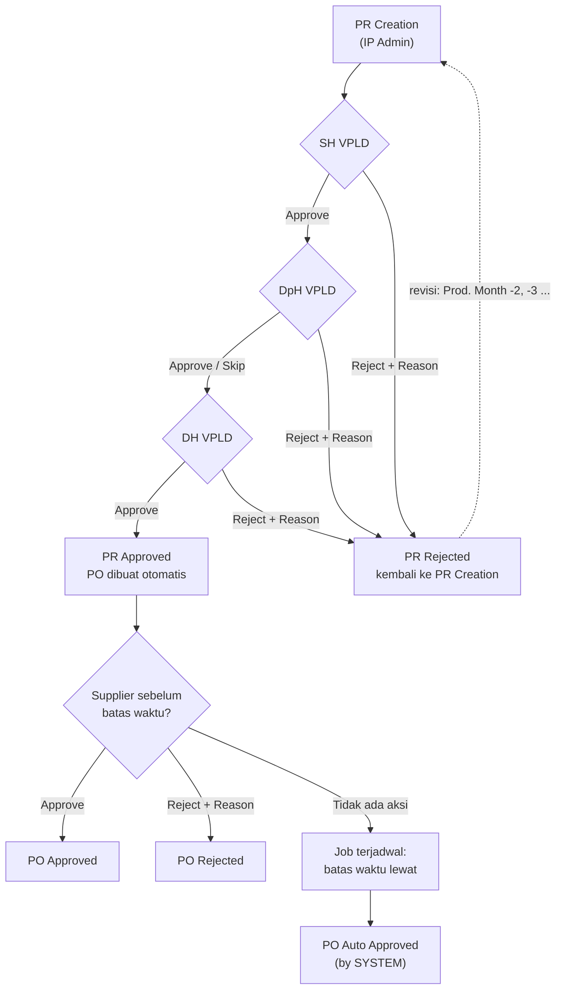
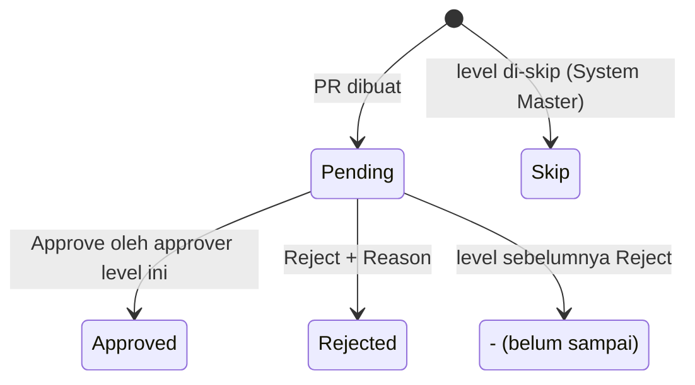
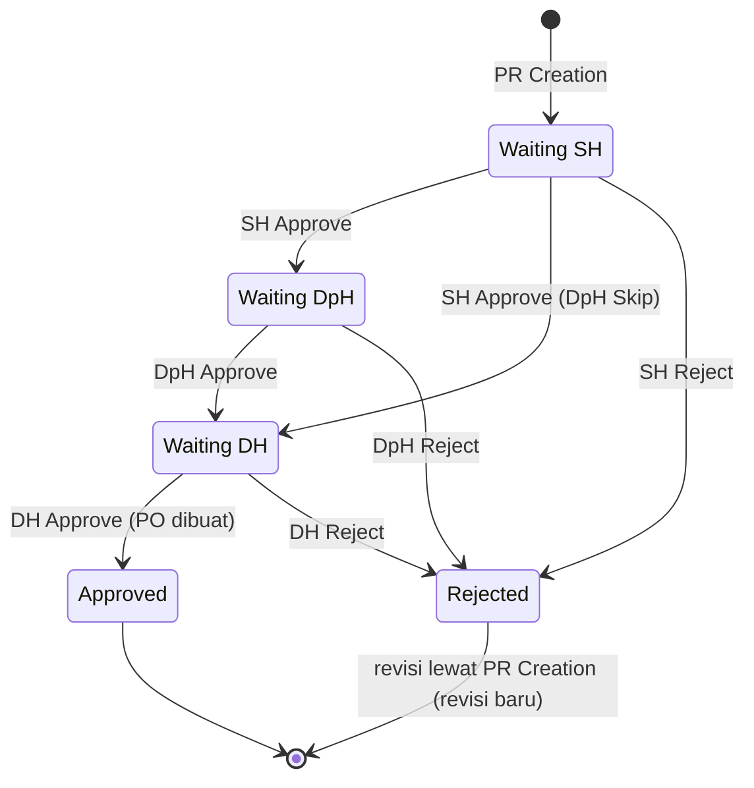
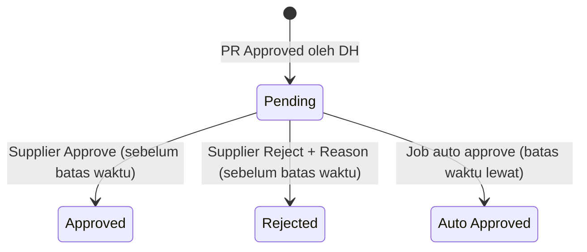

# ELIPS Monthly PR / PO: Proses, Status, dan Aturan Validasi

Dokumen ini menjabarkan alur Monthly PR (Purchase Request) dan PO (Purchase Order) untuk menu **PR Approval, PO Approval, PR Inquiry, dan PO Inquiry**. PR Creation belum termasuk.

Mock-up: `monthly.html`. Logika ada di [`monthly-workflow.js`](../monthly-workflow.js), jadi perilaku mock-up dan dokumen ini selalu sama.

---

## 1. Menu dan template

Keempat menu memakai template yang sama dengan **PR Inquiry**:
- **Kriteria pencarian:** Number, Prod. Month From/To, Status, tombol Search dan Clear.
- **Status Legend.**
- **Tabel:** Search, Kolom (show/hide), sort, dan paging.
- **Modal detail:** muncul saat nomor PR/PO (hyperlink) diklik. Isinya:
  - detail route: Route, Route Percentage, Qty 20/40/Total, Price 20/40/Total
  - total: Sharing Percentage, Total QTY, dan Total Price
  - Riwayat Approval
- **Tombol download** di sebelah nomor PR/PO: detail route dalam format CSV.

| Menu | Isi | Aksi |
|---|---|---|
| PR Approval | PR yang menunggu approval level login user (default filter `Waiting <level>`) | Approve / Reject (bisa beberapa PR sekaligus) |
| PO Approval | PO berstatus Pending (default filter) | Supplier: Approve / Reject. IP Admin: jalankan Auto Approve |
| PR Inquiry | Semua PR (default Prod. Month From = bulan berjalan) | Lihat detail, download |
| PO Inquiry | Semua PO (default Prod. Month From = bulan berjalan) | Lihat detail, download |

Kolom PR: Production Month, PR Number, Status SH/DpH/DH, Current PIC, PR date, Trucking Code/Name, Order Sharing (Percentage, Qty, Total Price), Released By SH/DpH/DH (user + tanggal).

Kolom PO: Production Month, PO Number, PR Number, PO Status, Auto Approve At (dengan sisa waktu), Approved By, PO date, Trucking Code/Name, Order Sharing.

---

## 2. Aktor dan hak akses

| Aktor | Data yang dilihat | Aksi |
|---|---|---|
| IP Admin | Semua PR / PO | Lihat; jalankan Auto Approve PO secara manual |
| SH VPLD | Semua PR / PO | Approve / Reject PR di level SH |
| DpH VPLD | Semua PR / PO | Approve / Reject PR di level DpH |
| DH VPLD | Semua PR / PO | Approve / Reject PR di level DH; approve DH membuat PO |
| Supplier (trucking) | Hanya PR / PO milik sendiri | Approve / Reject PO milik sendiri sebelum batas waktu |
| System (job terjadwal) | Semua PO | Auto Approve PO yang melewati batas waktu |

---

## 3. Alur proses

---

## 4. State transition

### 4.1 Status approval per level (SH, DpH, DH)

### 4.2 Status PR (keseluruhan)

### 4.3 Status PO

**Batas waktu PO** = waktu PO dibuat (approve DH) + `PO Auto Approve` jam dari System Master. Mock-up memakai 72 jam.

**Current PIC:**
- PR yang masih pending: user approver di level yang sedang ditunggu.
- PR yang sudah Approved atau Rejected: pembuat PR (`ielp1`).

---

## 5. Aturan validasi

| ID | Aturan | Pesan |
|---|---|---|
| MV-01 | Prod. Month From ≤ Prod. Month To | Prod. Month From tidak boleh lebih besar dari Prod. Month To |
| MV-02 | Approve / Reject minimal 1 dokumen dipilih; checkbox hanya aktif untuk dokumen yang boleh diproses user | Pilih minimal satu PR / PO |
| MV-10 | Hanya approver VPLD (SH, DpH, DH) yang dapat approve / reject PR | Hanya approver VPLD ... |
| MV-11 | Approval berurutan SH → DpH → DH; user hanya boleh memproses PR yang menunggu levelnya | PR ... sedang menunggu approval X, bukan Y |
| MV-12 | Level berstatus Skip dilewati otomatis | - |
| MV-13 | PR yang sudah Approved atau Rejected tidak bisa diproses lagi | PR ... sudah Approved / Rejected |
| MV-14 | Reject PR wajib Reason minimal 10 karakter; level setelahnya menjadi "-" | Reason wajib diisi / Reason minimal 10 karakter |
| MV-15 | Approve DH (level terakhir) membuat PO otomatis dengan status Pending dan batas waktu auto approve | - |
| MV-20 | Hanya supplier pemilik PO yang dapat approve / reject PO | PO ... bukan milik supplier Anda |
| MV-21 | PO hanya bisa diproses saat Pending dan sebelum batas waktu | PO ... sudah X / Batas waktu PO ... sudah lewat |
| MV-22 | Reject PO wajib Reason minimal 10 karakter | Reason wajib diisi / Reason minimal 10 karakter |
| MV-23 | Job terjadwal mengubah setiap PO Pending yang melewati batas waktu menjadi Auto Approved (Approved By = SYSTEM) | - |
| MV-30 | Supplier hanya melihat PR / PO milik sendiri (daftar, detail, download) | Anda tidak memiliki akses ke dokumen ini |
| MV-31 | Setiap approve / reject / auto approve dicatat di Riwayat Approval: waktu, user, role, aksi, status sebelum/sesudah, reason | - |

---

## 6. Asumsi yang perlu dikonfirmasi

1. **PO Approval dilakukan oleh supplier (trucking).** Kebutuhan hanya menyebut PO auto approve setelah waktu tertentu, tanpa menyebut siapa yang approve manual.
2. **Nama dan nilai parameter System Master** untuk batas waktu auto approve belum ada. Mock-up memakai 72 jam, dihitung sejak PO dibuat.
3. **Seberapa sering job auto approve berjalan** belum ditentukan. Mock-up menjalankannya setiap 15 detik dan saat IP Admin menekan tombol.
4. **Kondisi Skip** pada level approval belum ditentukan. Mock-up mencontohkan DpH di-skip lewat setting System Master.
5. **PR yang di-reject** kembali ke PR Creation. Revisinya diberi nomor baru di Production Month (`10/2026-2`).
6. **Current PIC** = approver yang sedang ditunggu, atau pembuat PR jika sudah selesai / rejected.
7. **Format PO Number** diasumsikan `PO` + PR Number.
8. **Route Percentage** = Qty route ÷ Total Qty PR (dibulatkan). Sharing Percentage diambil dari master sharing per trucking.
9. **Dampak PO Rejected** (misalnya kembali ke PR atau perlu PO baru) belum didefinisikan.
