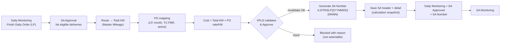
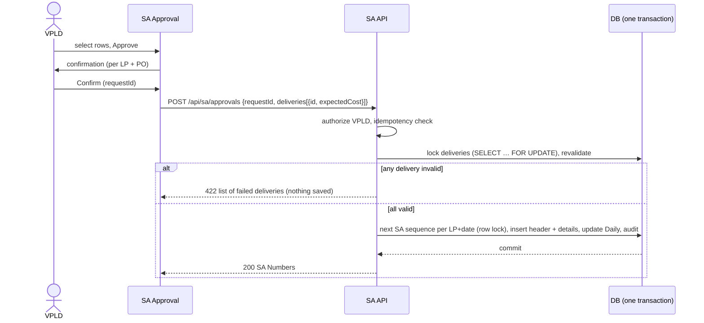
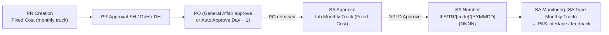

# TC-PBR Service Acceptance (SA) Approval – Functional & Technical Design

TC-PBR = Trucking Container Payment By Resource. VPLD performs Service Acceptance (GR) for two kinds of cost:
- **delivery cost** of completed trucking deliveries (§1–§26);
- **monthly truck cost**: the Fixed Cost PR/PO for the monthly rental of truck + driver, forwarded to SA Approval once the PO is released (§28). This supports the 3-way matching **PR → PO → GR/SA**.

**Mock-up:** `index.html#sa-approval` (Service Acceptance › SA Approval) and `index.html#sa-monitoring` (Service Acceptance › SA Monitoring).

**Code:**
- [`sa-rules.js`](../sa-rules.js): pure rules.
- [`sa.js`](../sa.js): UI and mock reference data.
- `workflow.js`: action `saApprove`.
- Tests: [`tests/sa-approval.test.js`](../tests/sa-approval.test.js) (19 tests).

**UISS:** [`uiss/UISS_Screen_SA_Approval.xlsx`](uiss/UISS_Screen_SA_Approval.xlsx) and [`uiss/UISS_Screen_SA_Monitoring.xlsx`](uiss/UISS_Screen_SA_Monitoring.xlsx).

**Legend used in every rule:**
- **C**: confirmed requirement (from the request or the reference screen).
- **P**: proposed technical implementation (mock-up behaviour).
- **A / OQ**: assumption or open question (see §27).

---

## 1. Business flow



| Stage | Status / location |
|---|---|
| Before | Daily Monitoring: **Finish Daily Order** (finished by LP), no SA Number = waiting for SA (C) |
| SA Approval | PO Mapping → KM → Cost → VPLD validation → Approve (C) |
| After | SA Number generated; Daily status **SA Approved** with SA Number; the delivery leaves SA Approval and appears in SA Monitoring (C) |

## 2. Detailed functional requirements

| ID | Requirement | Type |
|---|---|---|
| FR-01 | SA Approval lists only deliveries that are finished (Daily status `Finish Daily Order`) and have no SA Number | C (P for "finished" = Finish Daily Order, per the reference "Finished by LP") |
| FR-02 | Each row shows the delivery, trucking company and code, route, Total KM, PO, PO validity, rate, cost, currency and validation result | C |
| FR-03 | A row with any validation issue shows the reason and cannot be selected | C |
| FR-04 | VPLD selects rows (or Select All valid rows of the filter) and clicks **Approve**. A confirmation shows the deliveries, Total KM and cost per trucking company + PO | C / P (confirmation) |
| FR-05 | On Approve the server revalidates every selected row, generates the SA Number(s), saves header and detail with a calculation snapshot, updates Daily Monitoring and writes audit, all in one transaction | C |
| FR-06 | Approved rows disappear from SA Approval and appear in SA Monitoring | C |
| FR-07 | Only VPLD can approve (backend check). IELP Admin is view only. Supplier and Driver have no access to SA Approval | C (VPLD) / P (IELP Admin view, Supplier own data in SA Monitoring) |
| FR-08 | The same delivery can never be SA-approved twice | C |
| FR-09 | Detail popup per row shows the calculation (legs, KM, PO, formula) and the validation messages. A second icon opens the Daily Monitoring Order Detail | C ("detail data consistent with Daily Monitoring") / P |
| FR-10 | The Order Detail of Daily Monitoring no longer offers "Proses ke SA". SA status is set only through SA Approval | P (follows FR-07) |
| FR-11 | Besides deliveries, SA Approval lists the **monthly truck cost** of every released monthly (Fixed Cost) PO, for SA by VPLD (§28) | C |

## 3. Screen / UI design recommendation

The screen follows the reference **SA Monitoring Screen (Service Acceptance - acceptance)**:

| Area | Content |
|---|---|
| Header | Title **Service Acceptance**, breadcrumb `service acceptance - acceptance` |
| Search criteria | **Order From**, **Order To** (order date), **Search**, **Clear** |
| Tabs | **Regular Trip** / **Inter Plant Trip** (selection rule of Inter Plant Trip: OQ-02) |
| Order List | Section header; **Select All** with "n Item selected"; **Approve**; Search; **Kolom** (show/hide); paging 10 / 25 / 50 |
| Grid | Checkbox, Actions (calculation detail, Order Detail), Validation, DTP Type, Order Number, Order Date, Truck Company (`CODE - Name`), PO Number, PO Validity, CTR Size, Total KM, Rate / KM, **Price** (green), Currency, **Order Route** (blue), Cycle 1–5 (Service, Order Cycle `FROM-TO [container]`) |
| Popups | Calculation detail; Approve confirmation; result (SA Numbers) or error list |
| Mock only | Demo select to simulate: concurrent approval, PO rate change, DB failures |

Additions to the reference (required by the request): Validation, PO Validity, Total KM, Rate / KM and Currency.

## 4. Field list – SA Approval table

| Field | Source | Format | Note |
|---|---|---|---|
| Select | – | checkbox | Enabled only for VPLD and valid rows |
| Validation | Calculation result | badge | `Ready` or the error labels of §6 |
| DTP Type | Daily Order type | `DTP-n` / Universal | |
| Order Number (Delivery ID) | Daily Order No. | 18 chars | |
| Order Date | Daily Order date | YYYY-MM-DD | Basis for PO month |
| Truck Company | Trucking Company Master | `CODE - Name` | Code is mandatory for the SA Number |
| PO Number | Mapped PO (§7) | text | `-` if not mapped |
| PO Validity | PO valid from–to | YYYY-MM-DD – YYYY-MM-DD | |
| CTR Size | DTP record container size | 20 / 40 / … | `-` if not available |
| Total KM | Σ Master Mileage of the legs (§8) | 9,999.99 | |
| Rate / KM | PO rate per KM | 9,999 | |
| Price (Delivery Cost) | Total KM × Rate (§9) | 9,999,999 | Green column as in the reference |
| Currency | PO currency | IDR | |
| Order Route | Location codes of the stops | e.g. `D3S1D3` | Blue column as in the reference |
| Cycle n – Service | TBD | – | Value "CE" in the reference: meaning and source unknown (OQ-03); hidden by default |
| Cycle n – Order Cycle | Cycle From–To codes + container | `D3-S1 [TGCU…]` | |

## 5. Search / filter requirements

| Filter | Rule | Type |
|---|---|---|
| Order From / Order To | Order Date ≥ From and ≤ To. Default: first day of previous month to today | C / P (default) |
| Tab Regular Trip / Inter Plant Trip | Regular = all eligible orders. Inter Plant: rule TBD | C / OQ-02 |
| Search | Contains, case-insensitive, over Order No, DTP Type, Trucking Company, code, PO Number, Route, Container No | P |
| Kolom | Show / hide columns (Service hidden by default) | C |
| Sort | Order Date, then Order Number ascending | P |

## 6. Validation rules

| Code | Label (screen) | Condition | Type |
|---|---|---|---|
| NOT_ELIGIBLE | Not Eligible | Daily status is not Finish Daily Order | C |
| ALREADY_SA | Already SA Approved | Delivery already has an SA Number | C |
| LP_CODE_MISSING | Trucking Company Code Not Found | No code for the trucking company | C |
| ROUTE_NOT_FOUND | Route Not Found | No finished cycle, or a cycle location has no Master Location code | C |
| KM_NOT_FOUND | Total KM Not Found | A leg From→To has no active Master Mileage | C |
| KM_INVALID | Invalid Total KM | Leg or Total KM ≤ 0 | C |
| PO_NOT_FOUND | PO Not Found | No TC-PBR PO for the trucking company valid on the order date | C |
| PO_NOT_ACTIVE | PO Not Active | PO found but not Approved / Auto Approved | C |
| MULTI_PO | Multiple PO Found | More than one active PO covers the order date | C |
| RATE_NOT_FOUND | Rate Not Found | PO has no rate per KM | C |
| RATE_INVALID | Invalid Rate | Rate ≤ 0 | C |
| COST_FAILED | Cost Calculation Failed | Result not finite or ≤ 0 | C |
| COST_CHANGED | Cost Changed | Cost recalculated at Approve differs from the cost shown | C (recalculation difference) / P (block) |
| NOT_FOUND | Delivery Not Found | Order number of the request does not exist | P |

All failing checks of a row are shown together, not only the first one.

## 7. PO mapping logic

1. **Candidates** (C): PO type **TC-PBR**, same trucking company code, and validity period covering the order date (`validFrom ≤ orderDate ≤ validTo`). A PO of another month is never used unless its validity covers the date.
2. **No candidate**: `PO_NOT_FOUND` (C).
3. **Active**: status `Approved` or `Auto Approved` (the PO statuses of PO Approval). Only inactive candidates found: `PO_NOT_ACTIVE` (C / P for the status list).
4. **More than one active PO**: `MULTI_PO`. VPLD cannot choose; the PO data must be corrected (C / OQ-05: whether the route list of the PR/PO sequence should narrow the match).
5. **Rate**: `ratePerKm` of the PO. This is the Mileage Cost (IDR/Km) taken from E-Catalogue when the route-based PR was created (P, see [pr-creation-rules.md](pr-creation-rules.md) §3.2). Missing: `RATE_NOT_FOUND`; ≤ 0: `RATE_INVALID`.
6. The rate is never hard-coded (C).

## 8. Total KM calculation / retrieval

1. Legs = every **finished** cycle (`finishAt` set), From → To (P).
2. Location name → **Master Location code** (mock: mapping table in `sa.js`; real system: location codes stored on the order/cycle, OQ-06).
3. KM of a leg = **Master Mileage** From→To, status Active. Mileage is directional, so the return leg needs its own record (P, as in Master Mileage).
4. Total KM = Σ leg KM, rounded to 2 decimals. Order Route = first From + every To (e.g. `D3S1D3`).
5. Errors: missing code → `ROUTE_NOT_FOUND`; missing or inactive leg → `KM_NOT_FOUND`; leg or total ≤ 0 → `KM_INVALID`.

## 9. TC-PBR cost calculation flow

```
Delivery → Route (legs) → Total KM (Master Mileage) → Applicable PO → PO Rate (IDR/Km) → Delivery Cost
Delivery Cost = round(Total KM × PO Rate per KM)          (rounding to whole IDR: OQ-07)
```

- Only the **mileage component** is calculated per delivery. The Fix Cost (monthly price) goes to SA directly from its PO, per PR Creation §3.1 (A / OQ-08).
- Example: 36 km × 2,700 IDR/km = 97,200 IDR.

## 10. SA approval workflow



- **Revalidation** (C): eligibility, already SA, route, KM, PO, rate and cost again, compared with the cost shown on screen (`expectedCost`).
- **All-or-nothing per request** (P): one invalid delivery rejects the whole request, so the user sees one consistent result. Alternative (partial approval of valid trucking-company groups) is OQ-09.
- **Grouping** (P): one SA header per **trucking company + PO** in the request. SA Number carries the LP code; GR in PAS references one PO.

## 11. SA Number generation algorithm

`ILS/TR/{TRUCKING_COMPANY_CODE}/{YYMMDD}{SEQUENCE(4)}` (C).

- ILS = ELIPS, TR = TC-PBR. YYMMDD = approval (server) date. Example `ILS/TR/DNX/2611040001`.
- **Sequence scope** (P, configurable `SA_SEQ_SCOPE`):
  - `LP_DATE` (default) = per trucking company per date;
  - `DATE` = global per date.
  - OQ-01 confirms which one.
- The sequence starts at 0001 each date. 9999 is the maximum; beyond that the request fails with an error (P).
- The SA Number must be unique (unique index). A collision fails the transaction (C).

## 12. Concurrency strategy for SA Number

| Mechanism | Detail | Type |
|---|---|---|
| Sequence table | `TB_M_SA_SEQUENCE(SCOPE_KEY PK, LAST_SEQ, CHANGED_DT)`; `SCOPE_KEY` = `DNX|261104` or `261104` | P |
| Atomic increment | `UPDATE … SET LAST_SEQ = LAST_SEQ + 1 OUTPUT inserted.LAST_SEQ WHERE SCOPE_KEY = :k` (insert the row when missing, under `SERIALIZABLE` / `UPDLOCK, HOLDLOCK`) inside the approval transaction; rollback returns the number | P |
| Unique index | `UX_SA_HEADER_SA_NO` on `TB_R_SA_HEADER.SA_NO`. Retry once on duplicate key; then error | P |
| Delivery lock | `SELECT … WITH (UPDLOCK, ROWLOCK)` on the Daily orders of the request, then re-check `SA_NO IS NULL` | P |
| Unique detail | `UX_SA_DETAIL_ORDER` on `TB_R_SA_DETAIL.ORDER_NO` (where not cancelled) | P |

Two users approving at the same time therefore never get the same SA Number. The delivery that both select is approved only once; the second request gets `ALREADY_SA`.

## 13. Proposed database / data model changes

All names are proposed and must be aligned with the project naming convention.

| Table | Kind | Change |
|---|---|---|
| Daily Order (`TB_R_DAILY_ORDER`, TBD) | Existing | + `SA_NO`, `SA_DT`, `SA_BY` (status `SA Approved` already exists) |
| `TB_R_SA_HEADER` | New | §14 |
| `TB_R_SA_DETAIL` | New | §14 (calculation snapshot per delivery) |
| `TB_R_SA_DETAIL_LEG` | New (optional) | Legs + KM used (snapshot) |
| `TB_M_SA_SEQUENCE` | New | §12 |
| `TB_R_SA_APPROVAL_REQUEST` | New | `REQUEST_ID` PK, `USER_ID`, `STATUS`, `RESULT_JSON`, `CREATED_DT` (idempotency) |
| `TB_H_SA` | New | Audit / status history (§22) |
| PO (existing PO tables) | Existing | Needs `PO_TYPE` (TC-PBR), `VALID_FROM/TO`, `RATE_PER_KM`, `CURRENCY` available for mapping (OQ-04) |

## 14. SA Header and SA Detail structure

**TB_R_SA_HEADER:** `SA_NO` (PK), `LP_CD`, `LP_NAME`, `PO_NO`, `PO_VALID_FROM`, `PO_VALID_TO`, `CURRENCY`, `DELIVERY_COUNT`, `TOTAL_KM`, `TOTAL_COST`, `SA_STATUS` (`SA Approved`; later statuses OQ-10), `APPROVED_BY`, `APPROVED_DT`, `REQUEST_ID`, `CREATED_BY`, `CREATED_DT`, `CHANGED_BY`, `CHANGED_DT`, `VERSION`.

**TB_R_SA_DETAIL:**
- **Keys and delivery:** `SA_NO` (FK), `ORDER_NO` (unique), `ORDER_DT`, `DTP_TYPE`, `ROUTE_CD`, `TOTAL_KM`.
- **PO and cost:** `PO_NO`, `PO_STATUS_AT_APPROVAL`, `RATE_PER_KM`, `CURRENCY`, `COST`, `FORMULA`.
- **Snapshot:** `CALC_SNAPSHOT` (JSON: legs, mileage values, PO validity), `CALC_DT`.
- **Audit:** `CREATED_BY`, `CREATED_DT`.

The snapshot keeps the approved amount fixed. Later changes to the PO or master data never change it (C).

## 15. Daily Monitoring status update design

- Action `saApprove` (workflow.js): allowed for VPLD only.
  - Guard: status `Finish Daily Order` and no SA Number.
  - Effect: status `SA Approved`, `saNo`, `saAt`, plus a history row "SA Approval · SA Number …".
- It is `screenOnly`, so it is not offered in the Order Detail action bar (P).
- `Proses ke SA` is now SYSTEM only. It is kept for the legacy seed data, which receive an SA Number and appear as *legacy* in SA Monitoring (P).
- Daily Monitoring shows the SA Number under the status badge and in Order Detail. The Surat Jalan PDF prints it in **SA Number** (P).
- `Proses ke PAS` (SA Approved with PO Number) is now SYSTEM only. It is set when the PAS PO feedback is received in SA Monitoring ([sa-monitoring-spec.md](sa-monitoring-spec.md) §14).

## 16. SA Monitoring design

Detailed design (PAS interface, PAS PR / PO feedback, statuses): [sa-monitoring-spec.md](sa-monitoring-spec.md). Summary:

| Area | Content |
|---|---|
| Filter | Approval Date From / To, Trucking Company, Search (SA, PO, order, approver) |
| Grid | SA Number (link), Approval Date, Approved By, Trucking Code, Trucking Company, Deliveries, PO Number, PO Validity, Total KM, Total Cost, Currency, SA Status |
| Detail | Header data; deliveries with snapshot (Order, Date, Route, KM, Rate, Cost); audit |
| Access | VPLD / IELP Admin: all; Supplier: own trucking company; Driver: none (P) |

## 17. API endpoint recommendations (proposed)

| Method | Endpoint | Purpose |
|---|---|---|
| GET | `/api/sa/approval-candidates?orderFrom&orderTo&tab&q&page&size` | Eligible deliveries with calculation and validation |
| GET | `/api/sa/approval-candidates/{orderNo}/calculation` | Calculation detail |
| POST | `/api/sa/approvals` | Approve (idempotent by `requestId`) |
| GET | `/api/sa?approvedFrom&approvedTo&lpCd&q&page` | SA Monitoring list |
| GET | `/api/sa/{saNo}` | SA header + details + audit (`saNo` URL-encoded) |

## 18. API request / response examples

```http
POST /api/sa/approvals
Idempotency-Key: 7c9e…            (same as requestId)
{ "requestId": "7c9e…", "deliveries": [ { "orderNo": "261027C20000020254", "expectedCost": 29700 },
                                         { "orderNo": "261027C20000021621", "expectedCost": 162000 } ] }
```
```json
200 { "status": 200, "sas": [ { "saNo": "ILS/TR/SRL/2611040002", "lpCode": "SRL", "poNo": "202610PCSRL01303",
        "deliveries": 2, "totalKm": 71, "totalCost": 191700, "currency": "IDR" } ] }
422 { "status": 422, "message": "1 of 2 delivery(ies) failed revalidation. Nothing was approved.",
      "failed": [ { "orderNo": "261027C20000021621", "errors": [ { "code": "COST_CHANGED",
        "msg": "Cost on screen 162000, recalculated 168000" } ] } ] }
403 { "status": 403, "message": "Only VPLD users may approve Service Acceptance" }
409 { "status": 409, "message": "Request 7c9e… is still processing" }      (same key in progress)
500 { "status": 500, "message": "Daily Monitoring update failed. Transaction rolled back, nothing was approved." }
```

A replayed `requestId` returns the stored result with `"replay": true`.

## 19. Backend pseudocode

```text
approve(req, user):
  require user has role VPLD                                   -> 403
  if exists request(req.requestId): return stored result (409 if still processing)
  insert request(req.requestId, PROCESSING)
  BEGIN TRAN
    orders = SELECT … FROM DAILY_ORDER WITH (UPDLOCK) WHERE ORDER_NO IN req
    failed = []
    for o in orders: c = calculate(o)      # route, km, PO, rate, cost (§7-9)
                     if c.errors or c.cost != req.expectedCost[o]: failed += o
    if failed: ROLLBACK; save result 422; return 422
    for group in groupBy(lpCode, poNo):
       seq = nextSequence(scopeKey(lpCode, today))             # row lock
       saNo = "ILS/TR/" + lpCode + "/" + yymmdd(today) + pad4(seq)
       INSERT SA_HEADER; INSERT SA_DETAIL (snapshot) per order
       UPDATE DAILY_ORDER SET STATUS='SA Approved', SA_NO=saNo … WHERE ORDER_NO=… AND SA_NO IS NULL
         (rows affected must equal group size, else throw)
       INSERT TB_H_SA / daily history
  COMMIT; save result 200; return 200
  on exception: ROLLBACK; save result 500 (retryable); log
```

## 20. Transaction / rollback strategy

- One database transaction covers sequence, header, detail, Daily update, history and audit (C / P).
- Any failure rolls back everything: no SA Number is consumed, no header, and no Daily change. The mock-up simulates header, detail and Daily failures.
- The request row records the final result (200 / 422 / 500). A 500 may be retried with the same `requestId`.
- Events to other systems (PAS GR, Delivery Note attachment) are written to an outbox in the same transaction and sent after commit (P, OQ-11).

## 21. Authorization rules

| Role | SA Approval | Approve | SA Monitoring |
|---|---|---|---|
| VPLD (Planner) | View | **Yes** (backend enforced) | All |
| IELP Admin | View | No | All |
| Supplier (Viewer / LP Admin) | No access | No | Own trucking company |
| Driver | No access | No | No access |

- C: only VPLD approves, enforced in the backend (a hidden button is not enough).
- P: the other rows of the table.
- OQ-12: are other VPLD levels (SH / DpH / DH) also allowed?

## 22. Audit trail requirements

- **Stored at approval** (C):
  - SA Number, Delivery ID, PO Number;
  - PO rate, Total KM and legs used, calculated cost;
  - trucking company and code;
  - approval timestamp and approver, created timestamp;
  - calculation snapshot and status changes.
- **History** (P): Daily order history row "SA Approval", and SA header audit (who, when, action, request id, count).
- Failed approval attempts are logged with user, request id and reasons (P).

## 23. Error handling

| Situation | Behaviour |
|---|---|
| Validation issue on load | Row shown with reason(s), not selectable |
| Revalidation failure at Approve | 422, popup lists every failed delivery and reason, nothing saved |
| Not VPLD | 403, nothing saved |
| DB / Daily update failure | 500, full rollback, "nothing was approved", retry possible |
| Duplicate click / request | Confirm button disabled after click; same `requestId` returns the stored result |
| Concurrent approval | Second request gets `ALREADY_SA` for the shared delivery |

## 24. Edge cases

| Case | Handling |
|---|---|
| No PO / multiple PO / inactive PO | PO_NOT_FOUND / MULTI_PO / PO_NOT_ACTIVE |
| PO of another month | Not used unless its validity covers the order date |
| Missing / zero / negative rate | RATE_NOT_FOUND / RATE_INVALID |
| Missing route / location code | ROUTE_NOT_FOUND |
| Missing / inactive mileage | KM_NOT_FOUND |
| Zero / negative KM | KM_INVALID |
| Missing trucking code | LP_CODE_MISSING |
| Already SA / duplicate approval / concurrent users | ALREADY_SA, idempotency, row locks |
| SA sequence collision / > 9999 | Unique index + error, rollback |
| Daily update / header / detail insert failure | Rollback (500) |
| Cost recalculation difference | COST_CHANGED, refresh and check again |
| PO / master change after approval | Snapshot keeps the approved values |

## 25. Acceptance criteria (Given / When / Then)

1. **Given** a delivery in Finish Daily Order with a valid route, mileage and one active TC-PBR PO for its month, **when** VPLD opens SA Approval, **then** the row shows Total KM, PO Number, validity, rate and cost = KM × rate, and is selectable.
2. **Given** a delivery whose trucking company has no PO covering the order date, **when** the list loads, **then** the row shows *PO Not Found* and cannot be selected.
3. **Given** two active POs covering the date, **then** the row shows *Multiple PO Found*.
4. **Given** VPLD selects valid deliveries of PBM and SRL, **when** they confirm Approve, **then** one SA Number per trucking company + PO is generated in the format `ILS/TR/{code}/{YYMMDD}{NNNN}`, the deliveries become SA Approved with that number in Daily Monitoring, leave SA Approval and appear in SA Monitoring.
5. **Given** another user approved one of the selected deliveries first, **when** VPLD confirms, **then** the request fails with *Already SA Approved* and nothing is approved.
6. **Given** the PO rate changed after the list was shown, **when** VPLD confirms, **then** the request fails with *Cost Changed*.
7. **Given** the Daily Monitoring update fails, **when** VPLD confirms, **then** no SA, SA Number or status change is saved.
8. **Given** an IELP Admin or Supplier, **when** they call the approval, **then** the API returns 403.
9. **Given** an approved SA, **when** the PO rate is changed later, **then** SA Monitoring still shows the approved rate and cost.
10. **Given** the same request id is sent twice, **then** only one SA is created and the second call returns the same result.

## 26. Positive and negative test scenarios

- **Unit tests:** `tests/sa-approval.test.js` (15) cover §6–§12 and §20–§24.
- **Mock-up e2e (Playwright):**
  - access per role;
  - detail popup;
  - Cost Changed, Daily update failure and concurrent approval demos;
  - Select All approval generating 3 SA;
  - SA Monitoring detail;
  - Daily status;
  - persistence after reload;
  - supplier sees own SA;
  - IELP Admin no longer has "Proses ke SA".

## 27. Open questions / unclear business rules

| # | Question |
|---|---|
| OQ-01 | SA sequence scope: per trucking company per date (mock default) or global per date? |
| OQ-02 | Definition of **Inter Plant Trip** vs Regular Trip (which orders go to which tab)? |
| OQ-03 | Meaning and source of the **Service** column per cycle ("CE" in the reference)? |
| OQ-04 | Where are PO type (TC-PBR), validity, rate per KM and currency stored for mapping (PO from route-based PR, PAS)? |
| OQ-05 | Must the PO match on route (PR sequence route list) when one LP has several TC-PBR POs in a month? |
| OQ-06 | Will orders / cycles store Master Location codes? Today Daily Monitoring holds names. |
| OQ-07 | Rounding rule of the cost (whole IDR, round half up?) and of Total KM. |
| OQ-08 | Is the Fix Cost (monthly price) part of this SA screen, or only the mileage cost per delivery? |
| OQ-09 | All-or-nothing per request (mock) or partial approval per trucking company group? |
| OQ-10 | SA statuses after approval (e.g. GR posted in PAS, cancelled / reversed SA) and SA cancellation rules. |
| OQ-11 | Relation to the existing "Proses ke PAS / SA Approved with PO Number" and to the Delivery Note GR attachment. |
| OQ-12 | Which VPLD roles / levels may approve? Is there an approval limit by amount? |
| OQ-13 | Is "finished by LP" = Daily status Finish Daily Order, or must all cycles also be Finish Cycle with container? |
| OQ-14 | Default date range of the search, and the maximum number of rows per approval request. |
| OQ-15 | Currency: always IDR, or taken from the PO? |
| OQ-16 | Monthly truck cost: may SA be done before the month is finished (PO released in Month N-1), or only from / after the service month? |
| OQ-17 | Monthly truck cost: always the full monthly amount, or deductions (truck not available, KPI / performance, partial month)? |
| OQ-18 | Monthly truck cost: one SA per PO (mock), or one SA per trucking company and month together with the delivery SA? Does the SA Number need a different type code (e.g. not `TR`)? |
| OQ-19 | Monthly truck cost: does a PR / PO sequence > 1 (additional Fixed Cost) also come to SA Approval as its own row? |

## 28. Monthly truck cost (Fixed Cost PR / PO)

The monthly truck cost (rental of truck + driver for one month) is a PR of type **Fixed Cost** in PR Creation. Its amount is the E-Catalogue Monthly Price; see [pr-creation-rules.md](pr-creation-rules.md) §3.1. When the PO of that PR is released, the monthly cost is forwarded to SA Approval, and VPLD performs the SA as for deliveries. (C)



| ID | Rule | Type |
|---|---|---|
| SA-20 | Tab **Monthly Truck (Fixed Cost)** lists every monthly PO with type Fixed Cost, status **Approved / Auto Approved** (released), and no SA Number. Pending / Rejected PO are not listed. | C (released PO) / P (status list) |
| SA-21 | Filter: production month overlapping Order From – To; search over PO, PR, trucking company, month. | P |
| SA-22 | Row: PO Number, PR Number, Production Month, Truck Company, Cost Component *Monthly Cost (Fixed)*, PO Status, PO Released date-time, Service Period (1st – last day of the month), Price (= PO monthly cost), Currency, Validation. | P |
| SA-23 | Validation: *Monthly Cost Not Found* (PO without amount), *Invalid Monthly Cost* (≤ 0), *Trucking Company Code Not Found*, *PO Not Active*, *Already SA Approved*. A row with an issue cannot be selected. | P |
| SA-24 | Approve uses the same rules as delivery approval: VPLD only, confirmation, revalidation incl. *Monthly Cost Changed*, all-or-nothing, idempotent request id, rollback on any failure. | P |
| SA-25 | One SA per monthly PO. The SA Number uses the same format and the same sequence (per trucking company per date). Header `type = MONTHLY`, one detail `kind = MONTHLY` with the snapshot of PO, PR, month and amount. The PO is marked with the SA Number, so it is never approved twice. | P (OQ-18) |
| SA-26 | The monthly SA appears in SA Monitoring with SA Type *Monthly Truck* and goes through the same PAS interface / feedback. | P |

**Data model:** `TB_R_SA_HEADER.SA_TYPE` (`DELIVERY` / `MONTHLY`), `PO_NO`, `PR_NO`, `PROD_MONTH`. `TB_R_SA_DETAIL` gets one row with `DETAIL_KIND = MONTHLY`, `PO_NO`, `PR_NO`, `PROD_MONTH`, `AMOUNT` (no route / KM). The monthly PO gets `SA_NO`, `SA_DT` (unique: one SA per PO).

**Mock-up:** `MONTHLY_POS` in `sa.js` mirrors PO Inquiry.
- October: all trucking companies released.
- November:
  - SRL Pending, TFL Rejected: not listed.
  - SML without amount: *Monthly Cost Not Found*.
- The Demo select also works on this tab: other user, amount change, DB failures.
