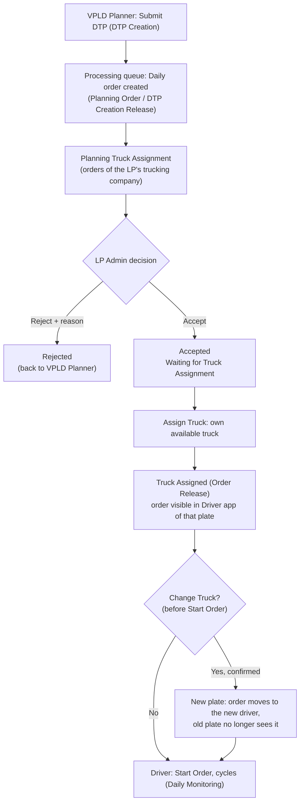
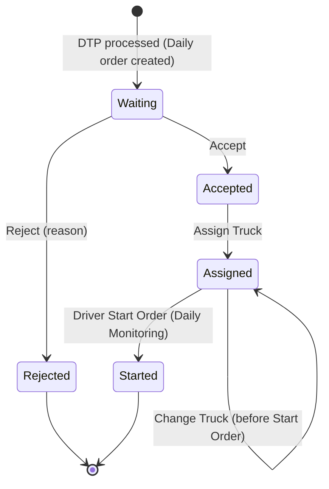

# ELIPS TC-PBR Planning Truck Assignment: Specification

**Planning Truck Assignment** (menu Daily > Planning Truck Assignment, `index.html#truck-assignment`) is used by the **LP Admin** of a trucking company to process the orders sent by the VPLD Planner:

1. Accept or reject the order.
2. Assign a truck to an accepted order.
3. Change the truck when needed.

- An assigned order appears in the **Driver app** of the truck's license plate.
- **Rules:** [`workflow.js`](../../../workflow.js) (`lpAccept`, `lpReject`, `lpAssign`, `lpChangeTruck`, `truckState`)
- **UI:** [`truck-assign.js`](../../../truck-assign.js)
- **Unit tests:** [`tests/truck-assignment.test.js`](../../../tests/truck-assignment.test.js)
- **Previous step:** [DTP Creation](../02_Planning_Order_DTP/dtp-creation-rules.md)
- **UISS:** [`UISS_Screen_Planning_Truck_Assignment.xlsx`](UISS_Screen_Planning_Truck_Assignment.xlsx)

---

## 1. User flow



Entry points:
- **Calendar** (as on the reference screen): one bar per date and DTP type with the number of orders. Clicking a bar opens **Assignment order list {DTP} On Period : dd/mm/yyyy**, which has a Truck selection, Select All, Search, the order table, and **Accept / Assign / Change Truck / Reject** for the selected orders.
- **Order List**: one row per order with filters and per-row actions.

---

## 2. Business rules

| ID | Rule |
|---|---|
| TA-01 | Orders reach the screen when the DTP queue has processed them (Daily order in Planning Order / DTP Creation Release) |
| TA-02 | The LP Admin sees only the orders of its own trucking company. Other users are view only: Supplier viewers see their own company, IELP Admin and Planner see all |
| TA-03 | **Waiting for Confirmation** → Accept or Reject. An order from DTP Creation must be **accepted** before any truck can be linked. This also blocks the IELP Admin Assign Truck and the LP Order Release |
| TA-04 | **Reject** needs a Reject Reason (min. 10 characters) and is only possible before Accept and before a truck is linked. A rejected order cannot be accepted or assigned and goes back to the planner (calendar of Planning Order: *Rejected by LP*) |
| TA-05 | **Assign Truck** only for Accepted orders without a truck. The truck must belong to the order's trucking company, must not be in **Maintenance**, its license must be valid on the delivery date, it must not be active (Order Release / Start Daily Order) on another order of the same date and shift, and its type must match the order's truck type (when given) |
| TA-06 | After assignment: plate stored on the order, driver = active driver registered on the truck (if any), Daily status **Order Release**. The order is visible in the Driver app for that plate only |
| TA-07 | One active assignment per order: a second Assign is not possible (use Change Truck) |
| TA-08 | **Change Truck** only while the order is Order Release and the driver has not started (cycle still DTP Creation Release). The replacement truck must be different and pass TA-05. It replaces the active assignment (no second active assignment). The old plate loses the order, the new plate gets it. Reason optional; confirmation required |
| TA-09 | Every Accept / Reject / Assign / Change Truck writes an audit record (order, previous / new LP status, previous / new plate, Daily status, action, reason, user, date-time) |
| TA-10 | Batch actions in the assignment modal are checked per order. Failed orders are listed with the reason, and successful ones are saved. Assign takes one order at a time (one truck per order and shift) |

---

## 3. Wireframe / screen structure

```
Planning Truck Assignment                              Order - planning assignment
┌──────────────────────────────────────────────────────────────────────────────┐
│ [Calendar][Order List]   LP Admin PT. X: orders of your company   Last refresh  [⟳ Refresh] │
├──────────────────────────────────────────────────────────────────────────────┤
│ Calendar view                                                                  │
│  ‹ › Today            November 2026                     [Month][Week][Day]    │
│  Sun  Mon  Tue ...  day cell: "(Universal) Import/Export [ 6 ]" (colour)       │
│  Legend: Waiting Assignment · Order Already Assign · Complete Order · Rejected │
├──────────────────────────────────────────────────────────────────────────────┤
│ Order List view                                                                │
│  Search Order/DTP | Delivery Date From | To | Order Status | Assignment Status │
│  | License Plate | [Clear]                                                     │
│  DTP/Order No | Delivery Date | Trucking Company | Origin | Destination |      │
│  Truck Type | Assigned License Plate | Driver | Order Status | Assignment      │
│  Status | Action [Accept][Reject] / [Assign Truck] / [Change Truck] / [View]   │
│  Showing x to y of z · rows per page · pager                                   │
└──────────────────────────────────────────────────────────────────────────────┘
Modal "Assignment order list {DTP} On Period : dd/mm/yyyy"
  Truck* [select: plate · type · status · driver]
  [□ Select All  n Selected]                                      [Search]
  □ | Assign To | Order Status | Assignment | Order No | From | To | Agent | Vessel | Ctr Book No | Ctr Size | Seal No | Detail
  [✓ Accept] [Assign] [Change Truck]                                   [Reject]
Dialogs: Accept confirmation · Reject Order (reason*) · Assign Truck picker · Change Truck picker + confirmation · Order detail + Audit Trail + "Open Driver app view"
```

---

## 4. Field specification

| Field | Source | Format | Rule |
|---|---|---|---|
| DTP / Order Number | Daily order | Text | Search (partial) |
| Delivery Date | Order date (DTP planning date) | DD/MM/YYYY | Filter From / To |
| Trucking Company | Order LP | Name | LP Admin: own company only |
| Origin / Destination | DTP From / To (code - name) | Text | – |
| Truck Type | DTP Truck Type | Text | Used in TA-05 |
| Assigned License Plate | Active assignment | Plate | Filter (contains) |
| Driver | Driver registered on the truck | Name | Empty when the truck has no active driver |
| Order Status | Derived | Waiting for Confirmation / Accepted / Rejected | Badge (amber / blue / red) |
| Assignment Status | Derived | – / Waiting for Truck Assignment / Truck Assigned | Badge |
| Action | By status | Buttons | Section 5 |
| Truck (picker) | Truck master of the LP | Plate, Truck Type, Truck Status, Driver | Not available trucks are disabled with the reason |
| Reject Reason | Key-in | Text ≥ 10 chars | Mandatory |
| Change Truck Reason | Key-in | Text | Optional |

---

## 5. Status transition



| Order Status | Assignment Status | Daily status | Actions |
|---|---|---|---|
| Waiting for Confirmation | – | Planning Order | Accept, Reject, View Detail |
| Accepted | Waiting for Truck Assignment | Planning Order | Assign Truck, View Detail |
| Accepted | Truck Assigned | Order Release (not started) | Change Truck, View Detail |
| Accepted | Truck Assigned | Start Daily Order or later | View Detail |
| Rejected | – | Planning Order | View Detail |

---

## 6. Validation rules

| No | Validation | Message |
|---|---|---|
| V-01 | User is LP Admin of the order's trucking company | (role) tidak boleh melakukan … / Anda tidak memiliki akses ke order ini |
| V-02 | Accept: Planning Order, no truck, not rejected, not yet accepted | Accept hanya bisa saat status Planning Order dan belum ada truck · Order sudah ditolak LP · Order sudah di-Accept |
| V-03 | Reject: before Accept, no truck, reason ≥ 10 | Reject hanya bisa … · Order sudah di-Accept, tidak bisa di-Reject · Reason wajib diisi / Reason minimal 10 karakter |
| V-04 | Assign: accepted, not rejected, no truck | Order harus di-Accept terlebih dahulu · Order Rejected tidak dapat di-assign truck · Order sudah punya truck, gunakan Change Truck |
| V-05 | Truck registered | Truck tidak terdaftar |
| V-06 | Truck of the same trucking company | Truck bukan milik trucking company order ini |
| V-07 | Truck not in maintenance | Truck sedang maintenance |
| V-08 | License valid on delivery date | Lisensi truck habis (date) sebelum tanggal order |
| V-09 | Truck not active on another order of the same date + shift | Truck sudah di-assign ke order {no} ({shift} {date}) |
| V-10 | Truck type matches the order | Truck type {type} tidak sesuai order ({type}) |
| V-11 | Change Truck: Order Release with truck, not started; different truck | Change Truck hanya bisa untuk order Order Release … · Order sudah dimulai driver, truck tidak bisa diganti · Truck pengganti harus berbeda dari truck saat ini |
| V-12 | Truck is required for Assign / Change Truck | Truck is required |

---

## 7. API specification (proposed)

| Method | Endpoint | Body / Query | Result |
|---|---|---|---|
| GET | `/api/lp/orders` | `dateFrom, dateTo, orderStatus, assignmentStatus, plate, q, sort, page, size` (LP from the token) | Page of orders with derived statuses |
| GET | `/api/lp/orders/calendar` | `month=YYYY-MM` | Per date + DTP type: count, colour status |
| GET | `/api/lp/orders/{orderNo}` | – | Order detail + audit trail |
| POST | `/api/lp/orders/{orderNo}/accept` | `{ version }` | 200 order / 409 conflict / 422 rule |
| POST | `/api/lp/orders/{orderNo}/reject` | `{ reason, version }` | 200 / 422 (reason) |
| GET | `/api/lp/orders/{orderNo}/trucks` | `q` (plate) | Trucks of the LP with `available`, `statusLabel`, `reason`, driver |
| POST | `/api/lp/orders/{orderNo}/assign` | `{ plate, version }` | 200 / 422 (V-04..V-10) / 409 |
| POST | `/api/lp/orders/{orderNo}/change-truck` | `{ plate, reason?, version }` | 200 / 422 (V-11, V-05..V-10) / 409 |
| POST | `/api/lp/orders/batch/{accept\|reject\|change-truck}` | `{ orderNos[], plate?, reason? }` | `{ done[], failed[{orderNo, message}] }` |
| GET | `/api/driver/orders` | plate from the driver session | Orders whose **active** assignment has that plate |

- **Errors:** `401` not logged in · `403` not LP Admin / other company · `404` order not found · `409` version changed (concurrency) · `422` business rule (message of section 6) · `500` system error (rollback).
- Accept, assign, change truck and the audit rows are written in **one transaction per order**.

---

## 8. Database / data model (proposed)

| Table | Kind | Main columns |
|---|---|---|
| Daily order (existing, `TB_R_DAILY_ORDER` TBD) | Transaction | ORDER_NO (PK), ORDER_DT, DTP_TYPE, LP_CD, FROM / TO, SHIFT, STATUS, **LP_STATUS** (WAITING / ACCEPTED / REJECTED), **LP_ACCEPTED_BY / DT**, **LP_REJECT_REASON / BY / DT**, ACTIVE_PLATE, DRIVER_ID, VERSION, audit columns |
| `TB_R_ORDER_TRUCK_ASSIGN` | Transaction | ASSIGN_ID (PK), ORDER_NO, PLATE_NO, DRIVER_ID, **ACTIVE_FLAG** (Y/N), ASSIGNED_BY / DT, RELEASED_BY / DT (when replaced), audit. **Unique index (ORDER_NO) where ACTIVE_FLAG = 'Y'** (no duplicate active assignment) |
| `TB_H_ORDER_ASSIGN` | History (audit) | HIST_ID, ORDER_NO, ACTION, PREV_LP_STATUS, NEW_LP_STATUS, PREV_ORDER_STATUS, NEW_ORDER_STATUS, PREV_PLATE, NEW_PLATE, REASON, UPDATED_BY, UPDATED_DT |
| Truck master (existing) | Master | PLATE_NO, LP_CD, TRUCK_TYPE, STATUS (Active / Maintenance), LICENSE_DT, DRIVER_ID |

- **Change Truck:** the active row is set `ACTIVE_FLAG = 'N'` (RELEASED_BY / DT), a new active row is inserted, the order's ACTIVE_PLATE is updated, and one history row is written, all in one transaction.
- **Driver app:** `orders JOIN TB_R_ORDER_TRUCK_ASSIGN ON ACTIVE_FLAG = 'Y' AND PLATE_NO = :sessionPlate`.

---

## 9. Error handling

| Case | Handling |
|---|---|
| Rule violation (section 6) | Message shown; nothing saved |
| Batch with some invalid orders | Valid ones saved; result dialog lists the failed orders with reasons |
| Order changed by another user | 409: "Error in Update because of concurrency check." Refresh and retry |
| Truck became unavailable between picker and submit | Re-checked on submit (V-07..V-10) |
| DB / server error | Rollback; system error message; nothing changed |
| Non-LP user | Screen read only; action buttons hidden; API returns 403 |

---

## 10. Acceptance criteria

1. The LP Admin of PT. X sees only orders of PT. X, in the Calendar and in the Order List.
2. A new order shows *Waiting for Confirmation* with Accept and Reject.
3. Accept asks for confirmation. Afterwards the order shows *Accepted / Waiting for Truck Assignment* with Assign Truck.
4. Reject needs a reason of at least 10 characters. Afterwards the order shows *Rejected* with View Detail only, and the planner's calendar shows *Rejected by LP*.
5. The Assign Truck picker lists only the LP's trucks. Unavailable trucks (maintenance, expired license, in use on the same shift, wrong type) cannot be selected and show the reason. The plate can be searched.
6. After Assign the order shows *Truck Assigned* with the plate and driver. The driver who logs in with that plate sees the order; other drivers do not.
7. Change Truck shows the current truck, accepts only another available truck, and asks for confirmation. Afterwards only the new plate sees the order, and the old plate is free again.
8. Every action appears in the Audit Trail with previous / new status, previous / new plate, reason, user and date-time.
9. Search, filters (delivery date, order status, assignment status, plate), sorting, pagination and Refresh work in the Order List.

---

## 11. Test scenarios

| # | Scenario | Expected | Type |
|---|---|---|---|
| 1 | LP PBM opens the screen | Only PBM orders | Positive |
| 2 | Accept a waiting order | Accepted, Assign Truck available | Positive |
| 3 | Reject with reason "Truck tidak tersedia untuk shift ini" | Rejected | Positive |
| 4 | Assign an available own truck | Truck Assigned, driver set, visible for that plate | Positive |
| 5 | Change Truck to another available truck, reason "Truck breakdown" | New plate; old plate no longer sees it; audit row with both plates | Positive |
| 6 | Batch accept 3 orders in the modal | 3 Accepted | Positive |
| 7 | Filter by plate / Rejected / delivery date | Matching rows only | Positive |
| 8 | Reject with empty / short reason | "Reject Reason wajib diisi" / "Reason minimal 10 karakter" | Negative |
| 9 | Assign before Accept (LP, IELP Admin, Order Release) | "Order harus di-Accept terlebih dahulu" | Negative |
| 10 | Assign a rejected order | "Order Rejected tidak dapat di-assign truck" | Negative |
| 11 | Assign a truck of another LP / in maintenance / expired license / COMBO for a TRAILER order | Matching V-06..V-10 message; truck disabled in the picker | Negative |
| 12 | Assign a truck already active on another order of the same date + shift | "Truck sudah di-assign ke order …" | Negative |
| 13 | Assign again on an assigned order | Blocked; use Change Truck | Negative |
| 14 | Change Truck to the same truck | "Truck pengganti harus berbeda …" | Negative |
| 15 | Change Truck after the driver started | "Change Truck hanya bisa …" | Negative |
| 16 | LP SRL tries to act on a PBM order | No access | Negative |
| 17 | Supplier viewer / IELP Admin / Planner | View only, no action buttons | Negative |
| 18 | Assign without selecting a truck in the modal | "Truck is required" | Negative |

Scenarios 1–18 are covered by `tests/truck-assignment.test.js` (rules) and the Playwright end-to-end run of the mock-up.

---

## 12. Open questions (TBD)

1. **Accept for the whole DTP or per order?** The mock-up does it per order, with batch selection in the modal.
2. **Truck availability:** which statuses besides Maintenance, and is a truck allowed several orders on the same day in different shifts (allowed in the mock-up)?
3. **Truck type** list and matching rules (e.g. may a COMBO serve a TRAILER order?).
4. **Driver:** fixed per truck (as in the mock-up) or chosen during assignment?
5. **Change Truck:** is a reason mandatory, and is a change still allowed after Start Order (e.g. breakdown on the road)?
6. **Rejected order:** does the planner reassign it to another LP or create a new DTP?
7. **Seal No** (column on the reference modal): what is its source?
8. **Notification** to the driver and the planner after assign / change / reject.
EOF
python3 - <<'EOF'
p='/home/user/tc-pbr/docs/uiss/02_Planning_Order_DTP/dtp-creation-rules.md'; s=open(p).read()
s=s.replace("Daily now has three sub menus: Daily Monitoring, Planning Order and Truck Assignment (Truck Assignment is still a placeholder).","Daily now has three sub menus: Daily Monitoring, Planning Order and Planning Truck Assignment ([truck-assignment-spec.md](truck-assignment-spec.md)).")
s=s.replace("10. **Truck Assignment menu:** waiting for the reference screen.","10. **Truck Assignment menu:** done, see [truck-assignment-spec.md](truck-assignment-spec.md).")
open(p,'w').write(s)
EOF
cd /tmp/claude-0/-home-user-tc-pbr/9e412a63-1435-5c0e-b1b1-989da22a9217/scratchpad && node mm.js $PWD /home/user/tc-pbr/docs/uiss/03_Planning_Truck_Assignment/truck-assignment-spec.md 2>&1 | tail -1

## Database mapping (ELIPS schema, review 14-Nov-2026)

The UISS of this function were revised against `docs/db/ELIPS_Schema.sql` ([DB-R1]) and the conflicts were resolved by the decision of
14-Nov-2026 ([DB-R2]): **the existing application logic is kept**; where the existing table cannot hold it a DB change request (DCR) is raised
([../../review/12-db-change-requests.md](../../review/12-db-change-requests.md)). No sample data was available: value lists / status codes stay TBD.

- **UISS_Screen_Planning_Truck_Assignment** - tables: `ielp.DTP_2_DETAIL`, `ielp.MS_TRUCK_REGISTRATION`, `ielp.ORDER_CYCLE`, `ielp.ORDER_TRUCK_H`
  - G-TA-01 LP accept / reject: Existing logic kept: LP Accept / Reject with reason (workflow.js:194, 202). **DCR-27**: ADD ielp.DTP_2_DETAIL.LP_STATUS varchar(20), LP_REJECT_REASON varchar(500), LP_ACTION_BY varchar(500), LP_ACTION_DATE datetime
  - G-TA-02 Assignment table: Existing logic kept: one active truck per order, every assign / change kept in an audit trail. **DCR-28**: ADD ielp.ORDER_TRUCK_H.ACTION varchar(30), PREV_LICENSE_PLATE varchar(20), DRIVER_ID varchar(10)
- **UISS_Batch_Driver_Order_Sync** - tables: `ielp.MS_DRIVER`, `ielp.MS_LOCATION`, `ielp.ORDER_CYCLE`, `ielp.TB_M_DRIVER`
  - G-DRV-01 Sync mechanism: Existing logic kept as specified in the UISS (HiveMQ outbox). **DCR-23**: CREATE TB_T_DRIVER_SYNC_QUEUE, TB_R_DRIVER_ORDER, TB_R_DRIVER_MQ_OUTBOX, TB_R_DRIVER_SYNC_LOG (definitions in the UISS-Batch Appendix)

Full lists: [../../review/07-gap-analysis.md](../../review/07-gap-analysis.md), [../../review/12-db-change-requests.md](../../review/12-db-change-requests.md), [../../review/10-tbd-list.md](../../review/10-tbd-list.md).
