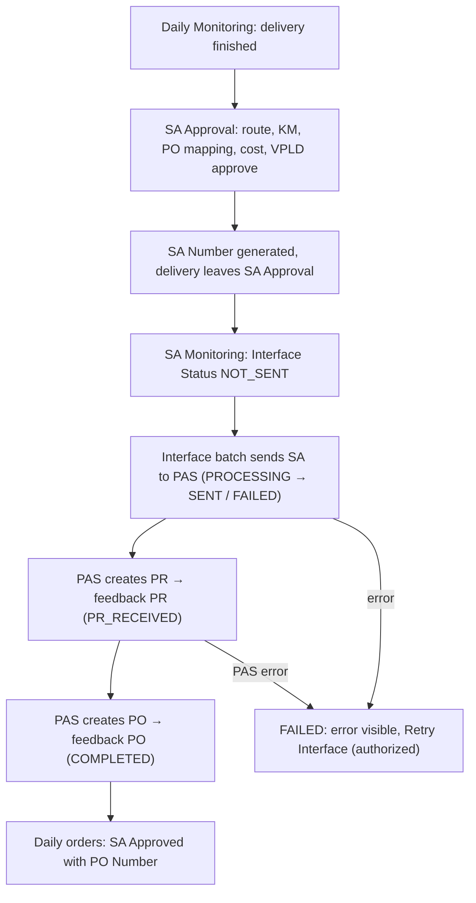
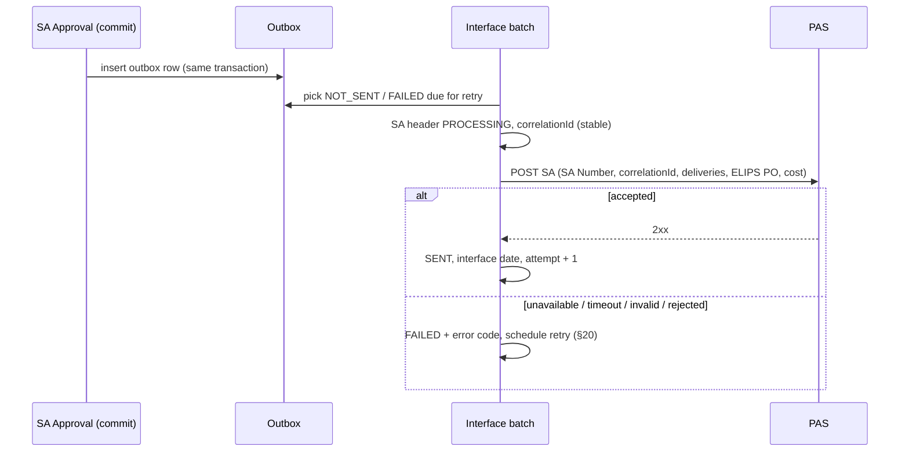

# TC-PBR Service Acceptance Monitoring – Functional & Technical Design

**What it is:** a continuation of [SA Approval](../05_SA_Approval/sa-approval-spec.md). VPLD uses it to monitor approved SA, their cost, and the ELIPS → PAS interface with its feedback (PR, PO).

**Mock-up:** `index.html#sa-monitoring` (Service Acceptance › SA Monitoring).

**Code:**
- [`sa-pas-rules.js`](../../../sa-pas-rules.js): send to PAS, PAS feedback, WBS split.
- [`sa-monitoring.js`](../../../sa-monitoring.js): UI and demo PAS simulator.
- `sa-rules.js`: SA Det No and initial PAS status at approval.

**Tests:** [`tests/sa-monitoring.test.js`](../../../tests/sa-monitoring.test.js) (13).

**UISS:** [`uiss/UISS_Screen_SA_Monitoring.xlsx`](UISS_Screen_SA_Monitoring.xlsx).

**Legend:**
- **CONFIRMED (C)**: stated by the requirement or visible on the reference screen.
- **PROPOSED (P)**: recommended design (mock-up behaviour).
- **OPEN QUESTION (OQ)**: needs business confirmation (§29).

Example record used below:

| Field | Value | Origin |
|---|---|---|
| SA Number | ILS/TR/DNX/2611040001 | ELIPS (SA Approval) |
| SA Approval Date | 04-Nov-2026 | ELIPS |
| Trucking Company Code | DNX | ELIPS |
| Delivery | DLV-001 | ELIPS |
| Total KM | 100 | ELIPS snapshot |
| ELIPS PO Number (cost reference) | PO-RATE-001 | ELIPS snapshot |
| Calculated Cost | IDR 2,000,000 | ELIPS snapshot |
| PAS PR Number | PR-001 | **PAS feedback** |
| PAS PR Date | 04-Nov-2026 | **PAS feedback** |
| PAS PO Number | PO-001 | **PAS feedback** |
| Interface Status | COMPLETED | ELIPS, derived from the PAS feedback |

---

## 1. Business objective

VPLD monitors the Service Acceptance that has been approved (it has an SA Number and has left SA Approval). They can see:
- the deliveries and cost of each SA;
- whether the SA reached PAS;
- the PR and PO returned by PAS;
- any integration errors.

This supports the 3-way matching PR → PO → GR/SA. (C)

## 2. End-to-end business flow



| Step | Type |
|---|---|
| SA Approval → SA Number → leaves SA Approval → SA Monitoring | C |
| SA interfaced to PAS; PAS processes PR and PO; PAS feedback updates ELIPS | C |
| Interface by batch / outbox after the approval commit | P (OQ-01) |
| PAS PO feedback also sets the Daily orders to the existing status *SA Approved with PO Number* | P (OQ-11) |

## 3. Detailed functional requirements

| ID | Requirement | Type |
|---|---|---|
| SM-01 | Only SA approved in SA Approval (SA Number present) are shown; SA Monitoring never generates an SA Number | C |
| SM-02 | Show SA, delivery, cost / ELIPS PO, PAS and integration information, and keep ELIPS data separate from PAS data | C |
| SM-03 | PAS PR Number, PAS PR Date and PAS PO Number are empty until PAS feedback provides them. ELIPS never generates them, and never fills PR Date from the SA, interface or system date | C |
| SM-04 | The ELIPS PO used for the cost (cost reference PO) is stored separately from the PAS PO Number and is never overwritten by PAS feedback | C |
| SM-05 | The interface status shows the integration state (§9) | C (list) / P (exact model, OQ-02) |
| SM-06 | Feedback is matched by SA Number and correlation ID; processing is idempotent; staged feedback (PR, then PO) updates the same SA | C |
| SM-07 | Status is derived from the PAS values received: PR + PO → COMPLETED, PR only → PR_RECEIVED, PO only → PO_RECEIVED, none → SENT. A PAS error → FAILED | P |
| SM-08 | A second feedback with different PR or PO values is rejected and logged, never overwritten | P (OQ-05) |
| SM-09 | A PAS PR Number may belong to one SA only; a PAS PO Number may be shared unless configured unique | P (OQ-06) |
| SM-10 | Approved snapshot fields (SA Number, deliveries, trucking company, route, KM, ELIPS PO, rate, cost, approval) are never changed by PAS feedback | C |
| SM-11 | An integration error never removes the SA from SA Monitoring | C |
| SM-12 | Every interface and feedback event is audited (§21) | C |
| SM-13 | Retry Interface is a separate authorization (IELP Admin in the mock-up). Viewing does not allow modification | C (separate) / P (role, OQ-08) |
| SM-14 | An SA waiting for feedback for more than 24 h (TBD) shows an **Overdue** flag. This is visual only; the status does not change | P (OQ-07) |

## 4. UI/UX design recommendation

The screen follows the reference **Service Acceptance Monitoring** screen.

| Area | Content | Type |
|---|---|---|
| Search criteria | SA Date From / To, SA Number, **Status \***, **Truck Company \*** (with *All*), Search, Cancel | C (reference) |
| Extra criteria | Delivery Number, Delivery Date, PAS PR Number, PAS PO Number, *PAS PO Number empty* | C (requirement) |
| Status chips | One chip per interface status with its count; a click filters the list | P |
| Tabs | **Service Acceptance List** (one row per SA detail, as the reference); **Service Acceptance List (WBS Group)** (one row per SA header with PAS data and actions); **Inter Plant** (rule TBD) | C (tabs) / P (WBS Group content, OQ-03) |
| List bar | Search, Kolom (show / hide), **Export Excel** | C |
| Summary row | Summary of Price, WBS Cost Summary per WBS | C (reference) |
| Colours | Price green (as on the reference); status badges in distinct colours, FAILED red, Overdue orange | P |
| Detail | Popup with sections A–G; every section is labelled with its source (ELIPS / PAS feedback) | C (sections) / P (labels) |
| Interface Log | Popup listing all events of the SA | P |
| Demo only | PAS simulator to produce send results and PAS feedback | P (mock-up) |

## 5. Main monitoring table design

**Tab Service Acceptance List** (detail level, reference columns plus the required ones):

`Options | SA No | SA Type | SA Det No | Delivery No (monthly: description) | Delivery Date | Truck Company | PAS PR No | PAS PO No | PAS PR Date | Interface Status | Route Code | Ctr Size | Service Type Cycle 1–5 | Total KM | ELIPS PO No* | Rate / KM* | Price | Currency* | WBS % CS, RRE, RRR, SP, CE, CI | WBS Cost CS…CI | Approval Date`

\* hidden by default (Kolom).

**Tab Service Acceptance List (WBS Group)** (header level, §21 of the request):

`Action (View Detail, View Interface Log, Retry Interface) | SA Number | SA Type | SA Approval Date | Approved By | Truck Company | Delivery Count | Total KM | Total Cost | Currency | WBS Cost CS…CI | PAS PR Number | PAS PR Date | PAS PO Number | Interface Status | Feedback | Last Update`

Both tabs: summary row, paging 10 / 25 / 50, sort SA Approval Date descending then SA Number.

## 6. Detail screen design

| Section | Fields | Source |
|---|---|---|
| A. SA Information | SA Number, SA Date, Approved Date, Approved By, SA Status | ELIPS |
| B. Trucking Information | Trucking Company, Trucking Company Code | ELIPS |
| C. Delivery Information | Per delivery: SA Det No, Delivery Number, Date, Route, Origin, Destination, Total KM, Rate, Cost. Monthly SA: SA Det No, description, production month, service period, PR Number (ELIPS), monthly cost | ELIPS snapshot |
| D. Cost Calculation | ELIPS / Cost Reference PO, validity, PO Rate, Total KM, Calculated Cost, Currency | ELIPS snapshot |
| E. PAS Information | PAS PR Number, PAS PR Date, PAS PO Number, Interface Status | PAS feedback |
| F. Integration Information | Interface Date, Correlation ID, Attempts, Last Feedback Date, Feedback Status, Error Code, Error Message | PAS / interface |
| G. Audit Information | Created Date / By, Approved Date / By, Last Updated Date, and the event log | ELIPS |

SA Date = SA approval / generation date. A separate SA date is OQ-04.

## 7. Field definitions

| Field | Type / format | Rule |
|---|---|---|
| SA Number | `ILS/TR/{code}/{YYMMDD}{NNNN}` | From SA Approval, read only |
| SA Det No | `{YYMM}C{NNNNN}` | Proposed running number per month at approval (format OQ-09) |
| SA Type | `Delivery` / `Monthly Truck` | Delivery SA (route-based cost) or monthly truck cost SA (Fixed Cost PO); see [sa-approval-spec.md](../05_SA_Approval/sa-approval-spec.md) §28 |
| PAS PR Number | text (mock `5000xxxxxx`) | Only from PAS feedback |
| PAS PR Date | date `YYYY-MM-DD` | Only from PAS feedback; must be a valid date |
| PAS PO Number | text (mock `45xxxxxxxx`) | Only from PAS feedback |
| Interface Status | §9 | Derived (SM-07) |
| Feedback Status | `RECEIVED` / `REJECTED` / `ERROR` | Result of the last feedback |
| Interface Date | date-time | Time of the successful send |
| Correlation ID | `ELIPS-SA-{SA Number with "-"}` | Created at the first send, kept on every retry |
| Error Code / Message | text | Last send or feedback error |
| Service Type (cycle n) | text | Reference shows `CE`; source TBD (OQ-10). Mock: `CE` |
| WBS % / Cost | % / amount | Mock: share of cycles per service type × cost; source *WBS Consumption Master* TBD (OQ-10) |

## 8. Search / filter requirements

| Filter | Match | Type |
|---|---|---|
| SA Date From / To | SA approval date within range (default 1st day of previous month to today) | C / P (default) |
| SA Number | contains | C |
| Status * | Interface status, *All* allowed | C |
| Truck Company * | code, *All* allowed (Supplier: fixed to own) | C |
| SA Type | Delivery / Monthly Truck / All | P |
| Delivery Number | contains (any detail of the SA) | C |
| Delivery Date | equals | C |
| PAS PR Number / PAS PO Number | contains | C |
| PAS PO Number empty | SA without PAS PO | C |
| Search box | contains over the visible key values | P |

## 9. Status definitions

| Status | Meaning | Set by |
|---|---|---|
| NOT_SENT | Approved, not yet sent | SA Approval |
| PROCESSING | Send in progress | Interface |
| SENT | Accepted by PAS, waiting for feedback | Interface |
| PR_RECEIVED | PAS PR Number and Date received | Feedback |
| PO_RECEIVED | PAS PO received, PR not (yet) received | Feedback |
| COMPLETED | PR and PO received (the required feedback, OQ-02) | Feedback |
| FAILED | Send failed, or PAS reported an error (PR / PO creation failed) | Interface / feedback |

- **Allowed transitions** (P):
  - NOT_SENT → PROCESSING → SENT | FAILED;
  - SENT → PR_RECEIVED | PO_RECEIVED | COMPLETED | FAILED;
  - PR_RECEIVED → COMPLETED | FAILED;
  - FAILED (send) → PROCESSING by Retry;
  - FAILED (PAS step) → PR_RECEIVED / COMPLETED when PAS sends the missing data.
- An existing ELIPS–PAS status standard, if there is one, replaces this model (OQ-02).

## 10. Source of each field (ELIPS / PAS)

| ELIPS (SA Approval snapshot, never changed by PAS) | PAS feedback | ELIPS interface (derived) |
|---|---|---|
| SA Number, SA Det No, SA approval date / by, SA Status | PAS PR Number | Interface Status |
| Delivery No / Date, Trucking Company / Code, Route, Origin, Destination, Total KM | PAS PR Date | Interface Date, Correlation ID, Attempts |
| ELIPS (cost reference) PO, validity, rate, cost, currency | PAS PO Number | Last Feedback Date, Feedback Status |
| WBS % / Cost (derived from cost, OQ-10) | PAS error code / message | Overdue flag |

## 11. Database / data model recommendation

All names are proposed.

| Table | Change |
|---|---|
| `TB_R_SA_HEADER` | + PAS block:<br>`PAS_PR_NO`, `PAS_PR_DT`, `PAS_PO_NO`;<br>`INTERFACE_STS`, `INTERFACE_DT`, `CORRELATION_ID`, `INTERFACE_ATTEMPT`;<br>`LAST_FEEDBACK_DT`, `FEEDBACK_STS`, `ERROR_CD`, `ERROR_MSG`;<br>`PAS_UPDATED_DT`, `PAS_VERSION`.<br>The ELIPS `PO_NO` stays the cost reference PO. |
| `TB_R_SA_DETAIL` | + `SA_DET_NO` (unique). Snapshot columns unchanged. |
| `TB_R_SA_PAS_OUTBOX` | `OUTBOX_ID`, `SA_NO`, `PAYLOAD`, `STATUS`, `ATTEMPT`, `NEXT_RETRY_DT`, `CREATED_DT`: written in the approval transaction. |
| `TB_R_SA_PAS_FEEDBACK` | `FEEDBACK_ID` (PK, idempotency), `SA_NO`, `CORRELATION_ID`, `TYPE`, `PAYLOAD`, `RESULT_CD`, `RECEIVED_DT`. |
| `TB_H_SA_INTERFACE` | Audit events (§21). |
| Indexes | `SA_NO` (PK), `CORRELATION_ID` unique, `PAS_PR_NO` unique where not null (OQ-06), `INTERFACE_STS + APPROVED_DT`, `LP_CD + APPROVED_DT`, `SA_DETAIL.ORDER_NO` |

## 12. SA Header / Detail recommendation

- Header / detail is kept. One header per trucking company + ELIPS PO per approval request, as in [SA Approval §10](../05_SA_Approval/sa-approval-spec.md); one detail per delivery. (P, grouping OQ-12)
- PAS data lives on the **header**, because one SA is sent to PAS as one PR / PO.
- Per-detail PR / PO is OQ-13.

## 13. PAS integration flow



The request content is TBD (PAS contract, OQ-01). The cost values are sent from the snapshot and never recalculated (C).

## 14. PAS feedback processing flow

1. Receive feedback `{feedbackId, saNo, correlationId, type PR | PO | PR_PO | ERROR, prNo, prDate, poNo, errorCode, errorMessage}`.
2. Format check → 400 `INVALID_FORMAT`.
3. Feedback id already processed → 200 `DUPLICATE` (nothing changed).
4. SA unknown → 404 `UNKNOWN_SA` (logged, no SA created).
5. Correlation ID mismatch → 409. SA not sent yet → 409 `NOT_SENT`.
6. Value checks:
   - PR without number → 422 `MISSING_PR_NO`; PR without a valid date → 422 `MISSING_PR_DATE`;
   - PO without number → 422 `MISSING_PO_NO`;
   - different values than stored → 409 `PR_CONFLICT` / `PO_CONFLICT`;
   - PR Number already used by another SA → 409 `DUPLICATE_PR`.
7. Lock the SA header (row lock / version), then update the PAS fields only, recompute the status, and write the audit.
8. If the PO was received: set the SA's Daily orders to *SA Approved with PO Number* (P, OQ-11).
9. Commit. Store the result per feedback id.

Rejections from step 6 set Feedback Status `REJECTED` with the error code, and the status is unchanged. A DB failure returns 500 and stores nothing, so PAS can resend.

## 15. API endpoint recommendations (proposed)

| Method | Endpoint | Purpose |
|---|---|---|
| GET | `/api/sa/monitoring?saDateFrom&saDateTo&saNo&status&lpCd&deliveryNo&deliveryDate&pasPrNo&pasPoNo&pasPoEmpty&view=detail\|header&page&size&sort` | List (server-side paging) |
| GET | `/api/sa/{saNo}` | Detail A–G |
| GET | `/api/sa/{saNo}/interface-log` | Event log |
| POST | `/api/sa/{saNo}/interface/retry` | Retry Interface (separate permission) |
| GET | `/api/sa/monitoring/export?…` | Excel export (same filters) |
| POST | `/api/pas/sa-feedback` | Inbound PAS feedback (system account / mTLS, OQ-01) |

## 16. API request / response examples

```http
POST /api/pas/sa-feedback
{ "feedbackId": "PAS-FB-000123", "saNo": "ILS/TR/DNX/2611040001", "correlationId": "ELIPS-SA-ILS-TR-DNX-2611040001",
  "type": "PR", "prNo": "PR-001", "prDate": "2026-11-04" }
```
```json
200 { "status": 200, "code": "UPDATED", "message": "SA ILS/TR/DNX/2611040001: PR_RECEIVED" }
200 { "status": 200, "code": "DUPLICATE", "message": "Feedback PAS-FB-000123 already processed, ignored" }
409 { "status": 409, "code": "PR_CONFLICT", "message": "PAS PR PR-009 / 2026-11-04 differs from stored PR-001 / 2026-11-04; not overwritten" }
422 { "status": 422, "code": "MISSING_PR_DATE", "message": "PR feedback without valid PAS PR Date (YYYY-MM-DD)" }
404 { "status": 404, "code": "UNKNOWN_SA", "message": "SA ILS/TR/XXX/2611049999 not found in ELIPS" }
```
```http
GET /api/sa/ILS%2FTR%2FDNX%2F2611040001
200 { "saNo": "ILS/TR/DNX/2611040001", "elips": { "approvedAt": "2026-11-04T09:12:00+07:00", "approvedBy": "planner1",
        "lpCd": "DNX", "costReferencePoNo": "PO-RATE-001", "totalKm": 100, "totalCost": 2000000, "currency": "IDR",
        "details": [ { "saDetNo": "2611C00001", "deliveryNo": "DLV-001", "totalKm": 100, "rate": 20000, "cost": 2000000 } ] },
      "pas": { "prNo": "PR-001", "prDate": "2026-11-04", "poNo": "PO-001", "interfaceStatus": "COMPLETED",
        "interfaceAt": "2026-11-04T10:00:00+07:00", "correlationId": "ELIPS-SA-ILS-TR-DNX-2611040001", "lastFeedbackAt": "2026-11-04T13:00:00+07:00" } }
```

## 17. Backend pseudocode

```text
onFeedback(fb):
  validate format                                   -> 400
  if FEEDBACK(fb.feedbackId) exists: return stored result (DUPLICATE)
  BEGIN TRAN
    h = SELECT SA_HEADER WITH (UPDLOCK) WHERE SA_NO = fb.saNo     -> 404 if none
    check correlation / sent / values / conflicts / uniqueness    -> 409 / 422 (log, FEEDBACK_STS = REJECTED)
    UPDATE SA_HEADER SET PAS_PR_NO, PAS_PR_DT, PAS_PO_NO, INTERFACE_STS = derive(), LAST_FEEDBACK_DT, PAS_VERSION += 1
       WHERE SA_NO = h.SA_NO AND PAS_VERSION = h.PAS_VERSION   (rows = 1 else retry)
    INSERT TB_H_SA_INTERFACE events; INSERT FEEDBACK(fb.feedbackId, result)
    if PO received: UPDATE DAILY_ORDER (SA Approved with PO Number)
  COMMIT                                              (on error: ROLLBACK, 500)

interfaceBatch():
  for o in OUTBOX where STATUS in (NEW, RETRY) and NEXT_RETRY_DT <= now (lock, batch size N):
     header PROCESSING; call PAS with correlationId; SENT or FAILED(+ next retry time)
```

## 18. Idempotency strategy

- **Inbound:** `FEEDBACK_ID` primary key stores the result, so a repeat returns the stored result. A new id with the same values returns `NO_CHANGE`.
- **Outbound:** one stable correlation ID per SA, sent on every retry, so PAS can de-duplicate. A send is only possible from NOT_SENT / FAILED.
- **Header:** optimistic version and row lock, so concurrent feedback for one SA is serialized.
- SA Monitoring never creates an SA or an SA Number.

## 19. Error handling strategy

| Case | Result |
|---|---|
| PAS unavailable / network timeout / invalid request / PAS rejects | FAILED + error code; SA stays visible; retry (§20) |
| PR / PO creation failed (PAS error feedback) | FAILED; PAS values already received are kept; no resend (PAS fixes it and sends the missing data) |
| Feedback timeout | Overdue flag after 24 h (TBD); optional reminder (OQ-07) |
| Duplicate feedback / conflicting values | DUPLICATE (ignored) / PR_CONFLICT, PO_CONFLICT (rejected, logged) |
| Unknown SA / correlation mismatch / not sent | 404 / 409; nothing changed |
| Missing PR Number / PR Date / PO Number / invalid format | 422 / 400; Feedback Status REJECTED |
| Duplicate PAS PR (and PO if unique) | 409 DUPLICATE_PR / DUPLICATE_PO |
| DB update failure | 500, rollback, feedback not stored (PAS resends) |

## 20. Integration retry strategy (proposed)

- Automatic retry by the batch for PAS_UNAVAILABLE and TIMEOUT: backoff of 5, 15, 60 minutes, up to 3 attempts (values TBD).
- INVALID_REQUEST and PAS_REJECTED are not retried automatically; the data or the mapping must be checked first.
- **Retry Interface** (manual) is allowed only for FAILED send without PAS values, and needs the retry permission. It reuses the correlation ID.
- PAS-side failures (PR / PO creation failed) are resolved in PAS; ELIPS waits for new feedback.

## 21. Audit trail design

Events:
- `SA_APPROVED`, `SA_SENT_TO_PAS`;
- `PAS_REQUEST_SUCCESS`, `PAS_REQUEST_FAILED`;
- `PAS_PR_RECEIVED`, `PAS_PO_RECEIVED`;
- `PAS_FEEDBACK_FAILED`, `PAS_PROCESS_COMPLETED`.

Each event row (`TB_H_SA_INTERFACE`) holds:
- SA Number, event, timestamp, actor (user / `PAS Interface` / `PAS`);
- correlation ID, feedback id;
- previous and new status;
- error code and error message.

The mock-up shows them in View Interface Log and in detail section G. (C)

## 22. Authorization rules

| Role | View | Retry Interface | Correction / cancel SA |
|---|---|---|---|
| VPLD (Planner) | All SA | No (button disabled) | Not in scope |
| IELP Admin | All SA | **Yes** (proposed retry permission) | Not in scope |
| Supplier | Own trucking company | No | No |
| Driver | No access | No | No |
| PAS (system account) | – | – | Feedback API only |

- C: SA Monitoring is limited to authorized users, and each action needs its own authorization.
- P: the role assignment in the table. OQ-08: who holds the retry permission.

## 23. Performance / pagination

- Server-side paging and sorting.
- Default date range: one month.
- Indexes as in §11.
- Header view for summaries; detail view loaded per page.
- Export runs as a background job above N rows (TBD).
- Old SA are searched through the date range and the indexed SA Number / PAS numbers. Archiving / partitioning by approval month is optional.

## 24. Edge cases

| # | Case | Handling |
|---|---|---|
| 1 | Approved, not sent | NOT_SENT; picked up by the batch |
| 2 | Sent, no feedback | SENT; Overdue after 24 h (TBD) |
| 3 | PR received, PO not yet | PR_RECEIVED; PAS PO empty (filter *PAS PO Number empty*) |
| 4 | PR and PO received | COMPLETED; Daily → SA Approved with PO Number |
| 5 | Duplicate feedback | Same id ignored; same values = NO_CHANGE |
| 6 | Same SA, different values | PR_CONFLICT / PO_CONFLICT, not overwritten |
| 7 | Unknown SA Number | 404, logged |
| 8 | Correlation ID mismatch | 409, logged |
| 9 | PR Number without PR Date | 422 MISSING_PR_DATE |
| 10 | PO creation failed | FAILED with PAS error; PR kept |
| 11 | Interface timeout | FAILED TIMEOUT; automatic / manual retry with the same correlation ID |
| 12 | SA with several deliveries | One header, details listed; PAS fields on the header |
| 13 | Deliveries with different calculation data | Each detail keeps its own route, KM, rate, cost |
| 14 | Old SA | Date range + SA Number search; snapshot values shown |
| 15 | High volume | Paging, indexes, background export |
| 16 | Concurrent feedback | Row lock / version per SA header |
| 17 | DB failure during update | Rollback, 500, PAS resends |

## 25. Acceptance criteria (Given / When / Then)

1. **Given** an SA was approved in SA Approval, **when** VPLD opens SA Monitoring, **then** it is listed with status *Not Sent*, and PAS PR No, PR Date and PO No are empty.
2. **Given** the SA was sent to PAS, **when** PAS sends a PR feedback with number and date, **then** the SA shows that PAS PR Number and PAS PR Date and the status *PR Received*.
3. **Given** an SA in *PR Received*, **when** PAS sends the PO feedback, **then** the same SA (not a new one) shows the PAS PO Number and *Completed*. The ELIPS PO, rate and cost are unchanged.
4. **Given** a feedback id already processed, **when** it is received again, **then** nothing changes and the event log has no new entry.
5. **Given** an SA with PAS PR `PR-001`, **when** a feedback brings `PR-009`, **then** it is rejected as *PR_CONFLICT* and PR-001 stays.
6. **Given** a feedback for an unknown SA Number, **then** the API returns 404 and no SA is created.
7. **Given** a send fails with PAS unavailable, **then** the SA stays in the list with *Failed* and error *PAS_UNAVAILABLE*. Only a user with the retry permission can retry.
8. **Given** filter *PAS PO Number empty*, **then** only SA without a PAS PO are shown.
9. **Given** a Supplier login, **then** only the SA of its own trucking company are shown.
10. **Given** the database fails during feedback processing, **then** no PAS field changes and the same feedback can be processed later.

## 26. Positive test scenarios

- **Send and feedback:** send OK; PR feedback; PO feedback; PR + PO in one feedback; PO before PR (PO_RECEIVED).
- **Retry and resolution:** retry after timeout by IELP Admin; PAS error and later resolution.
- **Screen:** filters (SA Number partial, status chip, PAS PO empty, delivery number); Export Excel; detail A–G; interface log.

Covered by `tests/sa-monitoring.test.js` and the Playwright run of the mock-up.

## 27. Negative test scenarios

- **Rejected feedback:**
  - feedback before send;
  - missing PR Number / PR Date / PO Number, invalid PR Date format;
  - conflicting PR / PO;
  - duplicate PR across SA, duplicate PO when unique;
  - unknown SA, wrong correlation ID, invalid format.
- **Interface and access:**
  - invalid SA data sent;
  - retry by VPLD (403);
  - second send of a SENT SA;
  - DB failure.

## 28. Integration test scenarios

| # | Scenario | Expected |
|---|---|---|
| IT-01 | Approve → outbox → batch → PAS stub 200 → PR feedback → PO feedback | COMPLETED; Daily orders *SA Approved with PO Number* |
| IT-02 | PAS stub down during 3 retries | FAILED after the last attempt; manual retry works after recovery |
| IT-03 | PAS stub timeout but PAS processed the request; retry with the same correlation ID | PAS de-duplicates; one PR / PO |
| IT-04 | PAS sends the same feedback 3 times in parallel | One update, two DUPLICATE |
| IT-05 | PR and PO feedback arrive in reverse order | PO_RECEIVED, then COMPLETED |
| IT-06 | Feedback with a valid SA but another SA's correlation ID | 409, no change |
| IT-07 | DB connection dropped during feedback | 500; PAS resend succeeds |
| IT-08 | 10,000 SA in the date range | Paging response < SLA (TBD) |

## 29. Open questions / unclear business rules

| # | Question |
|---|---|
| OQ-01 | PAS interface contract: push (ELIPS → PAS API) or file / queue, request content, PAS feedback channel and authentication. |
| OQ-02 | Is there an existing ELIPS–PAS status standard? Which feedback makes an SA "Completed" (PR + PO, or also GR)? |
| OQ-03 | Content of the tab **Service Acceptance List (WBS Group)**. The mock-up shows the header level with WBS cost per SA. |
| OQ-04 | Is "SA Date" different from the approval date? |
| OQ-05 | Can PAS legitimately change a PR / PO number after it was sent (correction feedback), and how is that authorized? |
| OQ-06 | Uniqueness: one PAS PR per SA? Can one PAS PO cover several SA? |
| OQ-07 | Feedback timeout threshold, and whether a reminder / e-mail is needed. |
| OQ-08 | Who may Retry Interface, resend, correct or cancel an SA? |
| OQ-09 | SA Det No format (reference shows `2611C11050`). |
| OQ-10 | Service Type per cycle (CS, RRE, RRR, SP, CE, CI) source, and the WBS Consumption Master rule for percentage and cost split. |
| OQ-11 | Should the PAS PO feedback update Daily Monitoring to *SA Approved with PO Number* (as in the mock-up)? Which PO Number is shown there? |
| OQ-12 | Grouping: one SA per trucking company + ELIPS PO per approval (current), or one SA per delivery? |
| OQ-13 | Does PAS return PR / PO per SA header or per delivery (detail)? |
| OQ-14 | Definition of the **Inter Plant** tab. |
| OQ-15 | Excel export layout and maximum rows. |

## Database mapping (ELIPS schema, review 14-Nov-2026)

The UISS of this function were revised against `docs/db/ELIPS_Schema.sql` ([DB-R1]) and the conflicts were resolved by the decision of
14-Nov-2026 ([DB-R2]): **the existing application logic is kept**; where the existing table cannot hold it a DB change request (DCR) is raised
([../../review/12-db-change-requests.md](../../review/12-db-change-requests.md)). No sample data was available: value lists / status codes stay TBD.

- **UISS_Screen_SA_Monitoring** - tables: `ielp.LOG_ITGPAS`, `ielp.SA_DETAIL`, `ielp.SA_HEADER`, `ielp.SA_WBS_PERCENTAGE`
  - G-SA-01 SA number length: Existing logic kept: SA number ILS/TR/<LP>/<YYMMDD><NNNN> up to 22 characters (sa-rules.js saNumber). **DCR-29**: ALTER ielp.SA_DETAIL.SA_CODE and ielp.ORDER_CYCLE.SA_CODE varchar(16) -> varchar(25)
  - G-SA-02 Amounts as text: Existing logic kept: numeric KM / price / cost; stored as plain numbers in the existing varchar columns. (no DB change)
  - G-SA-03 Total KM / rate per KM: Existing logic kept: Total KM, rate per KM and currency kept on the SA (sa-rules.js calculate). **DCR-30**: ADD ielp.SA_DETAIL.TOTAL_KM decimal(9,2), RATE_PER_KM decimal(15,2), CURRENCY varchar(3)
  - G-SA-04 Status codes: Existing logic kept: SA statuses and types of sa-rules.js / sa-pas-rules.js. **DCR-31**: Register code values (SA_HEADER.STATUS_CODE, SA_TYPE, SA_DETAIL.STATUS_CODE) - data, no column change
  - G-SAM-01 Interface tracking: Existing logic kept: interface tracking with correlation id, attempts, error code / message (sa-pas-rules.js). **DCR-33**: ADD ielp.SA_DETAIL.CORRELATION_ID varchar(60), INTERFACE_ATTEMPT int, ERROR_CD varchar(30), ERROR_MSG varchar(500)
  - G-SAM-02 VISION columns: Existing logic kept: VISION columns are not used by the TC-PBR logic. (no DB change)
- UISS_Batch_SA_PAS_Interface: created in the review, see the UISS.

Full lists: [../../review/07-gap-analysis.md](../../review/07-gap-analysis.md), [../../review/12-db-change-requests.md](../../review/12-db-change-requests.md), [../../review/10-tbd-list.md](../../review/10-tbd-list.md).
