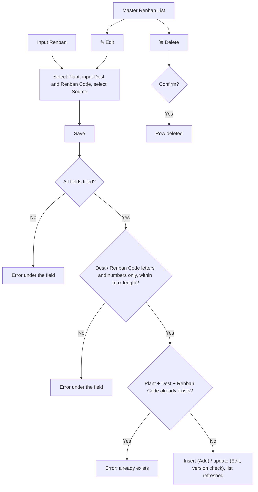

# ELIPS Master Renban: Process and Validation Rules

Master Renban maintains the **Renban Code** per **Plant** and **Dest**, together with its **Source**.

Mock-up: `master.html#renban` (Master > Renban). Rules live in [`master-renban.js`](../../../master-renban.js). UISS: [`docs/uiss/14_Master_Renban/UISS_Screen_Master_Renban.xlsx`](UISS_Screen_Master_Renban.xlsx). The screen follows the existing **Master Renban** screen.

---

## 1. Screen (Master Renban)

| Section | Content |
|---|---|
| Header | Title "Master Renban", breadcrumb "Master - Master Renban" |
| Input Renban | **Plant (Code - Description)*** (drop-down, e.g. `KRW 3 - KARAWANG PLANT`), **Dest*** (text), **Renban Code*** (text), **Source*** (drop-down). Save / Cancel |
| Master Renban List | Search, Table View (show / hide columns), Export .xls. Columns: Action (✎ / 🗑), Plant (Code - Description), Dest, Renban Code, Source, Created By, Created Dt, Changed Dt, Changed By |
| Footer | "Showing x to y of z entries", per page 10 / 25 / 50 / 100 (default 25), « ‹ pages › » |

- **Edit:** ✎ loads the row into Input Renban (title "Edit Renban - Plant / Dest / Renban"); Save updates it, Cancel clears the form.
- **Delete:** 🗑 asks for confirmation.
- **Order:** rows are listed in entry order, as on the existing screen.

---

## 2. Flow

---

## 3. Rules

| ID | Rule |
|---|---|
| RB-01 | Plant, Dest, Renban Code and Source are required |
| RB-02 | Plant from the plant list (`Code - Description`); Source from the source list. Lists in the mock-up: Plant KRW 3, STR 2; Source DPM, KUO, TDB, TMP, TMT, TMV, UMW (real source TBD) |
| RB-03 | Dest: letters / numbers, max 10 characters. Renban Code: letters / numbers, max 3 characters. Both saved in upper case |
| RB-04 | **Unique key = Plant + Dest + Renban Code.** The same Renban Code may be used for another Dest or Plant (e.g. `T` for 722C and 812D) |
| RB-05 | Edit may change all fields; the unique check excludes the edited row. Concurrency check on save (version) |
| RB-06 | Delete after confirmation (physical delete in the mock-up) |
| RB-07 | Audit: Created By / Dt on insert, Changed By / Dt on update (format `YYYY-MM-DD HH:MI:SS`) |
| RB-08 | Search filters on all visible columns. Export .xls exports all filtered rows with the visible columns |

### Messages

| Case | Message |
|---|---|
| Required | Plant is required. · Dest is required. · Renban Code is required. · Source is required. |
| Format | Dest must be letters / numbers only, max 10 characters. · Renban Code must be letters / numbers only, max 3 characters. |
| Duplicate | Renban Code {renban} for Plant {plant} and Dest {dest} already exists. |
| Concurrency | Error in Update because of concurrency check. |
| Success | Renban data has been successfully created. · Renban data has been successfully updated. · Renban {plant} / {dest} / {renban} has been deleted. |

---

## 4. Open questions

1. **Usage:** which TC-PBR function uses Master Renban (e.g. daily order / delivery, Surat Jalan), and how is the Renban Code used there?
2. **Plant list:** which master provides the plants (only KRW 3 and STR 2 are on the reference)?
3. **Source:** what is Source (supplier / vendor / origin code), and which master provides the list?
4. **Dest:** is Dest a code from a master (dock / destination), and what is its exact format and length?
5. **Unique key:** is Plant + Dest + Renban Code correct, or must Source be part of the key?
6. **Delete:** physical delete, or inactive flag with history? Is delete blocked when the renban is already used in transactions?

## Database mapping (ELIPS schema, review 14-Nov-2026)

The UISS of this function were revised against `docs/db/ELIPS_Schema.sql` ([DB-R1]) and the conflicts were resolved by the decision of
14-Nov-2026 ([DB-R2]): **the existing application logic is kept**; where the existing table cannot hold it a DB change request (DCR) is raised
([../../review/12-db-change-requests.md](../../review/12-db-change-requests.md)). No sample data was available: value lists / status codes stay TBD.

- **UISS_Screen_Master_Renban** - tables: `ielp.MS_RENBAN_TCPBR`
  - G-MRB-01 Plant name: Existing logic kept: plant list as coded in master-renban.js (code - description). (no DB change)

Full lists: [../../review/07-gap-analysis.md](../../review/07-gap-analysis.md), [../../review/12-db-change-requests.md](../../review/12-db-change-requests.md), [../../review/10-tbd-list.md](../../review/10-tbd-list.md).
